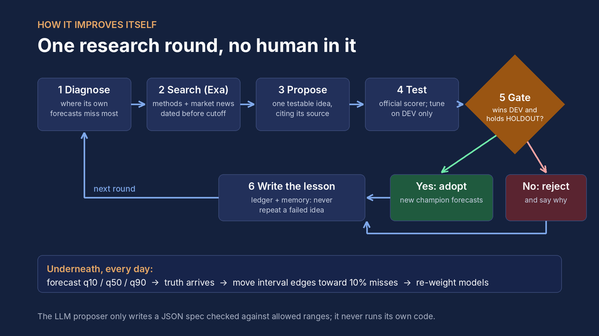
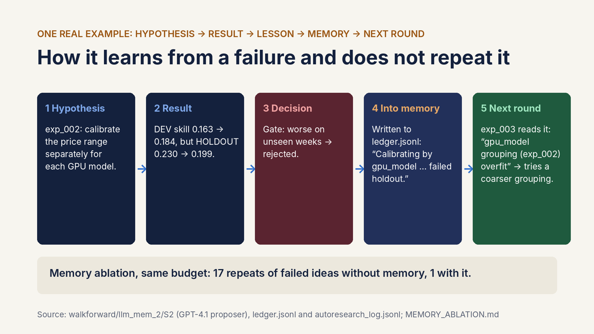
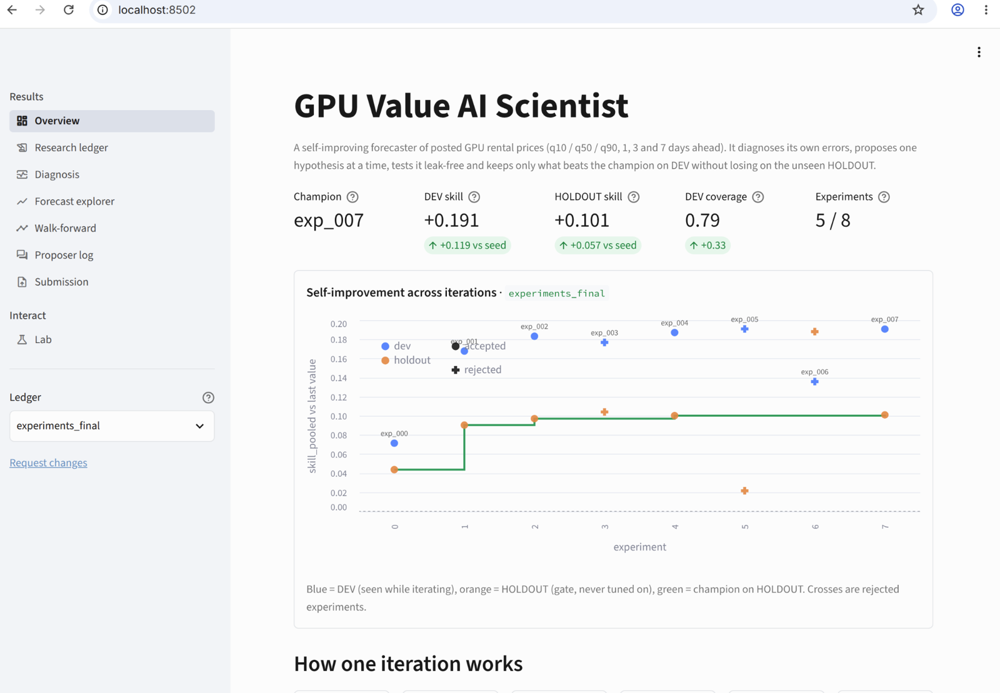

# Pacific Scientist: a self-improving AI that prices GPU time

**SF AI Research Hackathon · Track 2 (Pacific): Recursive Self-Improvement · also entered: Exa challenge**

**▶ Live app:** https://ai-scientist-agent-7tr2gdce25ju7s2y4awdbj.streamlit.app/ · **Findings:** [FINDINGS.md](FINDINGS.md) · **Submission:** [`forecast_2026-11-06.csv`](gpu_scientist/submission_final/forecast_2026-11-06.csv) · **Reproduce:** `cd gpu_scientist && GPU_PACK=/path/to/pack bash run_all.sh`

## 1. The problem

GPUs are financed, leased and traded like long-lived assets, yet nobody has a reliable price for them. Posted rental prices move in steps and differ 10–40% between sources, real transaction prices are private, and a forecast that worked last month quietly stops working. Lenders, data-centre builders and compute buyers need two numbers: **what an hour of H100 or A100 time will cost next week**, and **what these GPUs will rent and resell for in 2–3 years**.

## 2. Our solution

An **AI scientist** that forecasts a price range (low / middle / high = 10th / 50th / 90th percentile) 1, 3 and 7 days ahead for 37 price series, checks its own mistakes every day, and improves its own method round after round, with no human in the loop and every decision written down.

## 3. How it improves itself

1. **Diagnose:** find where forecasts miss most (by GPU, provider type, horizon) on development data only.
2. **Search (Exa):** look for forecasting methods and GPU market news published *before* the data cutoff, and cite the source used.
3. **Propose:** an LLM (GPT-4.1) or a rule-based scientist turns the diagnosis into one testable idea, written as a JSON spec checked against allowed ranges; it never runs its own code.
4. **Test:** score with the organisers' `scorer.py`; any parameter sweep runs on DEV only, so one candidate per idea meets the gate.
5. **Gate:** keep only if it passes the criteria below.
6. **Remember:** write the lesson to the ledger; the next round reads it.

Underneath, a fast loop runs every day: forecast → truth arrives → move interval edges toward 10% misses → re-weight models.

## 4. Our criteria: a change is kept only if it passes all four

| | Check | Rule |
|---|---|---|
| 1 | Better on development weeks | pooled skill vs last value must rise by ≥ 0.002 on DEV (origins 15 Sep – 15 Oct) |
| 2 | Not worse on unseen weeks | HOLDOUT (16 – 30 Oct) must not fall; it is never used to tune anything |
| 3 | No peeking at the future | a test multiplies or deletes all data after the forecast date; forecasts must not move |
| 4 | Organisers' rules | official `scorer.py`: pinball loss at q10 / q50 / q90; interval coverage target 80% |

A panel of 5 AI reviewers then flags weak wins (noise, overfit, wider-not-better ranges). Reviewers flag; they never overrule the gate.

## 5. Which models

| Role | Models |
|---|---|
| Baselines | last value (the yardstick), drift (starter kit) |
| Forecasters | recent-window quantiles (trend tail), momentum after real rises, step-hazard jump model, provider-change-aware model, leader–follower across collectors |
| Combining | Hedge ensemble weights and online interval calibration, re-learned from each error |
| Tested and rejected | Chronos-Bolt, Chronos-2, Timestral (time-series foundation models: lost on DEV) |
| Research team | GPT-4.1 (proposer, 5 reviewers) · Exa (web search) · Claude (research lead) · Devin (runs, code review, app) |

## 6. One real example: hypothesis → result → lesson → memory → next round

In walk-forward run `walkforward/llm_mem_2/S2` the GPT-4.1 proposer hypothesised that calibrating the range **per GPU model** would help (exp_002). DEV skill rose 0.163 → 0.184 but HOLDOUT fell 0.230 → 0.199, so the gate **rejected** it. The lesson *"Calibrating by gpu_model … failed holdout"* was written to `ledger.jsonl`. In the next round (exp_003) the proposer quoted it, *"gpu_model grouping (exp_002) overfit"*, and tried a coarser grouping instead. Across the memory ablation (same budget, 2 runs per arm) the loop repeated already-rejected ideas **17 times without memory and once with it**.

## 7. Everything we tried, and what the system learned

| Tried | Result | Learned |
|---|---|---|
| Recent-window price range | kept: DEV +0.096 | the last price is the best middle; the value is in the range |
| Daily range calibration | kept: coverage 0.64 → 0.79 | correct the range from its own misses |
| Hedge ensemble of 3 models | rejected: DEV −0.007 | mixing models added noise |
| Momentum after a rise | kept: +0.004 | 68.5% of rises continue |
| Calibration by GPU model | rejected: HOLDOUT −0.079 | overfits the October rise |
| Chronos-Bolt, Chronos-2, Timestral | lost on DEV | benchmark ranks don't transfer to step prices |
| Momentum only on real repricing | **kept: submitted champion (exp_007)** | separate repricing from provider churn |
| Fade moves caused by provider churn | worse in 18 of 18 settings | don't bet against composition moves |
| GetDeploying weekly signal (exp_008) | passed gate, within noise (p = 0.14) | gain was provider churn: not submitted |
| GIX market index as a leading signal | no lead (Spearman 0.09) | the index doesn't predict direction |
| LLM vs rule-based proposer | +0.042 vs +0.034, 3 of 3 weeks | the LLM needs the allowed ranges in its prompt |
| Memory on vs off | 1 vs 17 repeated failures; +0.044 vs +0.035 | memory stops repeated mistakes |
| Exa web search in the loop | +0.017 vs +0.042 (one run) | evidence rarely used; queries must vary |
| 5-reviewer AI panel | caught the GPU-model overfit | reviewers flag; the gate decides |
| Cross-machine replay | 43 of 111 rows differed → fixed | floating-point ties; now byte-exact |
| Look-ahead audit | 1 leak found → fixed | a test now guards it |

## 8. Rigor

- **Unseen data:** DEV for choosing, HOLDOUT as a gate only, plus walk-forward on 6 weekly TEST slices that no decision ever saw ([walkforward/](gpu_scientist/walkforward/)).
- **Statistics:** per-series Wilcoxon and sign tests ([SIGNIFICANCE.md](gpu_scientist/SIGNIFICANCE.md)); cluster-bootstrap 95% intervals by series and by day ([uncertainty.json](gpu_scientist/uncertainty.json)); a hindsight-free re-evaluation ([HONEST_EVAL.md](gpu_scientist/HONEST_EVAL.md)).
- **Ablations:** memory on/off ([MEMORY_ABLATION.md](gpu_scientist/walkforward/MEMORY_ABLATION.md)), Exa on/off, LLM vs rules, calibration grouping, at equal budget.
- **Leak guards:** 27 automated tests (`bash gpu_scientist/run_tests.sh`), including no-look-ahead and DEV-only sweep tests.
- **Provenance:** every forecast hashed (SHA-256) and tied to a code commit ([MANIFEST.json](gpu_scientist/submission_final/MANIFEST.json)); `run_all.sh` rebuilds the submission byte for byte in about 2 minutes.
- **Reviewer panel:** [REVIEWER.md](gpu_scientist/REVIEWER.md). **Failures are reported**, not hidden (table above).

## 9. Results

| | Result |
|---|---|
| Error vs "price stays the same", on weeks never used for tuning | **10% lower** (95% CI 2% to 17%) |
| Series where it beats "price stays the same" | **27 of 34** (Wilcoxon p = 0.006) |
| Real prices inside its range (target 80%) | 79% on DEV, 76% on HOLDOUT |
| Restarted from scratch on 6 unseen weeks | improved **5 of 6** |
| Reproducible | one command, byte-exact, ~2 minutes |

**Honest limits:** the gain over the organisers' simple drift baseline is not significant on unseen weeks; the calibration favours expensive GPUs; posted prices are not transaction prices.

## 10. How it scales

- **More GPUs and markets** plug into the same pipeline; adjustments are learned per provider type and collector.
- **Parallel research:** each round is short and self-contained with its own pass/fail gate, so many can run at once in the cloud without a person checking each one.
- **New evidence is tested, not trusted:** web search, indices and hardware data enter as hypotheses that must pass the gate.
- **Safe autonomy:** the AI proposes settings, never runs its own code, and cannot touch the evaluation.

## 11. The 2–3 year view

In the base case an H100 still rents for about **$2.30/hr in late 2028** and about $2 in 2029, while its used resale value falls faster, to about **$8,000** in 2028 from $14,250 today. Rent and resale are different markets: last year A100 posted rent rose 23% while A100 resale fell about 35%. Five hypotheses are tested before they are assumed, with low/base/high ranges, a discounted-cash-flow cross-check and sources: [LONG_HORIZON.md](gpu_scientist/LONG_HORIZON.md).

## 12. Demo

- **Live app:** https://ai-scientist-agent-7tr2gdce25ju7s2y4awdbj.streamlit.app/ with Overview, Research ledger, Diagnosis, Forecast explorer, Walk-forward, Proposer log (with Exa sources), Submission, and a **Lab** to start an autonomous research run live.

- **Run the loop yourself (~1 minute, no API key):** `cd gpu_scientist && bash demo.sh` (add `--llm` with `OPENAI_API_KEY`; with Exa: `python3 autoresearch.py --proposer llm --exa --iters 3` and `EXA_API_KEY`).
- **Run the app locally:** `cd gpu_scientist/app && python3 -m pip install -r requirements.txt && GPU_PACK=/path/to/pack streamlit run main.py`

## 13. Repo map

| Path | What it is |
|---|---|
| [FINDINGS.md](FINDINGS.md) | question, method, evaluation, results with uncertainty, what it learned |
| [`gpu_scientist/experiments_final/REPORT.md`](gpu_scientist/experiments_final/REPORT.md) | the report the system wrote about its own official run |
| `gpu_scientist/autoresearch.py` · `exa_scout.py` | the research loop · where Exa is called each iteration |
| `gpu_scientist/online.py`, `models/` | forecasters, daily calibration, ensembles |
| `gpu_scientist/run_experiment.py`, `evaluate.py`, `diagnose.py` | test, score with `scorer.py`, diagnose |
| `gpu_scientist/walkforward/` | unseen-week tests, memory and Exa ablations |
| `gpu_scientist/review.py` · `REVIEWER.md` | AI reviewer panel |
| `gpu_scientist/app/` | the Streamlit app |
| [`gpu_scientist/README.md`](gpu_scientist/README.md) | code guide |

Data: Pacific gpu-price-pack v0.1.1 (CC BY 4.0). Built during the event by Tania Lin with Claude, Devin and GPT-4.1 as research agents.
