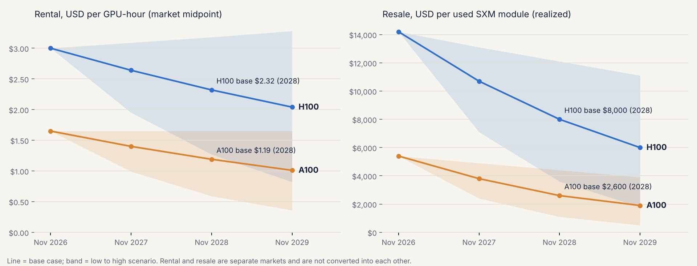

# The 2–3 year value of an H100 and an A100

This part can't be scored by Sunday. It is an argument from public evidence, with every assumption stated, three scenarios instead of one number, and a list of the things that would change the view. Numbers are reproducible with `python -m gpu_scientist.long_horizon` (writes `long_horizon.json` and `long_horizon.png`). Anchor date: November 2026, the origin of the short-horizon forecast.

Rental and resale are kept apart throughout. They are different markets with different buyers, and in 2025 they moved in opposite directions (American Compute: H100 rents fell while median resale prices rose). Converting one into the other would hide that.

## 1. The answer

| | Nov 2026 (anchor) | Nov 2028: low / **base** / high | Nov 2029: low / **base** / high |
|---|---|---|---|
| H100 rental, $/GPU-hr | 3.00 | 1.27 / **2.32** / 3.18 | 0.82 / **2.04** / 3.28 |
| A100 rental, $/GPU-hr | 1.65 | 0.59 / **1.19** / 1.65 | 0.36 / **1.01** / 1.65 |
| H100 resale, $ per used SXM module | 14,250 | 3,600 / **8,000** / 12,100 | 1,800 / **6,000** / 11,100 |
| A100 resale, $ per used SXM 80GB module | 5,400 | 1,100 / **2,600** / 4,400 | 500 / **1,900** / 3,900 |

Rental is a "market midpoint": between spot and on-demand, close to 1- to 12-month reserved. Resale is a typical realized sale of a bare module, not a dealer ask and not a whole HGX node (whole nodes sell for more per GPU; see 2).

In one sentence: in the base case an H100 still rents for about $2 an hour in 2029, roughly what an A100 rents for now, while its resale value falls faster than its rent, to around 40% of today's realized price.

## 2. Anchors (what is true today)

Rental, from our pack (GetDeploying weekly medians, week of 2026-11-02, `aggregator_medians.csv`):

| GPU | spot | reserved 1m | reserved 12m | on-demand |
|---|---|---|---|---|
| A100 | 1.51 | 1.70 | 1.68 | 1.99 |
| H100 | 2.52 | 3.36 | 3.21 | 4.02 |
| H200 | 3.46 | 3.95 | 3.56 | 4.87 |
| B200 | 4.78 | 8.09 | 7.64 | 7.80 |

Outside checks: Ornn's OCPI H100 index at $2.92 on 2026-10-01 (three-month range $2.46–$3.17); SemiAnalysis 1-year H100 contract midpoint around $2.80 in October 2026, up from a $1.70 trough in October 2025; Akash A100 80GB average $1.54 (August 2026). So $3.00 for H100 and $1.65 for A100 are the midpoint anchors.

Resale, from American Compute's October 2026 Rack Report (data through August 2026): used H100 SXM 80GB typical realized sale $14,250 (25th percentile $13,200, dealer ask 1.16× realized); HGX 8×H100 node $195,000 ($24,400 per GPU). Used A100 SXM4 80GB $4,700–5,400, down about 35% over the year; HGX 8×A100 80GB node $95,200 ($11,900 per GPU). Dealer and listing prices run much higher (used H100 $18–22k, used A100 80GB $12–18k on GPUnex), which is why we anchor on realized sales.

The last year went the "wrong" way for a depreciation story. In our pack, over Nov 2025 → Nov 2026, A100 on-demand rose from $1.60 to $1.99 and H100 from $2.98 to $4.02. CoreWeave signed an A100 contract that runs into 2029 and said prior-generation pricing is at or above where it was years ago. The base case must explain this, not ignore it.

## 3. Assumptions (the argument)

**A. Each new generation pushes older ones down a rung.** Our pack's capability units (MLPerf inference, A100 SXM 80GB = 1.0) put H100 at 2.47, H200 at 2.72 and B200 at 7.91. Dividing the reserved-1m price by capability gives the price per unit of work: A100 $1.70, H100 $1.36, H200 $1.46, B200 $1.02. Older parts already cost more per unit of work (they are easy to host and the software runs everywhere). NVIDIA's roadmap adds a step roughly every year: Rubin (second half 2026), Rubin Ultra (second half 2027), Feynman (2028). If the frontier price per unit of work stays flat, each step costs an older part somewhere around 15–25% of its rent.

**B. Power and buildings slow the slide.** Blackwell racks need liquid cooling and far more power per rack than the halls A100 and H100 sit in. Until those halls are rebuilt, Hopper and Ampere capacity has no substitute in them. This is the reason given for CoreWeave's A100-to-2029 contract and for H100s being rebooked at 95% of their original price. It is why the base rental decline (-12%/yr H100, -15%/yr A100) is much slower than the -30%/yr seen while H100 supply was catching up (contract prices fell from $6.62 in late 2023 to $2.83 by February 2026).

**C. Rent has a floor.** Below cash operating cost (power at PUE 1.3 and $0.08/kWh, colocation around $150 per kW-month, a share of network and staff) an owner turns the GPU off rather than renting it. We put this at about $0.35/hr for H100 (700 W) and $0.25/hr for A100 (400 W). The low scenarios stay above it.

**D. Resale falls faster than rent, because remaining life shrinks.** A buyer pays for the cash a GPU will still earn. Today a used node sells for about 1.5–1.6 years of net rental cash (H100: $24,400 per GPU against about $15,300 a year at 70% utilisation; A100: $11,900 against $7,900). In the base case for 2028 that multiple falls to about 1.1–1.2 years, which is what you would expect as the buyer's horizon shortens. The two markets are checked against each other this way, but each is forecast on its own.

**E. Scenario rates (annual, from the November 2026 anchor).**

| | low | base | high |
|---|---|---|---|
| H100 rental | -35% | -12% | +3% |
| A100 rental | -40% | -15% | 0% |
| H100 resale | -50% | -25% | -8% |
| A100 resale | -55% | -30% | -10% |

- Low = glut: Rubin ships in volume, AI demand growth slows, rebuilt halls take Blackwell and Rubin, older capacity is dumped. Rents fall at the 2023–25 catch-up pace. H100 resale in 2028 lands near American Compute's conservative residual band (5–7% of list).
- Base = the cascade continues: frontier training moves to Blackwell and Rubin, H100 and A100 shift to inference and fine-tuning in halls that can't host the new racks.
- High = compute scarcity persists: power, not chips, is the constraint through 2029, and old capacity stays fully booked, as in 2026.

**F. Depreciation is a separate question.** Hyperscalers book GPUs over about 6 years, CoreWeave 6, Lambda 5, Nebius 4; Amazon shortened part of its fleet to 5 years. Michael Burry argues the real life is 2–3 years. Our base case says an H100 bought in 2023 is still earning around $2/hr in 2029, which supports economic lives of 5–6 years for rental. The resale path is consistent with a much shorter life for the asset value, and both can be true at once.

## 4. What would change the view

| Signal | Moves us toward | Where to watch |
|---|---|---|
| Rubin rentals listed widely below about $1 per A100-unit of work | low | GetDeploying, our collectors |
| H100 1-yr contract midpoint below $2.00 for a quarter | low | SemiAnalysis, Ornn OCPI |
| Kalshi H100 monthly markets (Ornn-settled, listed through Aug 2027) pricing well above or below $3 | high / low | Kalshi KXH100MS (pointer only, not copied) |
| Large A100 or H100 contracts renewed at or above previous prices | high | CoreWeave, Nebius earnings calls |
| American Compute resale index falling faster than 35%/yr | low (resale) | Rack Report |
| Hyperscalers shortening GPU useful lives again | low (resale) | 10-K filings |
| Grid and data-centre power delays worsening | high | utility interconnection queues |

## 5. Limits

- This is a scenario argument, not a fitted forecast; it cannot be backtested on a 13-week panel.
- The capability units are composite, unverified ratios built from MLPerf results; the A100 → H100 step uses 2023 rounds with early H100 software.
- Resale data is thin (American Compute flags limited samples, liquidity grade B–C), and the resale index is restatable.
- "Market midpoint" rent hides the spread between spot and on-demand, which is itself 1.3–1.6× today.

## Sources

- GetDeploying weekly GPU price medians (CC BY 4.0), in our pack as `aggregator_medians.csv`; capability units from the pack's `capability/capability_units.csv` (MLPerf results, Apache-2.0 repositories).
- [American Compute, H100 appraisal](https://www.amcompute.com/appraisals/h100), [A100 appraisal](https://www.amcompute.com/appraisals/a100), [A100 SXM4 80GB](https://www.amcompute.com/appraisals/a100-sxm4-80gb) (October 2026 Rack Report).
- [CloudZero, H100 cost (Ornn OCPI, B200 spot)](https://www.cloudzero.com/blog/h100-gpu-cost); IntuitionLabs articles on data-center GPU prices and H100 rental prices (2026).
- [Akash, A100 guide (Aug 2026)](https://akash.network/bits/nvidia-a100-gpu-guide-2026-specs-benchmarks-pricing/); [GPUNex, buying and selling GPUs 2026](https://www.gpunex.com/blog/buying-selling-gpus-2026); [Hashrate Index, used GPU market](https://hashrateindex.com/blog/used-gpu-market-pricing-deprecation-secondary-ai/).
- [Tom's Hardware, CoreWeave A100 contract into 2029](https://www.tomshardware.com/tech-industry/coreweave-ceo-mike-intrator-says-it-has-signed-an-a100-contract-running-into-2029); [Benzinga](https://www.benzinga.com/node/61145901).
- NVIDIA roadmap (Rubin, Rubin Ultra, Feynman), as reported from GTC 2026 by Network World and Tom's Hardware.
- Depreciation schedules and the Burry critique, as reported by SiliconANGLE and Tom's Hardware.
