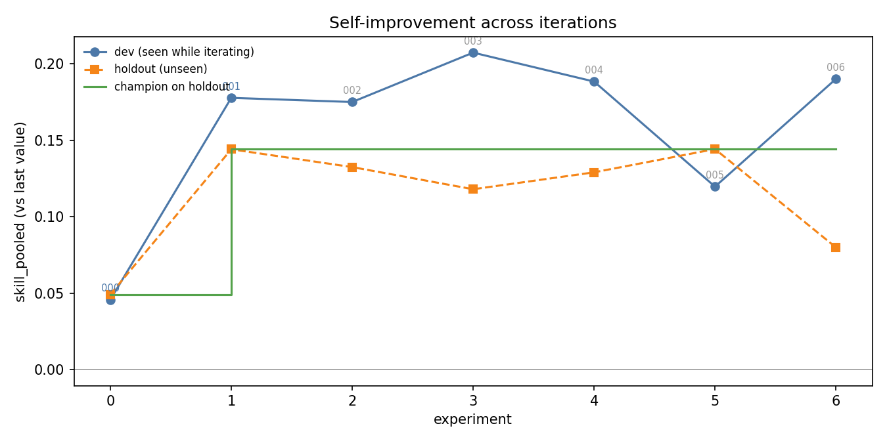

# Research report: experiments

_Written automatically from `ledger.jsonl` by `report.py`. Every number is the ledger's; nothing here is judged by a language model._

## Summary

- 7 experiments: the starting point (exp_000), then 1 kept and 5 rejected.
- Skill vs last value (pooled), DEV: +0.046 at the start (exp_000) → +0.178 for the champion (exp_001).
- HOLDOUT (never used to choose parameters, only as a gate): +0.049 → +0.144.
- Champion interval coverage: DEV 0.76, HOLDOUT 0.84 (target 0.80).
- Rule: keep a change only if DEV improves by at least 0.002 and HOLDOUT does not fall below the champion's.

## All experiments

| id | kept | DEV | HOLDOUT | coverage DEV | hypothesis |
|---|---|---|---|---|---|
| exp_000 | yes | +0.046 | +0.049 | 0.46 | Reference: the starter kit's drift baseline (whole-history empirical random walk), re-run through our walk-... |
| exp_001 | yes | +0.178 | +0.144 | 0.76 | Coverage_in is 0.463 (well below 0.80), and afhubbard/hyperscaler_spot has y_above_q50 0.26 and coverage_ab... |
| exp_002 | no | +0.175 | +0.133 | 0.73 | Diagnosis: after price change, y_above_q50=0.596 (truth above median far too often). -> Combining drift and... |
| exp_003 | no | +0.207 | +0.118 | 0.74 | Series with large-magnitude or anti-correlated leader signals (e.g., corr=-0.952 lag 2 for H100) may benefi... |
| exp_004 | no | +0.188 | +0.129 | 0.75 | Skill collapses and y_above_q50 goes to extreme (0.056) for provider-loss cases (prov_bucket='fewer', n=18)... |
| exp_005 | no | +0.120 | +0.144 | 0.62 | Coverage_in at 0.758 overall, but serious series-by-series miscoverage (see worst series table) suggests th... |
| exp_006 | no | +0.190 | +0.080 | 0.74 | Worst series see infinite or huge negative skill and y_above_q50 near zero (e.g., neocloud_spot/B200, vario... |

## The path, one experiment at a time

### exp_000: kept

**Hypothesis.** Reference: the starter kit's drift baseline (whole-history empirical random walk), re-run through our walk-forward pipeline on daily origins.

**What changed.** starting point. Model: drift (single; no calibration).

**Decision.** first experiment: becomes the starting champion

**Lesson written to memory.** seed: starting champion for this autonomous run

### exp_001: kept

**Hypothesis.** Coverage_in is 0.463 (well below 0.80), and afhubbard|hyperscaler_spot has y_above_q50 0.26 and coverage_above_q90 = 0.151. Coverage far too low, with uneven miss by group. -> Per-instrument_class calibration will let each major group adjust its intervals independently, better matching coverage to local volatility and error. Change: Set calibrate.enabled=true and calibrate.group_by=instrument_class; use (gamma=0.5, scale=0.01), the default.

**What changed.** `calibrate.enabled`: False → True; `calibrate.gamma`: None → 0.5; `calibrate.group_by`: None → instrument_class; `calibrate.scale`: None → 0.01. Model: drift (single; calibration by instrument_class).

**Test.** Against champion exp_000: DEV +0.1319, HOLDOUT +0.0949. By horizon (DEV, 1/3/7 days): +0.040 / +0.044 / +0.250.

**Decision.** dev skill_pooled +0.1319 vs champion exp_000 (need >= +0.002); holdout +0.0949 (need >= -0.0)

**Lesson written to memory.** Per-instrument_class calibration boosted dev skill_pooled by +0.1319 and holdout by +0.0949 vs champion, raising coverage_in from 0.463 to 0.758—this suggests subgroup calibration effectively improves coverage and accuracy and should be investigated further, potentially with finer groupings or different calibration strengths.

### exp_002: rejected

**Hypothesis.** Diagnosis: after price change, y_above_q50=0.596 (truth above median far too often). -> Combining drift and momentum with mean will upweight forecasts after changes, counteracting post-change underprediction. Calibration then adapts to group coverage, so any increase in post-change accuracy should reflect in dev skill. Change: Add momentum (default params) as second model, combine with drift by mean.

**What changed.** adds model `momentum`; `combine.method`: single → mean. Model: drift, momentum (mean; calibration by instrument_class).

**Test.** Against champion exp_001: DEV -0.0027, HOLDOUT -0.0117. By horizon (DEV, 1/3/7 days): -0.204 / +0.147 / +0.230.

**Decision.** dev skill_pooled -0.0027 vs champion exp_001 (need >= +0.002); holdout -0.0117 (need >= -0.0)

**Lesson written to memory.** Adding momentum and combining by mean reduced skill_pooled by -0.0027 on dev and -0.0117 on holdout vs the champion, with a slight coverage drop (73% vs 76%). This suggests further tuning or alternative model combinations are needed to improve post-change accuracy without sacrificing performance elsewhere.

### exp_003: rejected

**Hypothesis.** Series with large-magnitude or anti-correlated leader signals (e.g., corr=-0.952 lag 2 for H100) may benefit from including the leader. -> Using a leader model with default parameters for the top-correlation pairs might improve accuracy, especially in long-horizon series where external signals lead the true price movement. Change: Combine leader and drift models via hedge, allowing group-specific adaptive weighting so leader is only trusted where predictive.

**What changed.** adds model `leader`; `combine.eta`: None → 2.0; `combine.group_by`: None → series_id; `combine.method`: single → hedge. Model: drift, leader (hedge; calibration by instrument_class).

**Test.** Against champion exp_001: DEV +0.0296, HOLDOUT -0.0261. By horizon (DEV, 1/3/7 days): +0.034 / +0.199 / +0.230.

**Decision.** dev skill_pooled +0.0296 vs champion exp_001 (need >= +0.002); holdout -0.0261 (need >= -0.0)

**Lesson written to memory.** Adding the leader model improved dev pooled skill by +0.03 but failed holdout (−0.03), suggesting overfitting or unreliable leader signal out-of-sample; next, restrict leader trust to only series with stable leader-signal holdout performance, or revisit pairing criteria.

### exp_004: rejected

**Hypothesis.** Skill collapses and y_above_q50 goes to extreme (0.056) for provider-loss cases (prov_bucket='fewer', n=18). -> Provider-count shifts are poorly captured by drift; using the composition model's provider-aware mechanism will lessen pronounced under-prediction after such changes. Change: Switch to using the composition model (defaults) with calibration per instrument_class.

**What changed.** adds model `composition`; drops model `drift`. Model: composition (single; calibration by instrument_class).

**Test.** Against champion exp_001: DEV +0.0106, HOLDOUT -0.0151. By horizon (DEV, 1/3/7 days): -0.204 / +0.182 / +0.235.

**Decision.** dev skill_pooled +0.0106 vs champion exp_001 (need >= +0.002); holdout -0.0151 (need >= -0.0)

**Lesson written to memory.** The new model improved dev skill_pooled (+0.0106 vs champion), but holdout skill fell (-0.0151 vs champion) and coverage_in dropped slightly (0.748 vs 0.758); focus next on generalization or regularization to close the holdout gap before further model changes.

### exp_005: rejected

**Hypothesis.** Coverage_in at 0.758 overall, but serious series-by-series miscoverage (see worst series table) suggests that calibrate.group_by=series_id has not been tried and can correct persistent series-specific miss. -> Per-series calibration gives each time series power to adjust intervals independently, fixing systematic local errors that a coarser group misses. Change: Switch calibrate.group_by from instrument_class to series_id.

**What changed.** `calibrate.group_by`: instrument_class → series_id. Model: drift (single; calibration by series_id).

**Test.** Against champion exp_001: DEV -0.0581, HOLDOUT +0.0001. By horizon (DEV, 1/3/7 days): +0.123 / +0.131 / +0.114.

**Decision.** dev skill_pooled -0.0581 vs champion exp_001 (need >= +0.002); holdout +0.0001 (need >= -0.0)

**Lesson written to memory.** Skill_pooled dropped -0.0581 on dev vs champion (need ≥ +0.002), with little change on holdout, and coverage_in worsened from 0.76 to 0.62. This suggests that switching calibrate.group_by from instrument_class to series_id causes substantial skill loss on pooled dev, so we should revert or try an intermediate grouping in the next experiment.

### exp_006: rejected

**Hypothesis.** Worst series see infinite or huge negative skill and y_above_q50 near zero (e.g., neocloud_spot/B200, various A100/L40S); but exp_005 with series_id-wide calibration collapsed coverage. -> Introduce vol_tail alongside drift, then hedge by instrument_class—lets models attend to group volatility patterns without pure localization to each series, which previously overfit. Change: Add vol_tail to drift, combine with hedge (group_by=instrument_class, eta=2.0).

**What changed.** adds model `vol_tail`; `combine.eta`: None → 2.0; `combine.group_by`: None → instrument_class; `combine.method`: single → hedge. Model: drift, vol_tail (hedge; calibration by instrument_class).

**Test.** Against champion exp_001: DEV +0.0124, HOLDOUT -0.0642. By horizon (DEV, 1/3/7 days): +0.018 / +0.162 / +0.221.

**Decision.** dev skill_pooled +0.0124 vs champion exp_001 (need >= +0.002); holdout -0.0642 (need >= -0.0)

**Lesson written to memory.** Adding vol_tail alongside drift and group hedging improved dev skill_pooled by +0.0124 vs champion but failed on holdout (-0.0642 vs required ≥0); coverage_in dropped to 0.739 from 0.758, suggesting overfit—next test should refine calibration and regularization to generalize group-tail benefits.

## What the loop ruled out

- **exp_002**: Adding momentum and combining by mean reduced skill_pooled by -0.0027 on dev and -0.0117 on holdout vs the champion, with a slight coverage drop (73% vs 76%). This suggests further tuning or alternative model combinations are needed to improve post-change accuracy without sacrificing performance elsewhere.
- **exp_003**: Adding the leader model improved dev pooled skill by +0.03 but failed holdout (−0.03), suggesting overfitting or unreliable leader signal out-of-sample; next, restrict leader trust to only series with stable leader-signal holdout performance, or revisit pairing criteria.
- **exp_004**: The new model improved dev skill_pooled (+0.0106 vs champion), but holdout skill fell (-0.0151 vs champion) and coverage_in dropped slightly (0.748 vs 0.758); focus next on generalization or regularization to close the holdout gap before further model changes.
- **exp_005**: Skill_pooled dropped -0.0581 on dev vs champion (need ≥ +0.002), with little change on holdout, and coverage_in worsened from 0.76 to 0.62. This suggests that switching calibrate.group_by from instrument_class to series_id causes substantial skill loss on pooled dev, so we should revert or try an intermediate grouping in the next experiment.
- **exp_006**: Adding vol_tail alongside drift and group hedging improved dev skill_pooled by +0.0124 vs champion but failed on holdout (-0.0642 vs required ≥0); coverage_in dropped to 0.739 from 0.758, suggesting overfit—next test should refine calibration and regularization to generalize group-tail benefits.

## Champion by horizon

| horizon | DEV skill | HOLDOUT skill |
|---|---|---|
| 1 day | +0.040 | +0.066 |
| 3 day | +0.044 | +0.059 |
| 7 day | +0.250 | +0.224 |

Champion spec: `experiments/exp_001/spec.json`. Diagnosis: `experiments/exp_001/diagnosis.md`.
