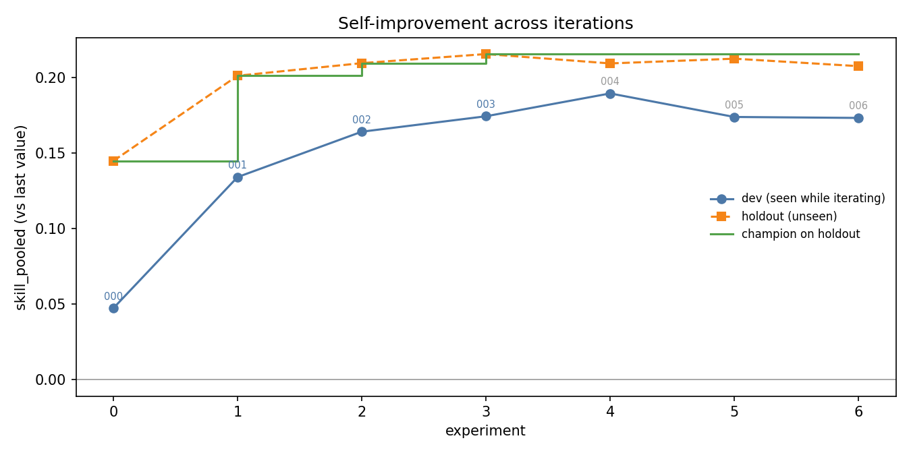

# Research report: experiments

_Written automatically from `ledger.jsonl` by `report.py`. Every number is the ledger's; nothing here is judged by a language model._

## Summary

- 7 experiments: the starting point (exp_000), then 3 kept and 3 rejected.
- Skill vs last value (pooled), DEV: +0.047 at the start (exp_000) → +0.174 for the champion (exp_003).
- HOLDOUT (never used to choose parameters, only as a gate): +0.145 → +0.216.
- Champion interval coverage: DEV 0.65, HOLDOUT 0.75 (target 0.80).
- Rule: keep a change only if DEV improves by at least 0.002 and HOLDOUT does not fall below the champion's.

## All experiments

| id | kept | DEV | HOLDOUT | coverage DEV | hypothesis |
|---|---|---|---|---|---|
| exp_000 | yes | +0.047 | +0.145 | 0.45 | Reference: the starter kit's drift baseline (whole-history empirical random walk), re-run through our walk-... |
| exp_001 | yes | +0.134 | +0.201 | 0.57 | For 1343 dev cells with 0-1 days since last price change: skill is 0.06 (much higher loss), y_above_q50 is ... |
| exp_002 | yes | +0.164 | +0.210 | 0.63 | In afhubbard/hyperscaler_spot, drift skill = 0.169, momentum = 0.050, and static 0.5/0.5 weights under-serv... |
| exp_003 | yes | +0.174 | +0.216 | 0.65 | At 7-day horizon: y_above_q50 is 0.577 (truth above median too often), above_q90 is 0.364 (should be ~0.10 ... |
| exp_004 | no | +0.190 | +0.209 | 0.67 | The group 'gpurentalprices/neocloud_rate_card' has both severe over-coverage (above_q90 = 0.301) and y_abov... |
| exp_005 | no | +0.174 | +0.213 | 0.65 | Calibration coverage_in is 0.648 (well below 0.80 target); gpurentalprices/neocloud_rate_card above_q90 is ... |
| exp_006 | no | +0.173 | +0.208 | 0.66 | Previous highest calibrate.scale tested was 0.0075 (exp_005). More aggressive expansion, up to 0.05, has no... |

## The path, one experiment at a time

### exp_000: kept

**Hypothesis.** Reference: the starter kit's drift baseline (whole-history empirical random walk), re-run through our walk-forward pipeline on daily origins.

**What changed.** starting point. Model: drift (single; no calibration).

**Decision.** first experiment: becomes the starting champion

**Lesson written to memory.** seed: starting champion for this autonomous run

### exp_001: kept

**Hypothesis.** For 1343 dev cells with 0-1 days since last price change: skill is 0.06 (much higher loss), y_above_q50 is 0.611 (strong under-prediction), and above_q90 is 0.557 (far too often under the true price after changes). -> Adding a momentum model with higher beta should better react to sharp moves immediately after price changes, reducing under-estimation spikes in these cells. Change: Add a high-beta momentum model to the ensemble (combine: mean), to amplify short-run trend-following right after changes.

**What changed.** adds model `momentum`; `combine.method`: single → mean. Model: drift, momentum (mean; no calibration).

**Test.** Against champion exp_000: DEV +0.0868, HOLDOUT +0.0564. By horizon (DEV, 1/3/7 days): +0.087 / +0.143 / +0.140.

**Decision.** dev skill_pooled +0.0868 vs champion exp_000 (need >= +0.002); holdout +0.0564 (need >= -0.0)

**Lesson written to memory.** Adding a high-beta momentum model increased dev skill_pooled by +0.0868 and holdout by +0.0564 vs the champion, with coverage_in up from 0.4549 to 0.5693, confirming improved reactivity to sharp price moves; next, test optimizing beta levels and combination weights for even better adaptation post-price change.

### exp_002: kept

**Hypothesis.** In afhubbard|hyperscaler_spot, drift skill = 0.169, momentum = 0.050, and static 0.5/0.5 weights under-serve drift, contributing to large negative skill in key series. -> Allowing ensemble weights to adapt by group ('instrument_class') can exploit observed skill gaps, assigning more to drift where superior, as in afhubbard|hyperscaler_spot. Change: Switch combine.method to 'hedge', use group_by=instrument_class, eta=2.0.

**What changed.** `combine.eta`: None → 2.0; `combine.group_by`: None → instrument_class; `combine.method`: mean → hedge. Model: drift, momentum (hedge; no calibration).

**Test.** Against champion exp_001: DEV +0.0300, HOLDOUT +0.0083. By horizon (DEV, 1/3/7 days): +0.094 / +0.168 / +0.177.

**Decision.** dev skill_pooled +0.0300 vs champion exp_001 (need >= +0.002); holdout +0.0083 (need >= -0.0)

**Lesson written to memory.** Adapting ensemble weights by instrument_class using the hedge method improved dev skill_pooled by +0.0300 and holdout by +0.0083 vs the champion, with coverage rising from 0.569 to 0.631; group-wise adaptive weighting should be further explored to address local skill gaps.

### exp_003: kept

**Hypothesis.** At 7-day horizon: y_above_q50 is 0.577 (truth above median too often), above_q90 is 0.364 (should be ~0.10 if calibrated); group coverage (in) is only 0.63 (target 0.80); dev_geomean skill 0.1687 is much higher than pooled skill 0.1642, suggesting interval width/placement gaps by series. -> Setting calibrate.enabled=true with group_by=series_id will directly tune coverage in each series, potentially bringing aggregate coverage closer to the 0.80 target and lowering excessive upper tail misses on hard series/horizons. Change: Enable calibration and group it by series_id with default gamma and scale. DEV sweep of calibrate.scale: 0.005->+0.1744, 0.01->+0.1734, 0.02->+0.1669; chose 0.005.

**What changed.** `calibrate.enabled`: False → True; `calibrate.gamma`: None → 0.5; `calibrate.group_by`: None → series_id; `calibrate.scale`: None → 0.005. Model: drift, momentum (hedge; calibration by series_id).

**Test.** Against champion exp_002: DEV +0.0102, HOLDOUT +0.0060. By horizon (DEV, 1/3/7 days): +0.085 / +0.177 / +0.191.

**Decision.** dev skill_pooled +0.0102 vs champion exp_002 (need >= +0.002); holdout +0.0060 (need >= -0.0)

**Lesson written to memory.** DEV pooled skill improved to 0.1745 (+0.0102 vs champion), with group coverage increasing to 0.648 (from 0.631), suggesting proper grouping/interval adjustments help, yet coverage is still below the 0.80 target—next, explore more aggressive calibration or alternative groupings to further boost coverage.

### exp_004: rejected

**Hypothesis.** The group 'gpurentalprices|neocloud_rate_card' has both severe over-coverage (above_q90 = 0.301) and y_above_q50 = 0.538, indicating intervals are too low and too narrow. Coverage_in is 0.648 overall, below the 0.80 target. -> Calibrating by 'gpu_model' instead of 'series_id' will make interval coverage less sensitive to data-thin series and smooth out group-level miscalibration, especially for frequently-failed groups such as rate_card. Change: calibrate.group_by from 'series_id' to 'gpu_model'.

**What changed.** `calibrate.group_by`: series_id → gpu_model. Model: drift, momentum (hedge; calibration by gpu_model).

**Test.** Against champion exp_003: DEV +0.0151, HOLDOUT -0.0062. By horizon (DEV, 1/3/7 days): +0.075 / +0.181 / +0.217.

**Decision.** dev skill_pooled +0.0151 vs champion exp_003 (need >= +0.002); holdout -0.0062 (need >= -0.0)

**Lesson written to memory.** Calibrating by 'gpu_model' instead of 'series_id' improved dev skill_pooled by +0.0151 (to 0.1896) and slightly increased dev coverage_in from 0.648 to 0.667, but failed the holdout criterion (-0.0062); next, prioritize calibration or groupings with more stable holdout gains, perhaps by combining grouping approaches or further regularizing calibration weights.

### exp_005: rejected

**Hypothesis.** Calibration coverage_in is 0.648 (well below 0.80 target); gpurentalprices|neocloud_rate_card above_q90 is 0.301, intervals are too narrow/too low. Previous calibrations with scale=0.005 and gamma=0.5 helped but did not go far enough. Critical for coverage. -> Increasing calibration scale to 0.01 (doubling step size, with gamma held at 0.5) will allow faster interval expansion after coverage failures, pushing coverage_in closer to target, especially in persistently under-covered series. Change: calibrate.scale from 0.005 to 0.01 DEV sweep of calibrate.scale: 0.0075->+0.1740, 0.01->+0.1734; chose 0.0075.

**What changed.** `calibrate.scale`: 0.005 → 0.0075. Model: drift, momentum (hedge; calibration by series_id).

**Test.** Against champion exp_003: DEV -0.0005, HOLDOUT -0.0031. By horizon (DEV, 1/3/7 days): +0.081 / +0.174 / +0.193.

**Decision.** dev skill_pooled -0.0005 vs champion exp_003 (need >= +0.002); holdout -0.0031 (need >= -0.0)

**Lesson written to memory.** Increasing calibrate.scale to 0.0075 improved coverage_in slightly (to 0.652 from 0.648) but skill_pooled on dev (-0.0005) and holdout (-0.0031) vs champion did not meet thresholds, so further scale increases or alternate calibration approaches are needed to reach the 0.80 coverage target without sacrificing skill.

### exp_006: rejected

**Hypothesis.** Previous highest calibrate.scale tested was 0.0075 (exp_005). More aggressive expansion, up to 0.05, has not been tested and is permitted. Coverage remains far below target. -> Widening intervals by increasing calibrate.scale could, at some point, achieve target coverage_in (0.80), revealing the best achievable coverage-skill balance. Change: Sweep calibrate.scale from 0.01 to 0.05 with calibrate.group_by=series_id. This raises interval offset more than before. DEV sweep of calibrate.scale: 0.01->+0.1734, 0.02->+0.1669, 0.03->+0.1544, 0.04->+0.1384, 0.05->+0.1221; chose 0.01.

**What changed.** `calibrate.scale`: 0.005 → 0.01. Model: drift, momentum (hedge; calibration by series_id).

**Test.** Against champion exp_003: DEV -0.0011, HOLDOUT -0.0080. By horizon (DEV, 1/3/7 days): +0.077 / +0.172 / +0.193.

**Decision.** dev skill_pooled -0.0011 vs champion exp_003 (need >= +0.002); holdout -0.0080 (need >= -0.0)

**Lesson written to memory.** Increasing calibrate.scale to 0.01 raised dev coverage from 0.648 to 0.657 but resulted in lower skill_pooled vs champion (-0.0011 dev, -0.0080 holdout), so further increases in calibrate.scale should be tested to see if higher coverage can be achieved with acceptable skill loss.

## What the loop ruled out

- **exp_004**: Calibrating by 'gpu_model' instead of 'series_id' improved dev skill_pooled by +0.0151 (to 0.1896) and slightly increased dev coverage_in from 0.648 to 0.667, but failed the holdout criterion (-0.0062); next, prioritize calibration or groupings with more stable holdout gains, perhaps by combining grouping approaches or further regularizing calibration weights.
- **exp_005**: Increasing calibrate.scale to 0.0075 improved coverage_in slightly (to 0.652 from 0.648) but skill_pooled on dev (-0.0005) and holdout (-0.0031) vs champion did not meet thresholds, so further scale increases or alternate calibration approaches are needed to reach the 0.80 coverage target without sacrificing skill.
- **exp_006**: Increasing calibrate.scale to 0.01 raised dev coverage from 0.648 to 0.657 but resulted in lower skill_pooled vs champion (-0.0011 dev, -0.0080 holdout), so further increases in calibrate.scale should be tested to see if higher coverage can be achieved with acceptable skill loss.

## Champion by horizon

| horizon | DEV skill | HOLDOUT skill |
|---|---|---|
| 1 day | +0.085 | +0.169 |
| 3 day | +0.177 | +0.235 |
| 7 day | +0.191 | +0.216 |

Champion spec: `experiments/exp_003/spec.json`. Diagnosis: `experiments/exp_003/diagnosis.md`.
