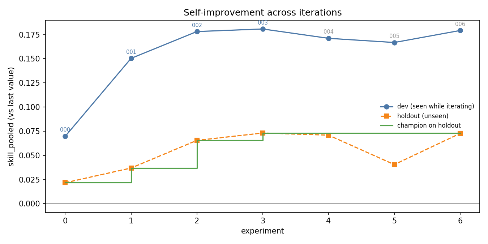

# Research report: experiments

_Written automatically from `ledger.jsonl` by `report.py`. Every number is the ledger's; nothing here is judged by a language model._

## Summary

- 7 experiments: the starting point (exp_000), then 3 kept and 3 rejected.
- Skill vs last value (pooled), DEV: +0.070 at the start (exp_000) → +0.181 for the champion (exp_003).
- HOLDOUT (never used to choose parameters, only as a gate): +0.022 → +0.073.
- Champion interval coverage: DEV 0.68, HOLDOUT 0.77 (target 0.80).
- Rule: keep a change only if DEV improves by at least 0.002 and HOLDOUT does not fall below the champion's.

## All experiments

| id | kept | DEV | HOLDOUT | coverage DEV | hypothesis |
|---|---|---|---|---|---|
| exp_000 | yes | +0.070 | +0.022 | 0.46 | Reference: the starter kit's drift baseline (whole-history empirical random walk), re-run through our walk-... |
| exp_001 | yes | +0.150 | +0.037 | 0.65 | Coverage well below 0.80 for all groups, worst for afhubbard/hyperscaler_spot (0.229) and fastgpu_daily/hyp... |
| exp_002 | yes | +0.178 | +0.065 | 0.67 | y_above_q50 is 0.628 and above_q90 is 0.296 for dsc_bucket=0-1 (0/1 days since last price change), indicati... |
| exp_003 | yes | +0.181 | +0.073 | 0.68 | afhubbard/hyperscaler_spot has worst skill (-1.096) and momentum underperforms drift (0.041 vs 0.174), so s... |
| exp_004 | no | +0.171 | +0.071 | 0.67 | afhubbard/hyperscaler_spot and fastgpu_daily/hyperscaler_spot show very different model wins—momentum deepl... |
| exp_005 | no | +0.167 | +0.040 | 0.69 | In fastgpu_daily/hyperscaler_spot, y_above_q50 is only 0.228 and below_q10 is 0.289—far too many low quanti... |
| exp_006 | no | +0.179 | +0.073 | 0.68 | In fastgpu_daily/hyperscaler_spot, y_above_q50=0.228 and below_q10=0.289: systematic underprediction, worst... |

## The path, one experiment at a time

### exp_000: kept

**Hypothesis.** Reference: the starter kit's drift baseline (whole-history empirical random walk), re-run through our walk-forward pipeline on daily origins.

**What changed.** starting point. Model: drift (single; no calibration).

**Decision.** first experiment: becomes the starting champion

**Lesson written to memory.** seed: starting champion for this autonomous run

### exp_001: kept

**Hypothesis.** Coverage well below 0.80 for all groups, worst for afhubbard|hyperscaler_spot (0.229) and fastgpu_daily|hyperscaler_spot (0.211). -> Turning on per-series calibration will drive coverage upward most in worst undercovered series, while the default gamma*scale value keeps responses stable (avoiding overfitting). Change: Enable calibration with group_by='series_id', gamma=0.5, scale=0.01.

**What changed.** `calibrate.enabled`: False → True; `calibrate.gamma`: None → 0.5; `calibrate.group_by`: None → series_id; `calibrate.scale`: None → 0.01. Model: drift (single; calibration by series_id).

**Test.** Against champion exp_000: DEV +0.0806, HOLDOUT +0.0152. By horizon (DEV, 1/3/7 days): +0.112 / +0.164 / +0.151.

**Decision.** dev skill_pooled +0.0806 vs champion exp_000 (need >= +0.002); holdout +0.0152 (need >= -0.0)

**Lesson written to memory.** Per-series calibration improved dev skill_pooled by +0.0806 and holdout by +0.0152 over the champion, while raising coverage_in from 0.456 to 0.647; the next experiment should tune calibration parameters to balance coverage gains against any potential overfitting.

### exp_002: kept

**Hypothesis.** y_above_q50 is 0.628 and above_q90 is 0.296 for dsc_bucket=0-1 (0/1 days since last price change), indicating frequent underprediction just after a price change. -> Drift alone responds too slowly to price changes. Adding a momentum model with moderate beta will let predictions 'catch up' when a recent change occurs, boosting coverage and skill in recently-changed series. Change: Add a momentum model (window=60, beta=0.5, k=1) in a mean ensemble with drift.

**What changed.** adds model `momentum`; `combine.method`: single → mean. Model: drift, momentum (mean; calibration by series_id).

**Test.** Against champion exp_001: DEV +0.0278, HOLDOUT +0.0286. By horizon (DEV, 1/3/7 days): +0.096 / +0.185 / +0.192.

**Decision.** dev skill_pooled +0.0278 vs champion exp_001 (need >= +0.002); holdout +0.0286 (need >= -0.0)

**Lesson written to memory.** Adding a momentum model to the drift baseline increased dev skill_pooled by +0.0278 and holdout by +0.0286 vs champion, with coverage rising from 64.7% to 66.5%; this supports experimenting with further tuning of the momentum window and beta to enhance responsiveness to recent price changes.

### exp_003: kept

**Hypothesis.** afhubbard|hyperscaler_spot has worst skill (-1.096) and momentum underperforms drift (0.041 vs 0.174), so single shared weights likely penalize this group. -> Group-level model weighting (hedge by source_class) will downweight momentum where it fails, notably improving afhubbard|hyperscaler_spot skill, and may help others. Change: Switch combine.method to hedge and group_by to source_class, eta 2.0.

**What changed.** `combine.eta`: None → 2.0; `combine.group_by`: None → source_class; `combine.method`: mean → hedge. Model: drift, momentum (hedge; calibration by series_id).

**Test.** Against champion exp_002: DEV +0.0027, HOLDOUT +0.0076. By horizon (DEV, 1/3/7 days): +0.096 / +0.184 / +0.197.

**Decision.** dev skill_pooled +0.0027 vs champion exp_002 (need >= +0.002); holdout +0.0076 (need >= -0.0)

**Lesson written to memory.** Group-level model weighting by source_class (hedge, eta 2.0) improved skill_pooled on dev by +0.0027 and holdout by +0.0076 vs champion, with slightly higher dev coverage (0.68 vs 0.67), validating the approach; next, test finer groupings or eta tuning to further boost underperforming classes.

### exp_004: rejected

**Hypothesis.** afhubbard|hyperscaler_spot and fastgpu_daily|hyperscaler_spot show very different model wins—momentum deeply underperforms for afhubbard but is overweighted by source_class hedge. -> Grouping hedge by series_id will zero in on local base model skill, enabling full local adjustment for misfit (e.g., sharply downweighting momentum for series like afhubbard|hyperscaler_spot). Change: Set combine.group_by to series_id (was source_class).

**What changed.** `combine.group_by`: source_class → series_id. Model: drift, momentum (hedge; calibration by series_id).

**Test.** Against champion exp_003: DEV -0.0097, HOLDOUT -0.0022. By horizon (DEV, 1/3/7 days): +0.110 / +0.173 / +0.183.

**Decision.** dev skill_pooled -0.0097 vs champion exp_003 (need >= +0.002); holdout -0.0022 (need >= -0.0)

**Lesson written to memory.** Grouping hedge by series_id underperformed: dev skill_pooled -0.0097 and holdout -0.0022 vs champion, with slightly lower coverage. For the next experiment, explore finer model weighting or hybrid grouping to retain local skill adjustment without broad performance loss.

### exp_005: rejected

**Hypothesis.** In fastgpu_daily|hyperscaler_spot, y_above_q50 is only 0.228 and below_q10 is 0.289—far too many low quantile misses, especially just after price changes (dsc_bucket 0-1: y_above_q50 0.596, below_q10 0.152). -> Shortening the momentum window will make it more sensitive to recent jumps, catching up after price changes, likely reducing below_q10 and raising q50 hits in fastgpu_daily|hyperscaler_spot and early horizons. Change: Reduce the momentum window from 60 to 20 days (other params unchanged).

**What changed.** `momentum.params`: {'window': 60, 'beta': 0.5, 'k': 1} → {'window': 20, 'beta': 0.5, 'k': 1}. Model: drift, momentum (hedge; calibration by series_id).

**Test.** Against champion exp_003: DEV -0.0140, HOLDOUT -0.0327. By horizon (DEV, 1/3/7 days): +0.085 / +0.139 / +0.198.

**Decision.** dev skill_pooled -0.0140 vs champion exp_003 (need >= +0.002); holdout -0.0327 (need >= -0.0)

**Lesson written to memory.** Reducing the momentum window from 60 to 20 days led to a dev skill_pooled drop of -0.014 and a holdout drop of -0.0327 vs the champion, while coverage slightly improved to 0.693 (champion: 0.681); next, test more targeted spike-detection adjustments rather than only shortening the window.

### exp_006: rejected

**Hypothesis.** In fastgpu_daily|hyperscaler_spot, y_above_q50=0.228 and below_q10=0.289: systematic underprediction, worst 0-1 days after price change (y_above_q50=0.596, below_q10=0.152). -> The 60-day momentum window is too slow for abrupt changes, causing persistent low-side interval misses after jumps. A more aggressive post-change momentum (higher beta) will better capture these fast moves. Change: Increase momentum.beta from 0.5 to 1.0 (higher post-change weight).

**What changed.** `momentum.params`: {'window': 60, 'beta': 0.5, 'k': 1} → {'window': 60, 'beta': 1.0, 'k': 1}. Model: drift, momentum (hedge; calibration by series_id).

**Test.** Against champion exp_003: DEV -0.0016, HOLDOUT -0.0005. By horizon (DEV, 1/3/7 days): +0.081 / +0.181 / +0.198.

**Decision.** dev skill_pooled -0.0016 vs champion exp_003 (need >= +0.002); holdout -0.0005 (need >= -0.0)

**Lesson written to memory.** Increasing momentum.beta to 1.0 slightly worsened skill in both dev (-0.0016) and holdout (-0.0005) versus the champion, with no gain in coverage (dev: 67.97% vs 68.09%). For the next experiment, try a smaller step increase in beta or adaptive momentum to balance responsiveness and stability after abrupt price changes.

## What the loop ruled out

- **exp_004**: Grouping hedge by series_id underperformed: dev skill_pooled -0.0097 and holdout -0.0022 vs champion, with slightly lower coverage. For the next experiment, explore finer model weighting or hybrid grouping to retain local skill adjustment without broad performance loss.
- **exp_005**: Reducing the momentum window from 60 to 20 days led to a dev skill_pooled drop of -0.014 and a holdout drop of -0.0327 vs the champion, while coverage slightly improved to 0.693 (champion: 0.681); next, test more targeted spike-detection adjustments rather than only shortening the window.
- **exp_006**: Increasing momentum.beta to 1.0 slightly worsened skill in both dev (-0.0016) and holdout (-0.0005) versus the champion, with no gain in coverage (dev: 67.97% vs 68.09%). For the next experiment, try a smaller step increase in beta or adaptive momentum to balance responsiveness and stability after abrupt price changes.

## Champion by horizon

| horizon | DEV skill | HOLDOUT skill |
|---|---|---|
| 1 day | +0.096 | +0.102 |
| 3 day | +0.184 | +0.099 |
| 7 day | +0.197 | +0.055 |

Champion spec: `experiments/exp_003/spec.json`. Diagnosis: `experiments/exp_003/diagnosis.md`.
