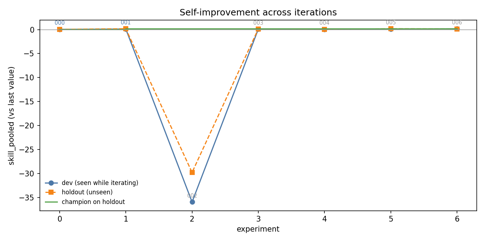

# Research report: experiments

_Written automatically from `ledger.jsonl` by `report.py`. Every number is the ledger's; nothing here is judged by a language model._

## Summary

- 7 experiments: the starting point (exp_000), then 1 kept and 5 rejected.
- Skill vs last value (pooled), DEV: +0.046 at the start (exp_000) → +0.118 for the champion (exp_001).
- HOLDOUT (never used to choose parameters, only as a gate): +0.049 → +0.178.
- Champion interval coverage: DEV 0.61, HOLDOUT 0.63 (target 0.80).
- Rule: keep a change only if DEV improves by at least 0.002 and HOLDOUT does not fall below the champion's.

## All experiments

| id | kept | DEV | HOLDOUT | coverage DEV | hypothesis |
|---|---|---|---|---|---|
| exp_000 | yes | +0.046 | +0.049 | 0.46 | Reference: the starter kit's drift baseline (whole-history empirical random walk), re-run through our walk-... |
| exp_001 | yes | +0.118 | +0.178 | 0.61 | Skill is 0.0459 with very poor coverage (0.46 in); highest skill (0.186, 0.196) is on afhubbard/hyperscaler... |
| exp_002 | no | -35.936767 | -29.778331 | 0.82 | Coverage in the current champion is only 0.61 (target 0.80), with 0.29 of outcomes above q90 (should be 0.1... |
| exp_003 | no | +0.093 | +0.146 | 0.49 | The main finding is that the current champion (empirical_quantiles, window=30) has skill_pooled=0.1177 (dev... |
| exp_004 | no | +0.064 | +0.067 | 0.49 | The champion's dev skill_pooled is 0.118, but coverage_in is 0.61 (well under the 0.80 target). The q90 tai... |
| exp_005 | no | +0.118 | +0.178 | 0.61 | By days since last price change, the champion's skill drops sharply (from 0.139 at 0-1d to 0.036 at 8-30d, ... |
| exp_006 | no | +0.170 | +0.153 | 0.54 | Coverage in interval is 0.61 (vs target 0.80), with skill_pooled 0.118; group fastgpu_daily/hyperscaler_spo... |

## The path, one experiment at a time

### exp_000: kept

**Hypothesis.** Reference: the starter kit's drift baseline (whole-history empirical random walk), re-run through our walk-forward pipeline on daily origins.

**What changed.** starting point. Model: drift (single; no calibration).

**Decision.** first experiment: becomes the starting champion

**Lesson written to memory.** seed: starting champion for this autonomous run

### exp_001: kept

**Hypothesis.** Skill is 0.0459 with very poor coverage (0.46 in); highest skill (0.186, 0.196) is on afhubbard|hyperscaler_spot and gpurentalprices|marketplace_ask. There is underestimation at the upper tail: above_q90 is 0.41 (should be 0.10 if well calibrated); below_q10 also over (0.12 vs 0.10). This suggests drift underestimates the true interval width. -> A simple log-changes based empirical quantile model, using the last N days for all three required horizons, should produce wider intervals and increase coverage toward the 0.8 target, with little loss (and possibly a gain) in overall skill. The coverage problem stems from underestimating price volatility, which a direct empirical quantile should correct on volatile series. Change: Replace the drift baseline with a new model that, for each horizon, computes the empirical 10th/50th/90th percentiles of h-day log changes over a rolling window (default 60 days) and applies them to forecast the p10/p50/p90 quantiles at 1, 3, and 7 days. DEV sweep of models.0.params.window: 30->+0.1177, 60->+0.1083, 120->+0.1078; chose 30.

**What changed.** adds model `empirical_quantiles`; drops model `drift`. Model: empirical_quantiles (single; no calibration).

**Test.** Against champion exp_000: DEV +0.0719, HOLDOUT +0.1288. By horizon (DEV, 1/3/7 days): +0.117 / +0.120 / +0.117.

**Decision.** dev skill_pooled +0.0719 vs champion exp_000 (need >= +0.002); holdout +0.1288 (need >= -0.0)

**Lesson written to memory.** The log-change empirical quantile model increased dev skill_pooled by +0.0719 and holdout by +0.1288 vs champion, while improving in-interval coverage from 0.46 to 0.61; next, test whether further increasing the rolling window length can boost coverage without harming skill.

### exp_002: rejected

**Hypothesis.** Coverage in the current champion is only 0.61 (target 0.80), with 0.29 of outcomes above q90 (should be 0.10 if calibrated), and weak skill especially for fastgpu_daily|hyperscaler_spot (-0.208) and fastgpu_daily|neocloud_spot (0.06). The current model, empirical_quantiles, builds intervals from a fixed-width rolling window of log changes, failing to adapt to changing short-term volatility and missing recent spikes or droughts (see high above_q90 rates in several groups and horizons). -> A new volatility-adaptive model that dynamically widens or narrows its forecast interval according to recent volatility (as measured by the median absolute deviation of short-horizon returns) will materially increase in-interval coverage (toward 0.80), particularly reducing above_q90 events, especially on groups/periods where volatility regime changes rapidly. Change: Switch to a new volatility-adaptive interval model, 'vol_adapt', replacing empirical_quantiles. DEV sweep of models.0.params.m: 5.0->-35.9368, 10.0->-479.9884, 15.0->-5889.6452; chose 5.0.

**What changed.** adds model `vol_adapt`; drops model `empirical_quantiles`. Model: vol_adapt (single; no calibration).

**Test.** Against champion exp_001: DEV -36.0545, HOLDOUT -29.9565. By horizon (DEV, 1/3/7 days): -170.709776 / -44.259309 / -17.286813.

**Decision.** dev skill_pooled -36.0545 vs champion exp_001 (need >= +0.002); holdout -29.9565 (need >= -0.0)

**Lesson written to memory.** Although the new volatility-adaptive model improved interval coverage (dev: 0.82 vs champion: 0.61), skill_pooled deteriorated significantly (dev: -35.9 vs champion: +0.12), suggesting that simply widening intervals does not resolve calibration/skill issues; the next experiment should focus on improving calibration while preserving or improving skill, possibly by combining volatility adaptation with mean adjustment or re-tuning the loss.

### exp_003: rejected

**Hypothesis.** The main finding is that the current champion (empirical_quantiles, window=30) has skill_pooled=0.1177 (dev), but poor coverage: only 0.61 in, with 0.29 above q90 and 0.11 below q10. By horizon, tail coverage is especially bad at 7 days (q90: 0.43). The weakest groups are fastgpu_daily|hyperscaler_spot (skill: -0.208, q90: 0.27, q10: 0.27) and fastgpu_daily|neocloud_spot (skill: 0.06, q90: 0.28, q10: 0.16). Empirical_quantiles is very simple: it just takes log changes on a rolling window. Recent rejection of a volatility-adaptive model showed huge overfitting and skill collapse. Leader/peer signals have not been exploited. -> Introducing an explicit model of directional trend, using a rolling average of recent log changes to bias the empirical quantiles, will improve both coverage and skill in groups with strongly persistent skew (e.g., fastgpu_daily|hyperscaler_spot, where q90/q10 rates are much too high and the skill is negative), by compensating for systematically missed directional moves across horizons. Change: Replace the empirical_quantiles model with a new model that augments the empirical distribution of log returns with a trend term, estimated as the mean log change over the window. This will bias the forecast slightly in the direction of recent movement, addressing the observed under- and overshoot in the tails. The window parameter is tunable (default 30). DEV sweep of models.0.params.trend_weight: 0.5->+0.0927, 1.0->+0.0626, 1.5->+0.0277, 2.0->-0.0109; chose 0.5.

**What changed.** adds model `trend_aware_empirical`; drops model `empirical_quantiles`. Model: trend_aware_empirical (single; no calibration).

**Test.** Against champion exp_001: DEV -0.0250, HOLDOUT -0.0323. By horizon (DEV, 1/3/7 days): +0.057 / +0.086 / +0.100.

**Decision.** dev skill_pooled -0.0250 vs champion exp_001 (need >= +0.002); holdout -0.0323 (need >= -0.0)

**Lesson written to memory.** Introducing a trend bias to empirical_quantiles (trend_weight=0.5) lowered dev skill_pooled to 0.093 (vs 0.118 champion), and coverage_in also dropped (0.49 vs 0.61), failing required thresholds on skill in both dev and holdout; future experiments should focus on data-driven or adaptive trend estimation, or explore integrating peer/leader signals rather than simple mean-based trends.

### exp_004: rejected

**Hypothesis.** The champion's dev skill_pooled is 0.118, but coverage_in is 0.61 (well under the 0.80 target). The q90 tail especially is much too high: coverage_above_q90 is 0.286 overall and 0.428 at 7 days. Previous direct-widen approaches overfit (exp_002, massive skill loss), and blind trend adjustments (exp_003) worsened both skill and coverage. One diagnosis hint: by dsc_bucket, skill and coverage collapse for dsc>8 days (skill=0.036/0, coverage_above_q90 drops, below_q10 rises), suggesting possible regime change or model overconfidence in staleness. The current model (empirical_quantiles(window=30)) ignores how stale the price is at the origin. -> Price intervals are much too narrow when the price has not changed for many days, leading to overconfidence (low coverage_in and excessive above_q90). Explicitly widening intervals by a factor based on days-since-change should improve coverage (especially in dsc_bucket 8-30 and >30) and bring calibration closer to the 80% target, without the catastrophic over-widening of vol-adapt (exp_002), if the widening is minimal for recent changes and ramps up only at high staleness. Change: Introduce a new model, stale_aware_quantiles, that applies a mild linear scaling to the empirical quantile interval width as days_since_change grows beyond 7 days (no effect if dsc<=7, up to 2x wider if dsc>=30). Keep window=30 as in the champion. DEV sweep of models.0.params.max_scale: 1.25->+0.0643, 1.5->+0.0643, 1.75->+0.0643, 2.0->+0.0643; chose 2.0.

**What changed.** adds model `stale_aware_quantiles`; drops model `empirical_quantiles`. Model: stale_aware_quantiles (single; no calibration).

**Test.** Against champion exp_001: DEV -0.0534, HOLDOUT -0.1107. By horizon (DEV, 1/3/7 days): +0.117 / +0.079 / +0.052.

**Decision.** dev skill_pooled -0.0534 vs champion exp_001 (need >= +0.002); holdout -0.1107 (need >= -0.0)

**Lesson written to memory.** Widening intervals by days_since_change with stale_aware_quantiles (max_scale=2.0) reduced dev skill_pooled from 0.118 to 0.064 and coverage_in from 0.61 to 0.49, failing both skill and coverage targets. Next, try a much lower scaling factor or nonlinear ramp to limit skill loss while still widening stale intervals slightly.

### exp_005: rejected

**Hypothesis.** By days since last price change, the champion's skill drops sharply (from 0.139 at 0-1d to 0.036 at 8-30d, and 0 for >30d), and coverage above q90 also drops (from 0.335 at 0-1d to 0.154 at >30d). The tail forecasts are especially poor (no hits in either tail for several series with stale prices). Previous experiments attempting crude stale-aware widening severely degraded skill and failed coverage (exp_004 with max_scale=2.0). Nonlinear, gentler interval adaptation to staleness may improve calibration, especially at 7d horizons where coverage_above_q90 is 0.428 (target 0.1). -> A gentle, capped and nonlinear widening of the empirical quantile intervals for origins with high days-since-change will improve calibration for stale series (particularly in >7 dsc buckets and 7d horizon), by increasing coverage above q90, without the drastic skill loss seen with aggressive scaling. Using max_scale=1.25 (capped, modest adjustment) and ramping up only after stale_thresh, not linearly, may reduce overfitting. Change: Introduce new model: gentle_stale_aware_quantiles, which multiplies the empirical q10-q90 log interval width by a nonlinear, capped function of days_since_change (ramp starts after stale_thresh, max 1.25x widening). Use same window=30 as champion.

**What changed.** adds model `gentle_stale_aware_quantiles`; drops model `empirical_quantiles`. Model: gentle_stale_aware_quantiles (single; no calibration).

**Test.** Against champion exp_001: DEV -0.0001, HOLDOUT -0.0001. By horizon (DEV, 1/3/7 days): +0.117 / +0.120 / +0.116.

**Decision.** dev skill_pooled -0.0001 vs champion exp_001 (need >= +0.002); holdout -0.0001 (need >= -0.0)

**Lesson written to memory.** The gentle, nonlinear stale-aware quantile widening showed virtually no change in skill on both dev (-0.0001 vs champion) and holdout (-0.0001), with identical coverage, implying this approach is too conservative or late-acting; next, consider either lowering the stale_thresh or slightly increasing max_scale to affect more stale origins without large skill degradation.

### exp_006: rejected

**Hypothesis.** Coverage in interval is 0.61 (vs target 0.80), with skill_pooled 0.118; group fastgpu_daily|hyperscaler_spot skill -0.208, above_q90 0.274, below_q10 0.274; skill for dsc>8 days is sharply lower (0.036 at 8-30d, 0 at >30d). All models so far use only local empirical quantiles (log returns in a rolling window); all attempts to widen intervals or trend-bias them have either overfit or failed to improve. The main missed signal in the diagnosis is: on many GPUs, another data source leads by 1-5 days with high |corr|>0.5, |corr|>0.9 for some series. No prior model codes or ideas use the cross-series leader signals. -> Many series (especially rate cards and spot) have strongly leading signals from the same-GPU, different-source series, sometimes lagged by 1-5 days (e.g., H100_SXM_80GB on-demand: leader from hyperscaler_list or spot with -0.95 corr). Directly including recent log changes from such a leader should improve sharpness, skill, and especially tail coverage for those series and horizons. Change: Add a model that forms forecast quantiles from a linear blend between the local rolling empirical quantiles (as in champion) and log-changes over the past N days in the leading series (identified by same gpu_model, different source_id), shifted by optimal lag; blending factor and lag tunable. Use only new leader_quantiles in single mode. DEV sweep of models.0.params.leader_weight: 0.25->+0.1607, 0.5->+0.1698, 0.75->+0.1488; chose 0.5.

**What changed.** adds model `leader_quantiles`; drops model `empirical_quantiles`. Model: leader_quantiles (single; no calibration).

**Test.** Against champion exp_001: DEV +0.0520, HOLDOUT -0.0256. By horizon (DEV, 1/3/7 days): +0.080 / +0.128 / +0.198.

**Decision.** dev skill_pooled +0.0520 vs champion exp_001 (need >= +0.002); holdout -0.0256 (need >= -0.0)

**Lesson written to memory.** Leader-quantile model improved dev skill_pooled (+0.0520) but regressed holdout (-0.0256), with in-sample coverage dropping from 0.61 to 0.54; this suggests overfitting, so next experiment should regularize blending or restrict leader use to high-corr, stable-lag series.

## What the loop ruled out

- **exp_002**: Although the new volatility-adaptive model improved interval coverage (dev: 0.82 vs champion: 0.61), skill_pooled deteriorated significantly (dev: -35.9 vs champion: +0.12), suggesting that simply widening intervals does not resolve calibration/skill issues; the next experiment should focus on improving calibration while preserving or improving skill, possibly by combining volatility adaptation with mean adjustment or re-tuning the loss.
- **exp_003**: Introducing a trend bias to empirical_quantiles (trend_weight=0.5) lowered dev skill_pooled to 0.093 (vs 0.118 champion), and coverage_in also dropped (0.49 vs 0.61), failing required thresholds on skill in both dev and holdout; future experiments should focus on data-driven or adaptive trend estimation, or explore integrating peer/leader signals rather than simple mean-based trends.
- **exp_004**: Widening intervals by days_since_change with stale_aware_quantiles (max_scale=2.0) reduced dev skill_pooled from 0.118 to 0.064 and coverage_in from 0.61 to 0.49, failing both skill and coverage targets. Next, try a much lower scaling factor or nonlinear ramp to limit skill loss while still widening stale intervals slightly.
- **exp_005**: The gentle, nonlinear stale-aware quantile widening showed virtually no change in skill on both dev (-0.0001 vs champion) and holdout (-0.0001), with identical coverage, implying this approach is too conservative or late-acting; next, consider either lowering the stale_thresh or slightly increasing max_scale to affect more stale origins without large skill degradation.
- **exp_006**: Leader-quantile model improved dev skill_pooled (+0.0520) but regressed holdout (-0.0256), with in-sample coverage dropping from 0.61 to 0.54; this suggests overfitting, so next experiment should regularize blending or restrict leader use to high-corr, stable-lag series.

## Champion by horizon

| horizon | DEV skill | HOLDOUT skill |
|---|---|---|
| 1 day | +0.117 | +0.083 |
| 3 day | +0.120 | +0.160 |
| 7 day | +0.117 | +0.223 |

Champion spec: `experiments/exp_001/spec.json`. Diagnosis: `experiments/exp_001/diagnosis.md`.
