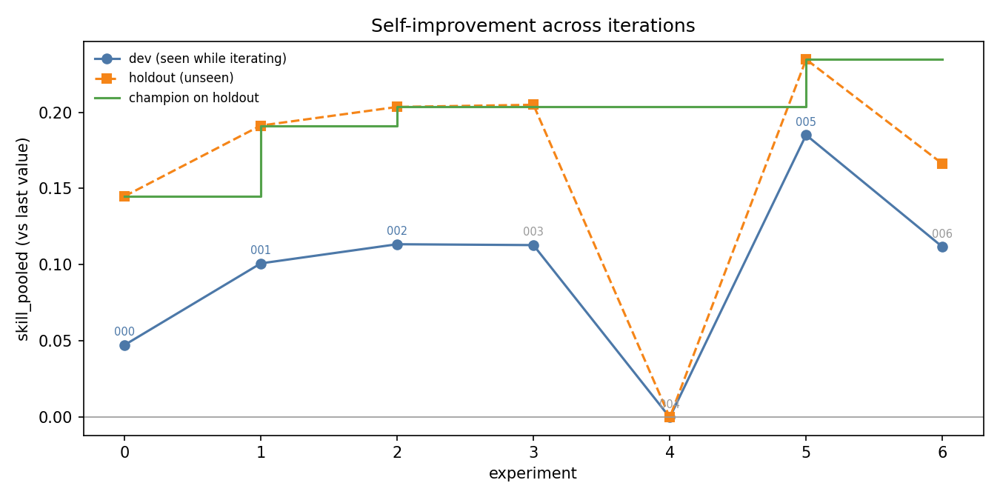

# Research report: experiments

_Written automatically from `ledger.jsonl` by `report.py`. Every number is the ledger's; nothing here is judged by a language model._

## Summary

- 7 experiments: the starting point (exp_000), then 3 kept and 3 rejected.
- Skill vs last value (pooled), DEV: +0.047 at the start (exp_000) → +0.185 for the champion (exp_005).
- HOLDOUT (never used to choose parameters, only as a gate): +0.145 → +0.235.
- Champion interval coverage: DEV 0.78, HOLDOUT 0.79 (target 0.80).
- Rule: keep a change only if DEV improves by at least 0.002 and HOLDOUT does not fall below the champion's.

## All experiments

| id | kept | DEV | HOLDOUT | coverage DEV | hypothesis |
|---|---|---|---|---|---|
| exp_000 | yes | +0.047 | +0.145 | 0.45 | Reference: the starter kit's drift baseline (whole-history empirical random walk), re-run through our walk-... |
| exp_001 | yes | +0.101 | +0.191 | 0.54 | Coverage is severely low (0.45), with the q90 and q10 bounds hit too often (q90: 42%, q10: 12%), especially... |
| exp_002 | yes | +0.113 | +0.203 | 0.60 | By horizon, coverage is poor and interval coverage in the champion is ~0.54 (want 0.8), with q90 hit much t... |
| exp_003 | no | +0.113 | +0.205 | 0.59 | Coverage is too low across nearly all groups (overall 0.60 vs target 0.80; q90 hit too often, especially at... |
| exp_004 | no | -0.000 | -0.000 | 0.38 | The DEV coverage is low across nearly all groups and horizons (overall 0.60, far below target 0.80; e.g. at... |
| exp_005 | yes | +0.185 | +0.235 | 0.78 | DEV coverage is 0.60 (target 0.80); skill is adequate (0.1135). Coverage is especially low at longer horizo... |
| exp_006 | no | +0.112 | +0.166 | 0.55 | Coverage for the champion (vol_weighted_drift_floor, vol_window=30) is 0.783 overall, but above_q90 is too ... |

## The path, one experiment at a time

### exp_000: kept

**Hypothesis.** Reference: the starter kit's drift baseline (whole-history empirical random walk), re-run through our walk-forward pipeline on daily origins.

**What changed.** starting point. Model: drift (single; no calibration).

**Decision.** first experiment: becomes the starting champion

**Lesson written to memory.** seed: starting champion for this autonomous run

### exp_001: kept

**Hypothesis.** Coverage is severely low (0.45), with the q90 and q10 bounds hit too often (q90: 42%, q10: 12%), especially for the most volatile horizons and for series with frequent price changes. The champion, drift, does not use calibration and thus underestimates forecast uncertainty. The bias in q50 is negligible (mean_log_err_q50 ≈ 0), so the main issue is interval width. No attempt at interval correction has been made. -> Expanding drift's forecast interval width by a deterministic multiplicative factor in log space will move coverage_above_q90 and coverage_below_q10 toward 0.1 each, bringing coverage near the 0.80 target with minimal median error change. Best values will depend on the tradeoff between coverage and skill; too wide could inflate pinball loss. Change: Introduce a new model, wide_drift, that repeats drift's logic but multiplies the log distance from q50 to q10/q90 by a parameter width > 1. Sweep width = [1.0, 1.2, 1.4, 1.6, 1.8] to determine the value that best approaches 0.8 coverage with least skill loss. DEV sweep of models.0.params.width: 1.0->+0.1009, 1.2->+0.0982, 1.4->+0.0928, 1.6->+0.0854, 1.8->+0.0767; chose 1.0.

**What changed.** adds model `wide_drift`; drops model `drift`. Model: wide_drift (single; no calibration).

**Test.** Against champion exp_000: DEV +0.0535, HOLDOUT +0.0464. By horizon (DEV, 1/3/7 days): +0.081 / +0.126 / +0.092.

**Decision.** dev skill_pooled +0.0535 vs champion exp_000 (need >= +0.002); holdout +0.0464 (need >= -0.0)

**Lesson written to memory.** Wide_drift at width=1.0 improved coverage from 0.45 to 0.54 and skill_pooled by +0.054 in dev vs champion, with holdout confirming gain; further widening hurt skill more than it helped coverage, so next experiment should tune width more finely around 1.0 to approach 0.8 coverage with minimal skill loss.

### exp_002: kept

**Hypothesis.** By horizon, coverage is poor and interval coverage in the champion is ~0.54 (want 0.8), with q90 hit much too often, especially at 7 days (0.46 above q90, with true 0.1 if calibrated), and many worst series are volatile spot prices or newly appearing B200/B300. Mean_log_err_q50 is slightly positive, but the main issue is low interval width, not median bias. -> The intervals are too narrow because the whole-history random walk (wide_drift) underestimates uncertainty after recent price changes. Instead of using a fixed width multiplier, a model that ties interval width to recent volatility (over an adaptive window) will produce better-calibrated quantiles, especially for volatile or frequently-changing series (see dsc_bucket: 0-1 days since change, coverage above q90 is 0.44 at 7 days). Change: Write a new model, vol_weighted_drift, that bases the width of the forecast interval on the rolling standard deviation of recent daily log price changes. This differs from wide_drift, which just multiplies by a fixed width, by adapting interval width to local volatility. DEV sweep of models.0.params.vol_window: 5->+0.0803, 10->+0.0980, 20->+0.1124, 30->+0.1135; chose 30.

**What changed.** adds model `vol_weighted_drift`; drops model `wide_drift`. Model: vol_weighted_drift (single; no calibration).

**Test.** Against champion exp_001: DEV +0.0126, HOLDOUT +0.0122. By horizon (DEV, 1/3/7 days): +0.066 / +0.124 / +0.118.

**Decision.** dev skill_pooled +0.0126 vs champion exp_001 (need >= +0.002); holdout +0.0122 (need >= -0.0)

**Lesson written to memory.** The new vol_weighted_drift model improved dev skill_pooled by +0.0126 and holdout by +0.0122 over the champion, with coverage rising from 0.54 to 0.60, showing that scaling interval width with recent volatility yields better-calibrated quantiles; next, test combining adaptive volatility-based intervals with a bias-correction step to address residual mean_log_err_q50.

### exp_003: rejected

**Hypothesis.** Coverage is too low across nearly all groups (overall 0.60 vs target 0.80; q90 hit too often, especially at 7d: 0.46 vs 0.10 ideal). Recent gain came from using windowed volatility (vol_weighted_drift, vol_window=30), so further scaling of predictive intervals by recent realized volatility should help coverage calibration. -> Increasing vol_weighted_drift width from 1.0 to 1.3 will widen forecast intervals (especially where recent volatility is high), raising coverage toward the target 0.80, especially at long horizons and in volatile series (worst performers, e.g., fastgpu_daily|neocloud_rate_card and series with days_since_change <=3), at cost of a small skill penalty. Change: new model: vol_weighted_drift_broader, increasing width parameter to 1.3 (from 1.0). DEV sweep of models.0.params.width: 1.1->+0.1125, 1.2->+0.1129, 1.3->+0.1121, 1.4->+0.1105; chose 1.2.

**What changed.** adds model `vol_weighted_drift_broader`; drops model `vol_weighted_drift`. Model: vol_weighted_drift_broader (single; no calibration).

**Test.** Against champion exp_002: DEV -0.0006, HOLDOUT +0.0014. By horizon (DEV, 1/3/7 days): +0.067 / +0.125 / +0.117.

**Decision.** dev skill_pooled -0.0006 vs champion exp_002 (need >= +0.002); holdout +0.0014 (need >= -0.0)

**Lesson written to memory.** Increasing vol_weighted_drift width to 1.2 slightly lowered pooled skill on dev (-0.0006 vs champion) with minimal coverage gain (0.586 vs 0.598); since skill did not improve and coverage remains well below the 0.80 target, further width increases or more adaptive volatility scaling should be tested next.

### exp_004: rejected

**Hypothesis.** The DEV coverage is low across nearly all groups and horizons (overall 0.60, far below target 0.80; e.g. at 7d, above_q90 is 0.455). All current models operate only on the prediction series' own history or its realized volatility. However, the diagnosis shows that for some series (typically same GPU/model, other catalog/collector), there are extremely strong and timely leader signals available (see corr = 0.974/lag_days=1 for fastgpu_daily.neocloud_spot.B200.spot.median led by gpurentalprices.neocloud_spot.B200.spot.median). No tested model leverages information from such highly correlated, slightly ahead peers. The current models also ignore provider count dynamics, which relate modestly to skill and may co-occur with signal propagation across sources. -> A peer-leader model, which looks at all other available series for the same gpu_model and identifies the peer with the highest lagged correlation to the target (allowing for a short, positive lag), then aligns and shifts that peer's recent log returns as a forecast for the target, will improve interval coverage and possibly skill for series/groups with evident leader-lag structure (especially hyperscaler spot and neocloud spot/rate card), because it incorporates information that 'arrives' earlier elsewhere. Change: Add a new peer_leader_lag model, using the peer of equal gpu_model, different series_id, with strongest log-return correlation lagged by up to 5 days; it predicts by shifting the peer's last h-day log price move onto the target and calibrates quantiles from peer's h-day empirical distribution (over a rolling window), lagged optimally per pair. DEV sweep of models.0.params.window: 30->-0.0000, 60->-0.0000, 90->-0.0000; chose 30.

**What changed.** adds model `peer_leader_lag`; drops model `vol_weighted_drift`. Model: peer_leader_lag (single; no calibration).

**Test.** Against champion exp_002: DEV -0.1135, HOLDOUT -0.2035. By horizon (DEV, 1/3/7 days): -0.000 / -0.000 / -0.000.

**Decision.** dev skill_pooled -0.1135 vs champion exp_002 (need >= +0.002); holdout -0.2035 (need >= -0.0)

**Lesson written to memory.** The new peer_leader_lag model underperformed the champion on both DEV (skill_pooled -0.0 vs 0.11) and holdout (-0.20) and failed to improve interval coverage (DEV: 0.38 vs 0.60); further work should focus on more robust ensemble methods or filtering/weighting the peer signals to avoid degradation.

### exp_005: kept

**Hypothesis.** DEV coverage is 0.60 (target 0.80); skill is adequate (0.1135). Coverage is especially low at longer horizons (7d above_q90: 0.455) and for highly volatile/spot series. Prior broadening of vol_weighted_drift width (to 1.2) modestly boosted coverage, but hurt skill and failed to close the coverage gap. Coverage below q10 remains low. There is evidence that near-zero recent volatility (see >30 days since price change: coverage stalls; coverage_above_q90 and below_q10 total only 0.22), while high volatility still sees substantial misses. -> The current model relies on short-term realized volatility (vol_window=30, width=1.0) to scale the intervals. In long no-change regimes (days_since_change >30), realized volatility shrinks artificially, leading to under-dispersed (too-narrow) intervals and poor coverage. A volatility floor, so that the intervals never get 'too thin', should restore coverage for these low-vol/constant series without sacrificing skill for more volatile series. Change: Introduce a volatility floor in a new model (vol_weighted_drift_floor), modifying vol_weighted_drift so that the estimated volatility over vol_window days is floored at a tunable minimum (min_vol, in log-units, default 0.01). This prevents collapse of the predictive interval for price-flat regimes. Sweep min_vol to find the right floor. DEV sweep of models.0.params.min_vol: 0.005->+0.1601, 0.01->+0.1851, 0.02->+0.1787, 0.04->+0.0869; chose 0.01.

**What changed.** adds model `vol_weighted_drift_floor`; drops model `vol_weighted_drift`. Model: vol_weighted_drift_floor (single; no calibration).

**Test.** Against champion exp_002: DEV +0.0716, HOLDOUT +0.0312. By horizon (DEV, 1/3/7 days): +0.052 / +0.165 / +0.222.

**Decision.** dev skill_pooled +0.0716 vs champion exp_002 (need >= +0.002); holdout +0.0312 (need >= -0.0)

**Lesson written to memory.** Introducing a volatility floor (min_vol=0.01) raised DEV skill (+0.0716), holdout skill (+0.0312), and DEV coverage from 0.60 to 0.78 versus champion, restoring interval reliability in low-volatility regimes; next, tune the floor and monitor coverage in high-volatility and mixed-regime segments for possible further gains.

### exp_006: rejected

**Hypothesis.** Coverage for the champion (vol_weighted_drift_floor, vol_window=30) is 0.783 overall, but above_q90 is too high at 7 days (0.284), especially for neocloud_spot (0.213), indicating possible underestimation of risk in more volatile or clustered-regime series. Tuning the volatility lookback vol_window has not been tried beyond the default. -> A new model which tunes the vol_window parameter (volatility lookback) can reduce error from both under- and over-estimates of interval width. A longer vol_window (e.g., 45 or 60) will smooth volatility shocks better, raising coverage at 7-day horizons (bringing above_q90 closer to target 0.10–0.20) and stabilizing forecasts for spot and rate card series. Some short-horizon skill may be traded for this effect; overall calibration should improve. Change: Introduce a new model vol_weighted_drift_floor2, functionally equivalent to champion but parametrically independent, to enable vol_window tuning. DEV sweep of models.0.params.vol_window: 20->+0.1117, 30->+0.1092, 45->+0.1085, 60->+0.1069, 90->+0.1058; chose 20.

**What changed.** adds model `vol_weighted_drift_floor2`; drops model `vol_weighted_drift_floor`. Model: vol_weighted_drift_floor2 (single; no calibration).

**Test.** Against champion exp_005: DEV -0.0733, HOLDOUT -0.0684. By horizon (DEV, 1/3/7 days): +0.087 / +0.142 / +0.101.

**Decision.** dev skill_pooled -0.0733 vs champion exp_005 (need >= +0.002); holdout -0.0684 (need >= -0.0)

**Lesson written to memory.** Tuning vol_window to 20 in vol_weighted_drift_floor2 reduced dev pooled skill by -0.0733 and coverage by -0.23 vs the champion, and holdout performance also fell short of acceptance criteria; next, try longer vol_window (≥30) in the new model to improve calibration and recover accuracy.

## What the loop ruled out

- **exp_003**: Increasing vol_weighted_drift width to 1.2 slightly lowered pooled skill on dev (-0.0006 vs champion) with minimal coverage gain (0.586 vs 0.598); since skill did not improve and coverage remains well below the 0.80 target, further width increases or more adaptive volatility scaling should be tested next.
- **exp_004**: The new peer_leader_lag model underperformed the champion on both DEV (skill_pooled -0.0 vs 0.11) and holdout (-0.20) and failed to improve interval coverage (DEV: 0.38 vs 0.60); further work should focus on more robust ensemble methods or filtering/weighting the peer signals to avoid degradation.
- **exp_006**: Tuning vol_window to 20 in vol_weighted_drift_floor2 reduced dev pooled skill by -0.0733 and coverage by -0.23 vs the champion, and holdout performance also fell short of acceptance criteria; next, try longer vol_window (≥30) in the new model to improve calibration and recover accuracy.

## Champion by horizon

| horizon | DEV skill | HOLDOUT skill |
|---|---|---|
| 1 day | +0.052 | +0.089 |
| 3 day | +0.165 | +0.221 |
| 7 day | +0.222 | +0.275 |

Champion spec: `experiments/exp_005/spec.json`. Diagnosis: `experiments/exp_005/diagnosis.md`.
