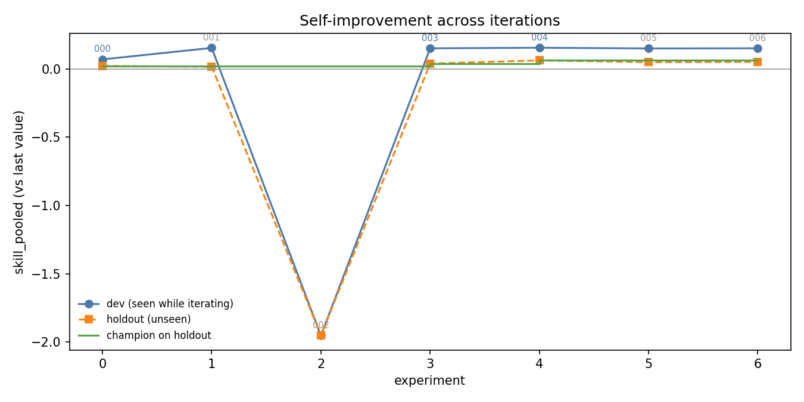

# Research report: experiments

_Written automatically from `ledger.jsonl` by `report.py`. Every number is the ledger's; nothing here is judged by a language model._

## Summary

- 7 experiments: the starting point (exp_000), then 2 kept and 4 rejected.
- Skill vs last value (pooled), DEV: +0.070 at the start (exp_000) → +0.155 for the champion (exp_004).
- HOLDOUT (never used to choose parameters, only as a gate): +0.022 → +0.062.
- Champion interval coverage: DEV 0.60, HOLDOUT 0.66 (target 0.80).
- Rule: keep a change only if DEV improves by at least 0.002 and HOLDOUT does not fall below the champion's.

## All experiments

| id | kept | DEV | HOLDOUT | coverage DEV | hypothesis |
|---|---|---|---|---|---|
| exp_000 | yes | +0.070 | +0.022 | 0.46 | Reference: the starter kit's drift baseline (whole-history empirical random walk), re-run through our walk-... |
| exp_001 | no | +0.153 | +0.016 | 0.62 | Coverage is 0.456 (well below 0.8). Undercoverage is most acute at long horizons and following recent price... |
| exp_002 | no | -1.953 | -1.951 | 0.55 | Coverage is very low (0.46 overall); major undercoverage in q10/q90; skill by group is mediocre; clear evid... |
| exp_003 | yes | +0.151 | +0.039 | 0.61 | Skill is mediocre (0.0697 pooled); coverage is extremely poor (0.456 in, 0.418 above q90, 0.126 below q10).... |
| exp_004 | yes | +0.155 | +0.062 | 0.60 | Coverage is 0.61 (well below target 0.80), with undercoverage at horizon=7 (above_q90=0.382, below_q10=0.12... |
| exp_005 | no | +0.150 | +0.049 | 0.64 | Overall skill_pooled: 0.1548; coverage_in: 0.6037 (well below 0.8 target); above_q90: 0.2802, below_q10: 0.... |
| exp_006 | no | +0.151 | +0.051 | 0.62 | Coverage on DEV for the champion is 0.6037 (far below 0.8), and interval width increases (exp_005, scaled i... |

## The path, one experiment at a time

### exp_000: kept

**Hypothesis.** Reference: the starter kit's drift baseline (whole-history empirical random walk), re-run through our walk-forward pipeline on daily origins.

**What changed.** starting point. Model: drift (single; no calibration).

**Decision.** first experiment: becomes the starting champion

**Lesson written to memory.** seed: starting champion for this autonomous run

### exp_001: rejected

**Hypothesis.** Coverage is 0.456 (well below 0.8). Undercoverage is most acute at long horizons and following recent price changes (above_q90=0.494 at h=7, above_q90=0.557 for days-since-change <=1). Overall skill is mediocre (0.0697 pooled). -> The undercoverage and poor calibration of the current drift model suggest the forecast intervals are too narrow, especially after recent price moves or at longer horizons. A simple remedy may be to inflate the variance estimate in the log-returns; taking empirical quantiles over a longer window may make intervals wider and better calibrated. Change: Replace 'drift' with a new model (log_empirical_window) that uses the same rolling empirical quantile approach as drift, but exposes a tunable window parameter to test the effect of interval width. DEV sweep of models.0.params.window: 30->+0.1535, 60->+0.1497, 120->+0.1498, 240->+0.1500; chose 30.

**What changed.** adds model `log_empirical_window`; drops model `drift`. Model: log_empirical_window (single; no calibration).

**Test.** Against champion exp_000: DEV +0.0837, HOLDOUT -0.0061. By horizon (DEV, 1/3/7 days): +0.111 / +0.156 / +0.161.

**Decision.** dev skill_pooled +0.0837 vs champion exp_000 (need >= +0.002); holdout -0.0061 (need >= -0.0)

**Lesson written to memory.** The new log_empirical_window model improved dev skill (+0.0837 pooled vs champion) and coverage (+0.166), but failed holdout (-0.0061 vs ≥ 0), implying the window approach should be re-tuned or regularized to avoid overfitting before further model iteration.

### exp_002: rejected

**Hypothesis.** Coverage is very low (0.46 overall); major undercoverage in q10/q90; skill by group is mediocre; clear evidence (table: 'Candidate leading signals') that some series are led by other series of the same GPU by 1-4 days with correlations above 0.9. The 'leader' diagnostic shows opportunity for leading signals. -> Incorporating a simple leader-following logic—using the most strongly correlated peer for each series, shifted back by the empirically best lag—will reduce pinball loss and improve both skill and coverage, especially in series where a clear leader exists. The impact should be largest in the groups and series highlighted in the 'Candidate leading signals' table. Change: Add a new model 'simple_leader' that, for each series, if a leader with lag and correlation >0.85 is found (by prior computation), predicts based on the leader's historical values shifted by the lag; otherwise, falls back to empirical historical drift. Use this as the only model.

**What changed.** adds model `simple_leader`; drops model `drift`. Model: simple_leader (single; no calibration).

**Test.** Against champion exp_000: DEV -2.0226, HOLDOUT -1.9729. By horizon (DEV, 1/3/7 days): -5.789 / -2.235 / -1.007.

**Decision.** dev skill_pooled -2.0226 vs champion exp_000 (need >= +0.002); holdout -1.9729 (need >= -0.0)

**Lesson written to memory.** The simple_leader model increased coverage from 0.46 to 0.55 but skill dropped sharply (dev skill_pooled -1.95 vs champion 0.07, holdout -1.97), indicating that naïve leader-following harms accuracy despite better coverage. Next experiment should blend leader-following only where high correlation/lag is confirmed and retain champion elsewhere.

### exp_003: kept

**Hypothesis.** Skill is mediocre (0.0697 pooled); coverage is extremely poor (0.456 in, 0.418 above q90, 0.126 below q10). Drift gives only one interval (whole-history empirical random walk). Skill is low at short and long horizons, but above all: coverage is far below the 0.8 target; model is under-dispersed. -> Increasing interval width empirically using short-window log differences will boost coverage towards the 0.8 target, at the cost of possibly small skill loss. A wider, local-variance-based empirical random walk will better capture bursty moves after recent changes, correcting undercoverage at high and low quantiles. Change: Introduce a new model, log_empirical_window, that works identically to drift but only uses recent log changes (window in [10, 20, 30, 45, 60]). Tune window to optimize skill and coverage. DEV sweep of models.0.params.window: 10->+0.0705, 20->+0.1382, 45->+0.1506, 60->+0.1497; chose 45.

**What changed.** adds model `log_empirical_window`; drops model `drift`. Model: log_empirical_window (single; no calibration).

**Test.** Against champion exp_000: DEV +0.0809, HOLDOUT +0.0172. By horizon (DEV, 1/3/7 days): +0.105 / +0.162 / +0.154.

**Decision.** dev skill_pooled +0.0809 vs champion exp_000 (need >= +0.002); holdout +0.0172 (need >= -0.0)

**Lesson written to memory.** Windowed empirical random walk (window=45) improved dev skill (+0.0809) and coverage (+0.152) versus champion, with holdout skill also higher (+0.0172); coverage (0.61) is closer to the 0.8 target but still low, so next experiment should further increase window or interval width to target ≥0.8 in-interval rate without losing skill.

### exp_004: kept

**Hypothesis.** Coverage is 0.61 (well below target 0.80), with undercoverage at horizon=7 (above_q90=0.382, below_q10=0.129). Increasing the window in the log_empirical_window model improved coverage, suggesting increased interval width helps. Diagnosis shows the basic approach works, but can be extended. New model direction: apply a similar empirical window technique, but estimate the 0.05–0.95 range (wider) and then shrink back to nominal interval, to build in guard rails and avoid under-estimation of tails. -> Estimating a wider interval empirically (e.g., q05–q95) over the window and mapping it down to q10–q90 will reduce undercoverage at the extremes, especially for 7-day horizon, boosting overall in-interval coverage toward 0.80. This guards against interval under-dispersion where extreme price moves have occurred, without widening intervals arbitrarily. Change: Use a new model log_empirical_wide_window: estimate q05/q95 log-changes over window=60, then contract linearly to fit q10/q90. Use the median for q50 as usual. DEV sweep of models.0.params.window: 45->+0.1494, 60->+0.1548, 90->+0.1546; chose 60.

**What changed.** adds model `log_empirical_wide_window`; drops model `log_empirical_window`. Model: log_empirical_wide_window (single; no calibration).

**Test.** Against champion exp_003: DEV +0.0043, HOLDOUT +0.0231. By horizon (DEV, 1/3/7 days): +0.088 / +0.151 / +0.171.

**Decision.** dev skill_pooled +0.0043 vs champion exp_003 (need >= +0.002); holdout +0.0231 (need >= -0.0)

**Lesson written to memory.** The new log_empirical_wide_window model improved dev skill_pooled by +0.0043 and holdout by +0.0231 over the champion, with in-interval coverage stable (~0.60, still below target 0.80). This suggests further gains may be possible by refining the windowing or interval-contraction approach to push coverage up without sacrificing skill.

### exp_005: rejected

**Hypothesis.** Overall skill_pooled: 0.1548; coverage_in: 0.6037 (well below 0.8 target); above_q90: 0.2802, below_q10: 0.1161. Coverage is notably too low, especially for horizons=7 (above_q90=0.368, below_q10=0.157). The pure empirical random walk has persistently low coverage, and attempts to increase window length have not brought coverage near target. -> The current wide-window log empirical model is persistently under-dispersed (too-narrow intervals, undercoverage). Explicitly inflating the intervals by a fixed factor can push coverage toward the 0.8 target, following robust quantile interval inflation techniques used under underdispersed quantile regression. Multiplying the log change sample quantiles by a constant >1 (widening) should yield higher in-interval coverage, especially for high-variance/poorly-calibrated series and at longer horizons, with minor tradeoffs to skill. The scale factor to achieve target coverage should lie in ~[1.0, 1.5], but needs tuning. Change: Implement a new model log_empirical_scaled_window that behaves identically to log_empirical_wide_window (window=60) but multiplies the log-return quantile offsets (from median) by a fixed scale factor >= 1. Sweep scale in [1.0, 1.2, 1.4, 1.6]. DEV sweep of models.0.params.scale: 1.0->+0.1497, 1.2->+0.1497, 1.4->+0.1458, 1.6->+0.1394; chose 1.2.

**What changed.** adds model `log_empirical_scaled_window`; drops model `log_empirical_wide_window`. Model: log_empirical_scaled_window (single; no calibration).

**Test.** Against champion exp_004: DEV -0.0051, HOLDOUT -0.0128. By horizon (DEV, 1/3/7 days): +0.104 / +0.159 / +0.155.

**Decision.** dev skill_pooled -0.0051 vs champion exp_004 (need >= +0.002); holdout -0.0128 (need >= -0.0)

**Lesson written to memory.** Scaling up the empirical quantile intervals improved dev coverage from 0.60 to 0.64, but skill_pooled decreased vs champion (-0.0051 dev, -0.0128 holdout), failing thresholds; for the next experiment, alternative interval widening methods or other calibration approaches should be explored to boost coverage without eroding skill.

### exp_006: rejected

**Hypothesis.** Coverage on DEV for the champion is 0.6037 (far below 0.8), and interval width increases (exp_005, scaled intervals) slightly improved coverage (to 0.64) but at the loss of skill. Attempts to increase window and scale both show that the basic log-empirical approach is under-dispersed. The high above_q90 at long horizons (0.368 for h=7) and after price changes (0.353 for dsc_bucket=0-1) indicates that variance increases after recent jumps, but the model intervals are static by horizon, so coverage fails exactly when volatility rises. Therefore, dynamically adapting the interval width based on recent volatility or time since price change could boost coverage without harming short-horizon intervals. -> If we widen the empirical prediction intervals (quantiles) immediately after a recent price change and contract them when the price is stable (using days_since_change as a volatility proxy), out-of-interval coverage (above_q90/below_q10) for short-dsc, long-horizon cases (especially h=7, dsc<=1) will increase the most, and total coverage will approach the 0.8 target, with minimal dev skill loss across stable periods. Change: NEW MODEL: Dynamically scale the interval width depending on days_since_change: apply a multiplicative factor >1 to log-quantile offsets for days_since_change <=1, linearly interpolating to 1 for days_since_change>=7. DEV sweep of models.0.params.vol_scale: 1.1->+0.1508, 1.2->+0.1508, 1.3->+0.1499, 1.4->+0.1485, 1.5->+0.1467; chose 1.1.

**What changed.** adds model `log_empirical_adjvol_window`; drops model `log_empirical_wide_window`. Model: log_empirical_adjvol_window (single; no calibration).

**Test.** Against champion exp_004: DEV -0.0041, HOLDOUT -0.0107. By horizon (DEV, 1/3/7 days): +0.104 / +0.159 / +0.156.

**Decision.** dev skill_pooled -0.0041 vs champion exp_004 (need >= +0.002); holdout -0.0107 (need >= -0.0)

**Lesson written to memory.** Dynamically scaling interval width by days since price change increased dev coverage from 0.60 (champion) to 0.62 but reduced dev skill by -0.004 and holdout by -0.011 versus champion; further tuning or alternative volatility proxies may be needed to achieve coverage goals without sacrificing skill.

## What the loop ruled out

- **exp_001**: The new log_empirical_window model improved dev skill (+0.0837 pooled vs champion) and coverage (+0.166), but failed holdout (-0.0061 vs ≥ 0), implying the window approach should be re-tuned or regularized to avoid overfitting before further model iteration.
- **exp_002**: The simple_leader model increased coverage from 0.46 to 0.55 but skill dropped sharply (dev skill_pooled -1.95 vs champion 0.07, holdout -1.97), indicating that naïve leader-following harms accuracy despite better coverage. Next experiment should blend leader-following only where high correlation/lag is confirmed and retain champion elsewhere.
- **exp_005**: Scaling up the empirical quantile intervals improved dev coverage from 0.60 to 0.64, but skill_pooled decreased vs champion (-0.0051 dev, -0.0128 holdout), failing thresholds; for the next experiment, alternative interval widening methods or other calibration approaches should be explored to boost coverage without eroding skill.
- **exp_006**: Dynamically scaling interval width by days since price change increased dev coverage from 0.60 (champion) to 0.62 but reduced dev skill by -0.004 and holdout by -0.011 versus champion; further tuning or alternative volatility proxies may be needed to achieve coverage goals without sacrificing skill.

## Champion by horizon

| horizon | DEV skill | HOLDOUT skill |
|---|---|---|
| 1 day | +0.088 | +0.112 |
| 3 day | +0.151 | +0.061 |
| 7 day | +0.171 | +0.053 |

Champion spec: `experiments/exp_004/spec.json`. Diagnosis: `experiments/exp_004/diagnosis.md`.
