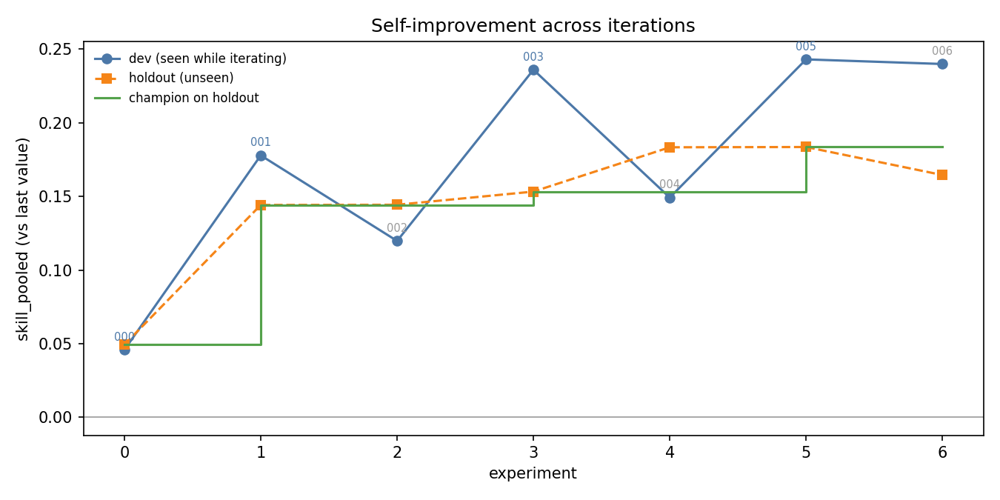

# Research report: experiments

_Written automatically from `ledger.jsonl` by `report.py`. Every number is the ledger's; nothing here is judged by a language model._

## Summary

- 7 experiments: the starting point (exp_000), then 3 kept and 3 rejected.
- Skill vs last value (pooled), DEV: +0.046 at the start (exp_000) → +0.243 for the champion (exp_005).
- HOLDOUT (never used to choose parameters, only as a gate): +0.049 → +0.183.
- Champion interval coverage: DEV 0.70, HOLDOUT 0.80 (target 0.80).
- Rule: keep a change only if DEV improves by at least 0.002 and HOLDOUT does not fall below the champion's.

## All experiments

| id | kept | DEV | HOLDOUT | coverage DEV | hypothesis |
|---|---|---|---|---|---|
| exp_000 | yes | +0.046 | +0.049 | 0.46 | Reference: the starter kit's drift baseline (whole-history empirical random walk), re-run through our walk-... |
| exp_001 | yes | +0.178 | +0.144 | 0.76 | The DEV coverage is very poor: overall coverage_in 0.463 (well below the 0.8 target), with coverage_above_q... |
| exp_002 | no | +0.120 | +0.144 | 0.62 | DEV diagnosis: coverage_in 0.758 (target 0.8), with all series using only drift as a model and calibration ... |
| exp_003 | yes | +0.236 | +0.153 | 0.72 | Champion has coverage_in 0.758 (target 0.8) and good pooled skill (0.1778), but some groups show notable un... |
| exp_004 | no | +0.149 | +0.183 | 0.63 | Fastgpu_daily/hyperscaler_spot and fastgpu_daily/neocloud_spot have above_q90 at 0.262 and 0.262 and below_... |
| exp_005 | yes | +0.243 | +0.183 | 0.70 | The champion achieves dev skill_pooled 0.236 and coverage_in 0.723, but notable undercoverage remains in fa... |
| exp_006 | no | +0.240 | +0.164 | 0.72 | The champion's coverage_in is 0.697 (target 0.8), with consistent undercoverage in fastgpu_daily/hyperscale... |

## The path, one experiment at a time

### exp_000: kept

**Hypothesis.** Reference: the starter kit's drift baseline (whole-history empirical random walk), re-run through our walk-forward pipeline on daily origins.

**What changed.** starting point. Model: drift (single; no calibration).

**Decision.** first experiment: becomes the starting champion

**Lesson written to memory.** seed: starting champion for this autonomous run

### exp_001: kept

**Hypothesis.** The DEV coverage is very poor: overall coverage_in 0.463 (well below the 0.8 target), with coverage_above_q90 0.414 and coverage_below_q10 0.123—most notably, on almost every group and horizon the 90% and 10% quantiles are hit far too often. The skill is positive but mediocre across groups, and mean_log_err_q50 is consistently positive (intervals too narrow and/or shifted up). -> Since the intervals are much too narrow (coverage below 0.5 everywhere), enabling online conformal recalibration should significantly increase coverage, particularly for outlying series and longer horizons, with only a modest or neutral effect on pinball loss (both too-narrow and too-wide intervals hurt loss). Change: Enable online recalibration using default gamma=0.5, scale=0.01, group_by=instrument_class.

**What changed.** `calibrate.enabled`: False → True; `calibrate.gamma`: None → 0.5; `calibrate.group_by`: None → instrument_class; `calibrate.scale`: None → 0.01. Model: drift (single; calibration by instrument_class).

**Test.** Against champion exp_000: DEV +0.1319, HOLDOUT +0.0949. By horizon (DEV, 1/3/7 days): +0.040 / +0.044 / +0.250.

**Decision.** dev skill_pooled +0.1319 vs champion exp_000 (need >= +0.002); holdout +0.0949 (need >= -0.0)

**Lesson written to memory.** Enabling online conformal recalibration increased dev coverage from 0.46 to 0.76 (well above the 0.5 threshold) and improved dev pooled skill from +0.0459 to +0.1778, with a strong holdout gain (+0.0949); next, test whether tuning the gamma or group_by parameter further improves calibration without degrading skill.

### exp_002: rejected

**Hypothesis.** DEV diagnosis: coverage_in 0.758 (target 0.8), with all series using only drift as a model and calibration grouped by instrument_class (champion). 'fastgpu_daily|hyperscaler_spot' and 'fastgpu_daily|neocloud_spot' have especially high above_q90 (0.214, 0.228) and below_q10 (0.179, 0.163), suggesting misspecified tails for these groupings. -> Calibrating by 'series_id' (rather than 'instrument_class') will improve coverage (closer to 0.8) and skill especially for series/groups with excessive tail hits (above_q90 > 0.18 or below_q10 > 0.16), for example fastgpu_daily|hyperscaler_spot and fastgpu_daily|neocloud_spot. This is because their error distributions may not align with the broader instrument_class aggregation, so series_id granularity should yield more accurate online conformal adjustment. Change: Set calibrate.group_by to 'series_id' instead of 'instrument_class'.

**What changed.** `calibrate.group_by`: instrument_class → series_id. Model: drift (single; calibration by series_id).

**Test.** Against champion exp_001: DEV -0.0581, HOLDOUT +0.0001. By horizon (DEV, 1/3/7 days): +0.123 / +0.131 / +0.114.

**Decision.** dev skill_pooled -0.0581 vs champion exp_001 (need >= +0.002); holdout +0.0001 (need >= -0.0)

**Lesson written to memory.** Calibrating by series_id instead of instrument_class substantially reduced coverage (dev coverage_in 0.62 vs 0.76 for champion) and worsened overall skill (dev skill_pooled -0.058 vs champion), implying that finer group-by granularity did not generalize skillfully and further tuning or aggregation logic is needed for improving tail calibration.

### exp_003: kept

**Hypothesis.** Champion has coverage_in 0.758 (target 0.8) and good pooled skill (0.1778), but some groups show notable undercoverage, especially fastgpu_daily|hyperscaler_spot (above_q90 0.214, below_q10 0.179) and fastgpu_daily|neocloud_spot (above_q90 0.228, below_q10 0.163). Previous attempt to increase calibration granularity (series_id, exp_002) sharply reduced coverage, implying the existing group_by (instrument_class) is a tolerable level of pooling. In the champion, the product of gamma (0.5) and scale (0.01) controls the step size (0.005) for recalibration. No test of a lower step size (slower/steadier correction) or a higher one (faster, noisier) exists. It is unknown whether more aggressive or more conservative updates improve coverage or skill. -> Decreasing the recalibration step size (e.g., gamma to 0.25, holding scale at 0.01, so step = 0.0025) will reduce overcorrection noise and possibly improve interval coverage, particularly in groups that show too-high hit rates in the tails (fastgpu_daily|hyperscaler_spot and fastgpu_daily|neocloud_spot), potentially trading some responsiveness for better calibration and robust skill. Change: Reduce calibrate.gamma from 0.5 to 0.25 (step size is now 0.0025 from 0.005). DEV sweep of calibrate.gamma: 0.1->+0.2155, 0.25->+0.2359, 1.0->+0.0351; chose 0.25.

**What changed.** `calibrate.gamma`: 0.5 → 0.25. Model: drift (single; calibration by instrument_class).

**Test.** Against champion exp_001: DEV +0.0581, HOLDOUT +0.0091. By horizon (DEV, 1/3/7 days): +0.091 / +0.101 / +0.310.

**Decision.** dev skill_pooled +0.0581 vs champion exp_001 (need >= +0.002); holdout +0.0091 (need >= -0.0)

**Lesson written to memory.** Lowering the calibration step size (gamma=0.25) improved dev skill_pooled (+0.0581) and holdout skill (+0.0091) versus the champion, though overall coverage_in decreased slightly (dev: 0.72 vs 0.76), supporting further tuning of recalibration aggressiveness and exploration of methods to recover lost coverage without sacrificing skill.

### exp_004: rejected

**Hypothesis.** Fastgpu_daily|hyperscaler_spot and fastgpu_daily|neocloud_spot have above_q90 at 0.262 and 0.262 and below_q10 at 0.202 and 0.163, respectively, showing consistent undercoverage. Coverage_in drops with more aggressive calibration (see exp_002, group_by=series_id; exp_003, smaller gamma), suggesting group granularity and step-size both matter. DEV coverage_in remains at 0.72, short of the 0.80 target. -> Calibrating by a coarser class—gpu_model instead of instrument_class—will increase coverage toward target 0.80, especially in groups with undercoverage (e.g., fastgpu_daily|hyperscaler_spot and fastgpu_daily|neocloud_spot), as recalibration will pool information across more series and smooth out local overconfidence. While skill might not improve, this will address persistent undercoverage in volatile groups. Change: Change calibrate.group_by from instrument_class to gpu_model.

**What changed.** `calibrate.group_by`: instrument_class → gpu_model. Model: drift (single; calibration by gpu_model).

**Test.** Against champion exp_003: DEV -0.0868, HOLDOUT +0.0301. By horizon (DEV, 1/3/7 days): +0.118 / +0.153 / +0.151.

**Decision.** dev skill_pooled -0.0868 vs champion exp_003 (need >= +0.002); holdout +0.0301 (need >= -0.0)

**Lesson written to memory.** Changing calibrate.group_by to gpu_model decreased dev skill_pooled by -0.087 vs champion, with coverage_in dropping from 0.72 to 0.63 and no improvement toward the 0.80 target; next, test finer groupings or alternate calibration methods, as coarser calibration did not resolve undercoverage.

### exp_005: kept

**Hypothesis.** The champion achieves dev skill_pooled 0.236 and coverage_in 0.723, but notable undercoverage remains in fastgpu_daily|hyperscaler_spot (above_q90: 0.262, below_q10: 0.202) and fastgpu_daily|neocloud_spot (above_q90: 0.262, below_q10: 0.163). Lowering calibration gamma from 0.5 to 0.25 improved skill modestly but decreased coverage further (0.76 to 0.72). Series-based and gpu_model-based calibration further reduced coverage and skill. The champion uses calibrate.group_by: instrument_class. -> Further reducing calibration step size (gamma) from 0.25 to 0.125 will make recalibration less aggressive and may improve coverage_in by decreasing the frequency of intervals being 'chased' out of position after outliers, especially for long-horizon undercovered groups such as fastgpu_daily|hyperscaler_spot and fastgpu_daily|neocloud_spot. This may slightly reduce skill if intervals become overly wide, but if undercoverage is mostly due to lag, gentler calibration may help overall. Change: Reduce calibrate.gamma from 0.25 to 0.125 (scale fixed at 0.01, group_by=instrument_class). DEV sweep of calibrate.gamma: 0.125->+0.2357, 0.1->+0.2155, 0.15->+0.2430; chose 0.15.

**What changed.** `calibrate.gamma`: 0.25 → 0.15. Model: drift (single; calibration by instrument_class).

**Test.** Against champion exp_003: DEV +0.0070, HOLDOUT +0.0303. By horizon (DEV, 1/3/7 days): +0.099 / +0.142 / +0.302.

**Decision.** dev skill_pooled +0.0070 vs champion exp_003 (need >= +0.002); holdout +0.0303 (need >= -0.0)

**Lesson written to memory.** Lowering calibrate.gamma from 0.25 to 0.15 improved dev skill_pooled (+0.0070 vs champion) and holdout (+0.0303), though at the cost of lower coverage_in (-0.025), suggesting future experiments should focus on gently increasing coverage, potentially by adjusting scale or post-calibrating undercovered groups.

### exp_006: rejected

**Hypothesis.** The champion's coverage_in is 0.697 (target 0.8), with consistent undercoverage in fastgpu_daily|hyperscaler_spot (above_q90 0.274, below_q10 0.226) and fastgpu_daily|neocloud_spot (above_q90 0.282, below_q10 0.163). All recent successful experiments improved skill at the cost of reducing coverage further, despite progressively smaller calibrate.gamma values. With calibrate.scale fixed at 0.01, we have not tested whether gently increasing scale can recover coverage. -> Increasing calibrate.scale (with gamma fixed at 0.15) will make calibration steps larger in price units, allowing the intervals to grow faster in response to systematic miscoverage. This should improve overall coverage_in—especially in undercovered groups—if the change is not so large as to induce overshooting and skill loss. We expect skill_pooled to decrease slightly if coverage is gained, but any gain above +0.005 in coverage_in alongside a minimal skill decline would be positive. Change: Increase calibrate.scale from 0.01 to 0.02, keeping gamma fixed at 0.15 and group_by='instrument_class'. DEV sweep of calibrate.scale: 0.015->+0.2399, 0.02->+0.2264, 0.03->+0.1905; chose 0.015.

**What changed.** `calibrate.scale`: 0.01 → 0.015. Model: drift (single; calibration by instrument_class).

**Test.** Against champion exp_005: DEV -0.0031, HOLDOUT -0.0190. By horizon (DEV, 1/3/7 days): +0.097 / +0.113 / +0.310.

**Decision.** dev skill_pooled -0.0031 vs champion exp_005 (need >= +0.002); holdout -0.0190 (need >= -0.0)

**Lesson written to memory.** Increasing calibrate.scale to 0.015 raised dev coverage_in from 0.697 to 0.717 but slightly decreased skill_pooled (-0.0031) and failed holdout (-0.0190); next, try finer scale increases or alternate calibration tuning to recover coverage without unacceptable skill loss.

## What the loop ruled out

- **exp_002**: Calibrating by series_id instead of instrument_class substantially reduced coverage (dev coverage_in 0.62 vs 0.76 for champion) and worsened overall skill (dev skill_pooled -0.058 vs champion), implying that finer group-by granularity did not generalize skillfully and further tuning or aggregation logic is needed for improving tail calibration.
- **exp_004**: Changing calibrate.group_by to gpu_model decreased dev skill_pooled by -0.087 vs champion, with coverage_in dropping from 0.72 to 0.63 and no improvement toward the 0.80 target; next, test finer groupings or alternate calibration methods, as coarser calibration did not resolve undercoverage.
- **exp_006**: Increasing calibrate.scale to 0.015 raised dev coverage_in from 0.697 to 0.717 but slightly decreased skill_pooled (-0.0031) and failed holdout (-0.0190); next, try finer scale increases or alternate calibration tuning to recover coverage without unacceptable skill loss.

## Outside evidence (Exa)

Each iteration searched the web with Exa before proposing, for a method and for dated market news published on or before the run's cutoff. What the proposer said it used:

| experiment | kept | source the proposer relied on | found this turn |
|---|---|---|---|
| exp_001 | yes | none | method 5, market 1 |
| exp_002 | no | none | method 5, market 1 |
| exp_003 | yes | none | method 5, market 1 |
| exp_004 | no | none | method 5, market 1 |
| exp_005 | yes | none | method 5, market 1 |
| exp_006 | no | none | method 5, market 1 |

Evidence memory: 6 dated sources in `experiments/evidence.jsonl`.

## Champion by horizon

| horizon | DEV skill | HOLDOUT skill |
|---|---|---|
| 1 day | +0.099 | +0.084 |
| 3 day | +0.142 | +0.143 |
| 7 day | +0.302 | +0.244 |

Champion spec: `experiments/exp_005/spec.json`. Diagnosis: `experiments/exp_005/diagnosis.md`.
