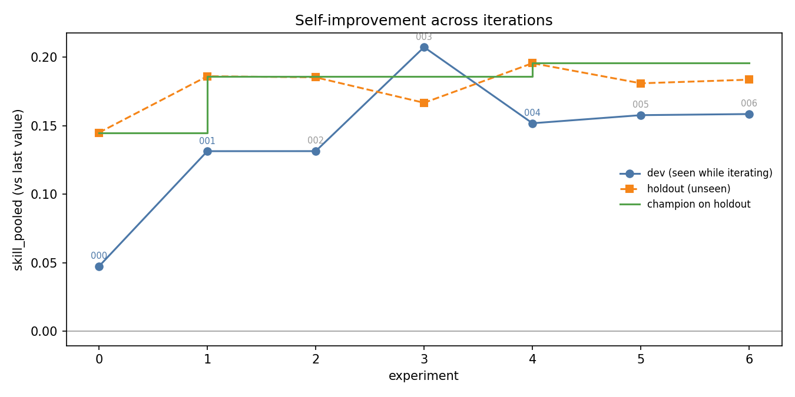

# Research report: experiments

_Written automatically from `ledger.jsonl` by `report.py`. Every number is the ledger's; nothing here is judged by a language model._

## Summary

- 7 experiments: the starting point (exp_000), then 2 kept and 4 rejected.
- Skill vs last value (pooled), DEV: +0.047 at the start (exp_000) → +0.152 for the champion (exp_004).
- HOLDOUT (never used to choose parameters, only as a gate): +0.145 → +0.196.
- Champion interval coverage: DEV 0.65, HOLDOUT 0.73 (target 0.80).
- Rule: keep a change only if DEV improves by at least 0.002 and HOLDOUT does not fall below the champion's.

## All experiments

| id | kept | DEV | HOLDOUT | coverage DEV | hypothesis |
|---|---|---|---|---|---|
| exp_000 | yes | +0.047 | +0.145 | 0.45 | Reference: the starter kit's drift baseline (whole-history empirical random walk), re-run through our walk-... |
| exp_001 | yes | +0.131 | +0.186 | 0.56 | Coverage in is very low at 0.455 (target is 0.80). Skill is higher for longer horizons, and severe undercov... |
| exp_002 | no | +0.131 | +0.185 | 0.56 | coverage_in = 0.562 (target = 0.80), above_q90 = 0.33, below_q10 = 0.11 (too narrow intervals). vol_tail is... |
| exp_003 | no | +0.207 | +0.167 | 0.77 | coverage_in = 0.562 (target = 0.80), coverage above_q90 = 0.33, below_q10 = 0.11: intervals are too narrow ... |
| exp_004 | yes | +0.152 | +0.196 | 0.65 | Enabling calibration with gamma=0.25, scale=0.01, group_by=instrument_class raised dev coverage_in to 0.772... |
| exp_005 | no | +0.158 | +0.181 | 0.69 | Dev coverage_in is 0.6499 (target 0.80), with 0.25 above q90 and 0.10 below q10 (intervals too narrow, skew... |
| exp_006 | no | +0.158 | +0.184 | 0.69 | champion calibrate.gamma=0.25, scale=0.01, group_by=series_id; coverage_in 0.650, above_q90 0.252, below_q1... |

## The path, one experiment at a time

### exp_000: kept

**Hypothesis.** Reference: the starter kit's drift baseline (whole-history empirical random walk), re-run through our walk-forward pipeline on daily origins.

**What changed.** starting point. Model: drift (single; no calibration).

**Decision.** first experiment: becomes the starting champion

**Lesson written to memory.** seed: starting champion for this autonomous run

### exp_001: kept

**Hypothesis.** Coverage in is very low at 0.455 (target is 0.80). Skill is higher for longer horizons, and severe undercoverage is seen for fastgpu_daily|neocloud_rate_card (above q90: 0.535, below: 0.133) and gpurentalprices|neocloud_rate_card (above: 0.503, below: 0.073), with mean_log_err_q50 positive, especially at longer horizons. -> Drift underestimates real market variation, especially for longer horizons and for neocloud_rate_card. Adding the 'vol_tail' model (which adaptively expands predictive intervals using past volatility) should widen and recalibrate intervals, raising coverage toward the 0.80 target with minimal expected skill loss—especially for groups where above-q90 coverage is much too high (ie true values are routinely above the q90). Change: Add vol_tail (window=60, lookback=30, m=10, lo_clip=0.5, hi_clip=2.0) as a second model, combine by mean ensemble. Champion is single drift; this is mean [drift, vol_tail]. DEV sweep of models.1.params.m: 3->+0.1298, 5->+0.1303, 7->+0.1308, 10->+0.1312, 15->+0.1314; chose 15.

**What changed.** adds model `vol_tail`; `combine.method`: single → mean. Model: drift, vol_tail (mean; no calibration).

**Test.** Against champion exp_000: DEV +0.0840, HOLDOUT +0.0411. By horizon (DEV, 1/3/7 days): +0.090 / +0.136 / +0.138.

**Decision.** dev skill_pooled +0.0840 vs champion exp_000 (need >= +0.002); holdout +0.0411 (need >= -0.0)

**Lesson written to memory.** Adding vol_tail and ensembling with drift increased dev skill_pooled from 0.047 to 0.131 and coverage from 0.455 to 0.562 (+0.107), with holdout skill still strong (+0.041 vs champion); next, further widen intervals (e.g. adjust lo_clip/hi_clip or ensemble weights) to approach the 0.80 coverage target without losing skill.

### exp_002: rejected

**Hypothesis.** coverage_in = 0.562 (target = 0.80), above_q90 = 0.33, below_q10 = 0.11 (too narrow intervals). vol_tail is allowed m=10.0 (default 10.0, champion 15) and lo_clip/hi_clip (allowed up to 2.0, at max). The quickest way to further widen intervals across the board is to increase vol_tail.m. -> Increasing vol_tail.m from 15 to 20 will widen the predicted intervals, increasing coverage closer to the 0.80 target, especially reducing the excess above_q90 rate (currently 33%) and below_q10 rate (currently 11%) without degrading skill more than -0.005. Change: Increase vol_tail.m from 15 (champion) to 20. DEV sweep of models.1.params.m: 10->+0.1312, 20->+0.1314; chose 20.

**What changed.** `vol_tail.params`: {'window': 60, 'floor': 1.0, 'lookback': 30, 'm': 15, 'lo_clip': 0.5, 'hi_clip': 2.0} → {'window': 60, 'floor': 1.0, 'lookback': 30, 'm': 20, 'lo_clip': 0.5, 'hi_clip': 2.0}. Model: drift, vol_tail (mean; no calibration).

**Test.** Against champion exp_001: DEV +0.0000, HOLDOUT -0.0008. By horizon (DEV, 1/3/7 days): +0.090 / +0.136 / +0.138.

**Decision.** dev skill_pooled +0.0000 vs champion exp_001 (need >= +0.002); holdout -0.0008 (need >= -0.0)

**Lesson written to memory.** Increasing vol_tail.m from 15 to 20 produced no meaningful change in dev skill (+0.0000 vs champion, holdout -0.0008), and coverage remained at 0.56—well below the 0.80 target—implying that alternative methods besides simply raising vol_tail.m are needed to broaden intervals and improve coverage. Next experiment: test alternate widening strategies or model adjustments.

### exp_003: rejected

**Hypothesis.** coverage_in = 0.562 (target = 0.80), coverage above_q90 = 0.33, below_q10 = 0.11: intervals are too narrow across almost all groups. vol_tail.hi_clip is at the maximum (2.0), m=15 (raising m to 20 had no effect in exp_002). -> The champion's coverage shortfall persists despite wide intervals from vol_tail; direct post-hoc interval calibration can correct systematic undercoverage. Enabling calibration with calibrate.enabled=true and a standard step size should raise coverage toward the 0.80 target, likely improving especially in high-undercoverage series and groups. Change: Enable interval calibration with calibrate.enabled=true (default gamma=0.5, scale=0.01, group_by=instrument_class). DEV sweep of calibrate.gamma: 0.25->+0.2072, 0.5->+0.1672, 1.0->+0.0615, 2.0->-0.2645; chose 0.25.

**What changed.** `calibrate.enabled`: False → True; `calibrate.gamma`: None → 0.25; `calibrate.group_by`: None → instrument_class; `calibrate.scale`: None → 0.01. Model: drift, vol_tail (mean; calibration by instrument_class).

**Test.** Against champion exp_001: DEV +0.0758, HOLDOUT -0.0194. By horizon (DEV, 1/3/7 days): +0.074 / +0.142 / +0.267.

**Decision.** dev skill_pooled +0.0758 vs champion exp_001 (need >= +0.002); holdout -0.0194 (need >= -0.0)

**Lesson written to memory.** Enabling interval calibration increased dev coverage to 0.77 and improved dev skill_pooled by +0.076 vs champion, but holdout skill dropped by -0.019, failing the criterion; the next experiment should focus on improving holdout generalization, possibly by tuning calibration settings or exploring groupings to reduce overfitting.

### exp_004: kept

**Hypothesis.** Enabling calibration with gamma=0.25, scale=0.01, group_by=instrument_class raised dev coverage_in to 0.772 (+0.21 vs champion) and dev skill_pooled to 0.207 (+0.076) but failed the holdout gate (holdout skill -0.019). -> High coverage gain with interval calibration is promising, but generalization was poor—likely due to group_by being set to 'instrument_class' on a small number of large, heterogeneous groups with variable shift and coverage needs. Using 'series_id' should limit overfitting while adjusting intervals more locally, addressing the champion's worst coverage gaps (esp. for e.g. neocloud_rate_card A100/H100 series) and supporting heterogeneous dynamics observed in the diagnosis. Change: Set calibrate.group_by from instrument_class to series_id. DEV sweep of calibrate.group_by: series_id->+0.1517; chose series_id.

**What changed.** `calibrate.enabled`: False → True; `calibrate.gamma`: None → 0.25; `calibrate.group_by`: None → series_id; `calibrate.scale`: None → 0.01. Model: drift, vol_tail (mean; calibration by series_id).

**Test.** Against champion exp_001: DEV +0.0204, HOLDOUT +0.0095. By horizon (DEV, 1/3/7 days): +0.097 / +0.157 / +0.160.

**Decision.** dev skill_pooled +0.0204 vs champion exp_001 (need >= +0.002); holdout +0.0095 (need >= -0.0)

**Lesson written to memory.** Switching calibrate.group_by from instrument_class to series_id improved dev skill_pooled by +0.0204 and holdout skill by +0.0095 versus the champion, with dev coverage_in up +0.087, indicating improved generalization and targeted coverage gains; next, tune gamma and scale to further optimize interval calibration now that group granularity is appropriate.

### exp_005: rejected

**Hypothesis.** Dev coverage_in is 0.6499 (target 0.80), with 0.25 above q90 and 0.10 below q10 (intervals too narrow, skewed above). Series-level calibration was an improvement vs earlier groupings. The only calibration parameter yet untuned is gamma*scale (currently 0.0025 via gamma=0.25, scale=0.01). Diagnosis shows poor coverage especially for fastgpu_daily|neocloud_rate_card (above_q90 0.273, below 0.13; many points above q50), and coverage continues to fall short for the neocloud_rate_card groups. -> Increasing the calibration step size (by raising gamma to 0.5, keeping scale at 0.01 so gamma*scale=0.005) will adapt intervals more aggressively to errors, improving coverage 'in' toward target, especially in groups with the largest miscoverage. Since group_by=series_id already targets the worst-off series, gain in coverage should not come at large cost to skill unless gamma*scale is set very high. Change: Increase calibrate.gamma from 0.25 to 0.5 (scale held at 0.01, so gamma*scale=0.005). DEV sweep of calibrate.gamma: 0.35->+0.1541, 0.5->+0.1574, 0.75->+0.1577; chose 0.75.

**What changed.** `calibrate.gamma`: 0.25 → 0.75. Model: drift, vol_tail (mean; calibration by series_id).

**Test.** Against champion exp_004: DEV +0.0059, HOLDOUT -0.0147. By horizon (DEV, 1/3/7 days): +0.087 / +0.159 / +0.171.

**Decision.** dev skill_pooled +0.0059 vs champion exp_004 (need >= +0.002); holdout -0.0147 (need >= -0.0)

**Lesson written to memory.** Increasing calibrate.gamma to 0.75 (gamma*scale=0.0075) raised dev skill_pooled by +0.0059 and coverage_in by +0.041 to 0.691, but holdout skill_pooled dropped -0.0147 vs the champion; this suggests future experiments should explore smaller gamma*scale or regularization to better trade off coverage gains versus generalization.

### exp_006: rejected

**Hypothesis.** champion calibrate.gamma=0.25, scale=0.01, group_by=series_id; coverage_in 0.650, above_q90 0.252, below_q10 0.098, skill_pooled 0.1517. Tuning gamma*scale upward (0.75*0.01=0.0075 in exp_005) improved dev skill/coverage but failed holdout; lowering gamma*scale not yet tested. -> The current calibration strength (gamma*scale=0.0025) may be insufficient to adapt quickly enough to regime changes and series-level idiosyncrasies, but prior attempt to triple it resulted in overfitting. A moderate increase to gamma=0.5 (product 0.005) should allow better coverage convergence while maintaining holdout generalization. Change: Increase calibrate.gamma from 0.25 to 0.5 (scale still 0.01, group_by series_id), so gamma*scale=0.005. DEV sweep of calibrate.gamma: 0.35->+0.1541, 0.5->+0.1574, 0.65->+0.1585; chose 0.65.

**What changed.** `calibrate.gamma`: 0.25 → 0.65. Model: drift, vol_tail (mean; calibration by series_id).

**Test.** Against champion exp_004: DEV +0.0067, HOLDOUT -0.0120. By horizon (DEV, 1/3/7 days): +0.089 / +0.162 / +0.171.

**Decision.** dev skill_pooled +0.0067 vs champion exp_004 (need >= +0.002); holdout -0.0120 (need >= -0.0)

**Lesson written to memory.** Raising calibrate.gamma to 0.65 improved dev skill_pooled (+0.0067) and coverage (+3.6pp) over champion, but holdout skill dropped substantially (-0.0120), indicating overfitting; next, test intermediate gamma values (0.35–0.5) to seek better holdout generalization.

## What the loop ruled out

- **exp_002**: Increasing vol_tail.m from 15 to 20 produced no meaningful change in dev skill (+0.0000 vs champion, holdout -0.0008), and coverage remained at 0.56—well below the 0.80 target—implying that alternative methods besides simply raising vol_tail.m are needed to broaden intervals and improve coverage. Next experiment: test alternate widening strategies or model adjustments.
- **exp_003**: Enabling interval calibration increased dev coverage to 0.77 and improved dev skill_pooled by +0.076 vs champion, but holdout skill dropped by -0.019, failing the criterion; the next experiment should focus on improving holdout generalization, possibly by tuning calibration settings or exploring groupings to reduce overfitting.
- **exp_005**: Increasing calibrate.gamma to 0.75 (gamma*scale=0.0075) raised dev skill_pooled by +0.0059 and coverage_in by +0.041 to 0.691, but holdout skill_pooled dropped -0.0147 vs the champion; this suggests future experiments should explore smaller gamma*scale or regularization to better trade off coverage gains versus generalization.
- **exp_006**: Raising calibrate.gamma to 0.65 improved dev skill_pooled (+0.0067) and coverage (+3.6pp) over champion, but holdout skill dropped substantially (-0.0120), indicating overfitting; next, test intermediate gamma values (0.35–0.5) to seek better holdout generalization.

## Outside evidence (Exa)

Each iteration searched the web with Exa before proposing, for a method and for dated market news published on or before the run's cutoff. What the proposer said it used:

| experiment | kept | source the proposer relied on | found this turn |
|---|---|---|---|
| exp_001 | yes | none | method 5, market 3 |
| exp_002 | no | none | method 5, market 3 |
| exp_003 | no | https://arxiv.org/html/2207.14219v9 | method 5, market 3 |
| exp_004 | yes | none | method 5, market 3 |
| exp_005 | no | none | method 5, market 3 |
| exp_006 | no | none | method 5, market 3 |

Evidence memory: 8 dated sources in `experiments/evidence.jsonl`.

## Champion by horizon

| horizon | DEV skill | HOLDOUT skill |
|---|---|---|
| 1 day | +0.097 | +0.164 |
| 3 day | +0.157 | +0.241 |
| 7 day | +0.160 | +0.178 |

Champion spec: `experiments/exp_004/spec.json`. Diagnosis: `experiments/exp_004/diagnosis.md`.
