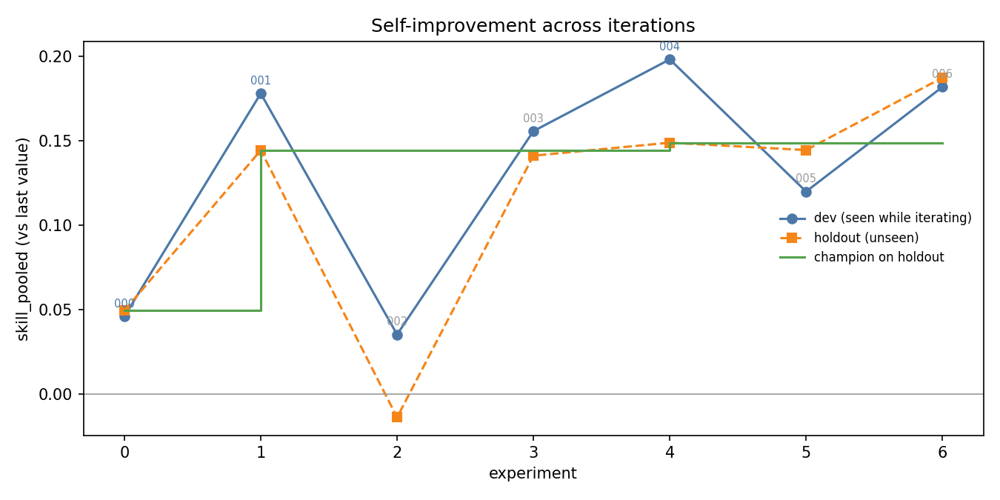

# Research report: experiments

_Written automatically from `ledger.jsonl` by `report.py`. Every number is the ledger's; nothing here is judged by a language model._

## Summary

- 7 experiments: the starting point (exp_000), then 2 kept and 4 rejected.
- Skill vs last value (pooled), DEV: +0.046 at the start (exp_000) → +0.198 for the champion (exp_004).
- HOLDOUT (never used to choose parameters, only as a gate): +0.049 → +0.149.
- Champion interval coverage: DEV 0.72, HOLDOUT 0.84 (target 0.80).
- Rule: keep a change only if DEV improves by at least 0.002 and HOLDOUT does not fall below the champion's.

## All experiments

| id | kept | DEV | HOLDOUT | coverage DEV | hypothesis |
|---|---|---|---|---|---|
| exp_000 | yes | +0.046 | +0.049 | 0.46 | Reference: the starter kit's drift baseline (whole-history empirical random walk), re-run through our walk-... |
| exp_001 | yes | +0.178 | +0.144 | 0.76 | Coverage is much too low: overall in (0.46), above_q90 0.41 and below_q10 0.12. Ideal is 0.80. Some groups ... |
| exp_002 | no | +0.035 | -0.014 | 0.77 | Calibration coverage is still low at 0.758, especially for 'fastgpu_daily/neocloud_rate_card' and 'gpurenta... |
| exp_003 | no | +0.156 | +0.141 | 0.76 | Increasing calibrate.scale from 0.01 to 0.02 caused a drastic skill_pooled drop (-0.143), even though dev c... |
| exp_004 | yes | +0.198 | +0.149 | 0.72 | DEV group fastgpu_daily/neocloud_spot shows below_q10 = 0.163 and above_q90 = 0.228, both much higher than ... |
| exp_005 | no | +0.120 | +0.144 | 0.62 | In the champion, fastgpu_daily/hyperscaler_spot group has skill 0.09 and very high overcoverage (above_q90 ... |
| exp_006 | no | +0.182 | +0.187 | 0.68 | Coverage for the fastgpu_daily/hyperscaler_spot group is too high: above_q90=0.262 and below_q10=0.31 (shou... |

## The path, one experiment at a time

### exp_000: kept

**Hypothesis.** Reference: the starter kit's drift baseline (whole-history empirical random walk), re-run through our walk-forward pipeline on daily origins.

**What changed.** starting point. Model: drift (single; no calibration).

**Decision.** first experiment: becomes the starting champion

**Lesson written to memory.** seed: starting champion for this autonomous run

### exp_001: kept

**Hypothesis.** Coverage is much too low: overall in (0.46), above_q90 0.41 and below_q10 0.12. Ideal is 0.80. Some groups overshoot, but overall intervals are too narrow: e.g. neocloud_rate_card on-demand series are 51-83% above q90. -> Enabling calibration with the default settings (gamma=0.5, scale=0.01) will expand the intervals and improve coverage, especially overall and for 7-day horizons, which are most undercovered (above_q90=0.56). While this may slightly worsen skill, a substantial coverage increase towards the target is likely. Change: Enable calibration with gamma=0.5, scale=0.01 (default) across instrument_class (default group).

**What changed.** `calibrate.enabled`: False → True; `calibrate.gamma`: None → 0.5; `calibrate.group_by`: None → instrument_class; `calibrate.scale`: None → 0.01. Model: drift (single; calibration by instrument_class).

**Test.** Against champion exp_000: DEV +0.1319, HOLDOUT +0.0949. By horizon (DEV, 1/3/7 days): +0.040 / +0.044 / +0.250.

**Decision.** dev skill_pooled +0.1319 vs champion exp_000 (need >= +0.002); holdout +0.0949 (need >= -0.0)

**Lesson written to memory.** Enabling calibration with gamma=0.5, scale=0.01 increased dev skill_pooled by +0.1319 and holdout by +0.0949 over the champion, while improving dev coverage from 0.46 to 0.76—confirming calibration effectively expands intervals and boosts coverage. Next, test tuning the calibration parameters to further improve coverage consistency across groups and horizons without sacrificing skill.

### exp_002: rejected

**Hypothesis.** Calibration coverage is still low at 0.758, especially for 'fastgpu_daily|neocloud_rate_card' and 'gpurentalprices|neocloud_rate_card' (0.071-0.076 below q10, 0.119-0.163 above q90) and 'fastgpu_daily|neocloud_spot' (0.163 below q10). The 0.01 scale is conservative (1% each step). -> Increasing calibrate.scale from 0.01 to 0.02 (keeping gamma fixed) will allow the calibration to adapt intervals more quickly, improving coverage, especially in 'neocloud_rate_card' and 'neocloud_spot' series where intervals remain too tight. Skill should not drop if the effect is not overfitting. Change: calibrate.scale from 0.01 to 0.02

**What changed.** `calibrate.scale`: 0.01 → 0.02. Model: drift (single; calibration by instrument_class).

**Test.** Against champion exp_001: DEV -0.1427, HOLDOUT -0.1581. By horizon (DEV, 1/3/7 days): -0.055 / -0.108 / +0.107.

**Decision.** dev skill_pooled -0.1427 vs champion exp_001 (need >= +0.002); holdout -0.1581 (need >= -0.0)

**Lesson written to memory.** Increasing calibrate.scale from 0.01 to 0.02 raised dev coverage from 0.758 to 0.768 but dropped skill_pooled by -0.143 (holdout: -0.158), failing the acceptance threshold; future experiments should try intermediate scales (e.g., 0.012–0.015) or adaptive scaling to boost coverage without substantial skill loss.

### exp_003: rejected

**Hypothesis.** Increasing calibrate.scale from 0.01 to 0.02 caused a drastic skill_pooled drop (-0.143), even though dev coverage increased from 0.758 to 0.768. Therefore, tuning calibrate.scale in finer increments may boost coverage without tanking skill. The champion (scale=0.01) is too conservative for series like 'fastgpu_daily|neocloud_spot' (dev above_q90 0.228, below_q10 0.163, coverage 0.76) and 'gpurentalprices|neocloud_rate_card'. -> Increasing calibrate.scale modestly from 0.01 to 0.012 (a +20% step) will slightly widen intervals and nudge coverage above 0.76 towards the 0.80 target, particularly improving undercovered regions (e.g., 'fastgpu_daily|neocloud_rate_card' and 'gpurentalprices|neocloud_rate_card') while avoiding the skill collapse seen with a scale jump to 0.02. Change: Increase calibrate.scale from 0.01 to 0.012 (keeping gamma and group_by the same).

**What changed.** `calibrate.scale`: 0.01 → 0.012. Model: drift (single; calibration by instrument_class).

**Test.** Against champion exp_001: DEV -0.0223, HOLDOUT -0.0032. By horizon (DEV, 1/3/7 days): -0.016 / +0.008 / +0.238.

**Decision.** dev skill_pooled -0.0223 vs champion exp_001 (need >= +0.002); holdout -0.0032 (need >= -0.0)

**Lesson written to memory.** Increasing calibrate.scale from 0.01 to 0.012 slightly improved dev coverage (+0.005), but skill_pooled dropped on both dev (-0.022) and holdout (-0.003), failing acceptance criteria; next, try an even smaller scale increase or different regularization to pursue better coverage without sacrificing skill.

### exp_004: kept

**Hypothesis.** DEV group fastgpu_daily|neocloud_spot shows below_q10 = 0.163 and above_q90 = 0.228, both much higher than ideal 0.10; overall coverage is 0.758. Increasing calibrate.scale from 0.01 to 0.012 (exp_003) helped coverage only by 0.005, but dropped skill. The group most overdispersed is fastgpu_daily|neocloud_spot. -> Default calibration applied to instrument_class systematically over- or under-adjusts for some groups. Targeted calibration by source_class may better control coverage for outlier groups like fastgpu_daily|neocloud_spot, improving their interval coverage toward 0.8 without harming overall skill or causing overfitting. Change: Set calibrate.group_by from instrument_class (champion) to source_class. All other settings unchanged.

**What changed.** `calibrate.group_by`: instrument_class → source_class. Model: drift (single; calibration by source_class).

**Test.** Against champion exp_001: DEV +0.0202, HOLDOUT +0.0045. By horizon (DEV, 1/3/7 days): +0.075 / +0.100 / +0.254.

**Decision.** dev skill_pooled +0.0202 vs champion exp_001 (need >= +0.002); holdout +0.0045 (need >= -0.0)

**Lesson written to memory.** Grouping calibration by source_class (instead of instrument_class) increased pooled skill on dev by +0.0202 and on holdout by +0.0045 compared to the champion, though dev coverage fell slightly (0.719 vs 0.758); the next test should explore finer source_class splits or hybrid grouping to balance skill gains with adequate coverage.

### exp_005: rejected

**Hypothesis.** In the champion, fastgpu_daily|hyperscaler_spot group has skill 0.09 and very high overcoverage (above_q90 = 0.262, below_q10 = 0.31). This group exhibits much wider than needed intervals, suggesting miscalibration. -> Calibrating by the more granular group_by='series_id' (instead of 'source_class') will better adapt to per-series error characteristics, especially for outlier series and groups like fastgpu_daily|hyperscaler_spot that are overdispersed at group level but may have series with tighter true intervals. This could tighten coverage toward target and improve skill, especially in overcovered groups. Change: Change calibrate.group_by from 'source_class' to 'series_id'

**What changed.** `calibrate.group_by`: source_class → series_id. Model: drift (single; calibration by series_id).

**Test.** Against champion exp_004: DEV -0.0782, HOLDOUT -0.0044. By horizon (DEV, 1/3/7 days): +0.123 / +0.131 / +0.114.

**Decision.** dev skill_pooled -0.0782 vs champion exp_004 (need >= +0.002); holdout -0.0044 (need >= -0.0)

**Lesson written to memory.** Calibrating by series_id instead of source_class decreased skill_pooled on dev by -0.0782 and slightly on holdout by -0.0044 vs the champion, with lower coverage (dev: 0.62 vs 0.72). This suggests that per-series calibration currently underperforms and needs refinement or alternative granularity for improvement.

### exp_006: rejected

**Hypothesis.** Coverage for the fastgpu_daily|hyperscaler_spot group is too high: above_q90=0.262 and below_q10=0.31 (should be ~0.10 for each). This suggests that the intervals are much too wide, likely due to calibration at the source_class level not addressing overdispersed series within this group. -> Changing calibrate.group_by from source_class to gpu_model may better target groups with miscalibrated and overdispersed intervals, such as fastgpu_daily|hyperscaler_spot, because GPU-specific noise and trends may not be captured at coarser source_class aggregation. This could reduce interval width (improving coverage on that group) while keeping skill_pooled stable. Change: Set calibrate.group_by to gpu_model (keeping all other settings as in the champion).

**What changed.** `calibrate.group_by`: source_class → gpu_model. Model: drift (single; calibration by gpu_model).

**Test.** Against champion exp_004: DEV -0.0163, HOLDOUT +0.0385. By horizon (DEV, 1/3/7 days): +0.108 / +0.160 / +0.199.

**Decision.** dev skill_pooled -0.0163 vs champion exp_004 (need >= +0.002); holdout +0.0385 (need >= -0.0)

**Lesson written to memory.** Setting calibrate.group_by to gpu_model reduced coverage on fastgpu_daily|hyperscaler_spot but decreased dev skill_pooled by -0.0163 vs champion (below threshold), despite a holdout gain of +0.0385. Next, try a hybrid grouping or per-series adjustment to better balance interval width and pooled skill.

## What the loop ruled out

- **exp_002**: Increasing calibrate.scale from 0.01 to 0.02 raised dev coverage from 0.758 to 0.768 but dropped skill_pooled by -0.143 (holdout: -0.158), failing the acceptance threshold; future experiments should try intermediate scales (e.g., 0.012–0.015) or adaptive scaling to boost coverage without substantial skill loss.
- **exp_003**: Increasing calibrate.scale from 0.01 to 0.012 slightly improved dev coverage (+0.005), but skill_pooled dropped on both dev (-0.022) and holdout (-0.003), failing acceptance criteria; next, try an even smaller scale increase or different regularization to pursue better coverage without sacrificing skill.
- **exp_005**: Calibrating by series_id instead of source_class decreased skill_pooled on dev by -0.0782 and slightly on holdout by -0.0044 vs the champion, with lower coverage (dev: 0.62 vs 0.72). This suggests that per-series calibration currently underperforms and needs refinement or alternative granularity for improvement.
- **exp_006**: Setting calibrate.group_by to gpu_model reduced coverage on fastgpu_daily|hyperscaler_spot but decreased dev skill_pooled by -0.0163 vs champion (below threshold), despite a holdout gain of +0.0385. Next, try a hybrid grouping or per-series adjustment to better balance interval width and pooled skill.

## Champion by horizon

| horizon | DEV skill | HOLDOUT skill |
|---|---|---|
| 1 day | +0.075 | +0.061 |
| 3 day | +0.100 | +0.121 |
| 7 day | +0.254 | +0.197 |

Champion spec: `experiments/exp_004/spec.json`. Diagnosis: `experiments/exp_004/diagnosis.md`.
