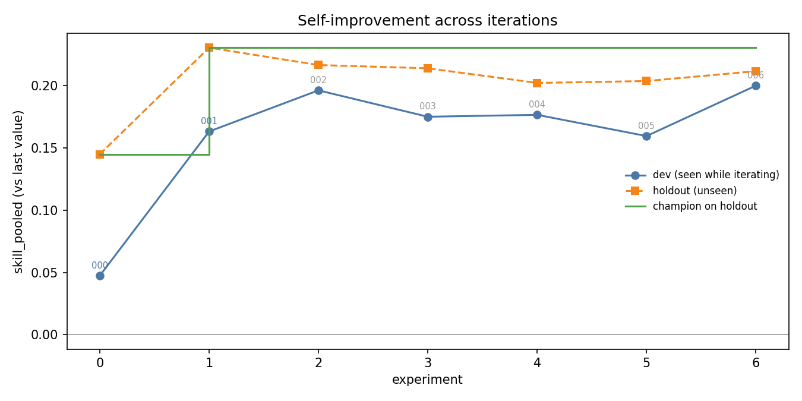

# Research report: experiments

_Written automatically from `ledger.jsonl` by `report.py`. Every number is the ledger's; nothing here is judged by a language model._

## Summary

- 7 experiments: the starting point (exp_000), then 1 kept and 5 rejected.
- Skill vs last value (pooled), DEV: +0.047 at the start (exp_000) → +0.163 for the champion (exp_001).
- HOLDOUT (never used to choose parameters, only as a gate): +0.145 → +0.230.
- Champion interval coverage: DEV 0.79, HOLDOUT 0.85 (target 0.80).
- Rule: keep a change only if DEV improves by at least 0.002 and HOLDOUT does not fall below the champion's.

## All experiments

| id | kept | DEV | HOLDOUT | coverage DEV | hypothesis |
|---|---|---|---|---|---|
| exp_000 | yes | +0.047 | +0.145 | 0.45 | Reference: the starter kit's drift baseline (whole-history empirical random walk), re-run through our walk-... |
| exp_001 | yes | +0.163 | +0.230 | 0.79 | Overall coverage is only 0.455; skill is 0.0474. Coverage above q90 is 0.42 (vs. 0.10 target), below q10 is... |
| exp_002 | no | +0.196 | +0.216 | 0.77 | calibration coverage 0.7896 (target 0.80), calibration gamma=0.5, scale=0.01, group_by=instrument_class. Sm... |
| exp_003 | no | +0.175 | +0.214 | 0.79 | The champion achieves 0.1631 pooled skill with 0.79 coverage, via empirical-drift and calibration by instru... |
| exp_004 | no | +0.176 | +0.202 | 0.76 | champion coverage_in 0.7896; above_q90 0.1188; below_q10 0.0916; overall skill 0.1631; diagnosis shows over... |
| exp_005 | no | +0.159 | +0.204 | 0.78 | calibration coverage_in is 0.7896 (target 0.80), and above_q90/ below_q10 are slightly off: 0.1188 and 0.09... |
| exp_006 | no | +0.200 | +0.212 | 0.76 | Calibration coverage_in is 0.7896 (target 0.80). Some series show persistent undercoverage or overcoverage,... |

## The path, one experiment at a time

### exp_000: kept

**Hypothesis.** Reference: the starter kit's drift baseline (whole-history empirical random walk), re-run through our walk-forward pipeline on daily origins.

**What changed.** starting point. Model: drift (single; no calibration).

**Decision.** first experiment: becomes the starting champion

**Lesson written to memory.** seed: starting champion for this autonomous run

### exp_001: kept

**Hypothesis.** Overall coverage is only 0.455; skill is 0.0474. Coverage above q90 is 0.42 (vs. 0.10 target), below q10 is 0.12 (target 0.10). Coverage by group and horizon shows substantial undercoverage. -> Calibrating the intervals should increase coverage much closer to the target of 0.8 without substantially degrading skill. The largest current failure is dramatic undercoverage (q90: 0.42 vs 0.10; q10: 0.12 vs 0.10). Change: Enable calibration with default gamma=0.5 and scale=0.01, grouping by instrument_class.

**What changed.** `calibrate.enabled`: False → True; `calibrate.gamma`: None → 0.5; `calibrate.group_by`: None → instrument_class; `calibrate.scale`: None → 0.01. Model: drift (single; calibration by instrument_class).

**Test.** Against champion exp_000: DEV +0.1158, HOLDOUT +0.0855. By horizon (DEV, 1/3/7 days): +0.057 / +0.051 / +0.241.

**Decision.** dev skill_pooled +0.1158 vs champion exp_000 (need >= +0.002); holdout +0.0855 (need >= -0.0)

**Lesson written to memory.** Enabling calibration (gamma=0.5, scale=0.01, by instrument_class) raised dev coverage from 0.46 to 0.79 and improved dev skill_pooled by +0.12 (holdout +0.09) vs. champion; next, tune calibration parameters to target coverage more precisely without unnecessary interval widening.

### exp_002: rejected

**Hypothesis.** calibration coverage 0.7896 (target 0.80), calibration gamma=0.5, scale=0.01, group_by=instrument_class. Small remaining undercoverage especially at q10 for some groups. Lowering gamma will slow calibration steps and may get intervals closer to desired coverage without further widening. -> Reducing calibration gamma from 0.5 to 0.3 (keeping scale constant so step size drops from 0.005 to 0.003) will allow finer, less volatile adjustments to interval width, reducing overshoot and helping coverage nudge closer to the 0.80 target, while retaining prior gains. Change: calibrate.gamma from 0.5 to 0.3 (scale remains 0.01, so smaller update step per miss hit).

**What changed.** `calibrate.gamma`: 0.5 → 0.3. Model: drift (single; calibration by instrument_class).

**Test.** Against champion exp_001: DEV +0.0330, HOLDOUT -0.0140. By horizon (DEV, 1/3/7 days): +0.080 / +0.084 / +0.276.

**Decision.** dev skill_pooled +0.0330 vs champion exp_001 (need >= +0.002); holdout -0.0140 (need >= -0.0)

**Lesson written to memory.** Lowering calibration gamma to 0.3 produced improved dev skill (+0.0330), but holdout skill dropped (-0.0140) vs champion, and coverage in dev fell short (0.768 vs target 0.80). Next experiment should focus on boosting holdout generalization and coverage, potentially by tuning calibration step size or group granularity.

### exp_003: rejected

**Hypothesis.** The champion achieves 0.1631 pooled skill with 0.79 coverage, via empirical-drift and calibration by instrument_class. But among base model skills by group, drift performs poorly (e.g., -0.03 and ~0 on fastgpu_daily|hyperscaler_spot and fastgpu_daily|neocloud_spot, respectively). The diagnosis shows strong leading signals (e.g., for fastgpu_daily.neocloud_spot.B200.spot.median, gpurentalprices.neocloud_rate_card.B200.serverless.median at lag=3, corr=-0.97). The leader model, which can use cross-collector signals, is missing. -> Adding a leader model will improve skill for series that have strong leaders (esp. fastgpu and gpurentalprices neocloud series with high lagged correlations), without materially harming coverage, since calibration remains enabled. Combining drift and leader with a simple mean will allow learning from both sources. Change: Add leader model alongside drift; combine by mean.

**What changed.** adds model `leader`; `combine.method`: single → mean. Model: drift, leader (mean; calibration by instrument_class).

**Test.** Against champion exp_001: DEV +0.0118, HOLDOUT -0.0166. By horizon (DEV, 1/3/7 days): +0.043 / +0.152 / +0.213.

**Decision.** dev skill_pooled +0.0118 vs champion exp_001 (need >= +0.002); holdout -0.0166 (need >= -0.0)

**Lesson written to memory.** Adding the leader model improved pooled skill on dev (+0.0118 vs champion), but caused a material drop on holdout (-0.0166), with no meaningful change in coverage; next, explore regularization or gating the leader influence to prevent holdout degradation.

### exp_004: rejected

**Hypothesis.** champion coverage_in 0.7896; above_q90 0.1188; below_q10 0.0916; overall skill 0.1631; diagnosis shows overall skill and coverage are very close to targets, but some groups (notably fastgpu_daily|neocloud_spot, skill=0.211, above_q90=0.161, below_q10=0.124) show substantial interval undercoverage at tails (especially above q90, which should target 0.10). There is also moderate interval overcoverage for gpurentalprices|marketplace_ask (above_q90 0.014, below_q10 0.027; both <0.10). Calibration is currently grouped by instrument_class, possibly missing finer group structure. -> Changing calibration group_by from instrument_class to source_class will allow the online interval correction to better fit series with divergent coverage needs, particularly for fastgpu_daily (high tail undercoverage) and gpurentalprices (overcoverage), improving coverage alignment and possibly interval sharpness. Change: Change calibrate.group_by from 'instrument_class' to 'source_class'.

**What changed.** `calibrate.group_by`: instrument_class → source_class. Model: drift (single; calibration by source_class).

**Test.** Against champion exp_001: DEV +0.0133, HOLDOUT -0.0283. By horizon (DEV, 1/3/7 days): +0.066 / +0.110 / +0.232.

**Decision.** dev skill_pooled +0.0133 vs champion exp_001 (need >= +0.002); holdout -0.0283 (need >= -0.0)

**Lesson written to memory.** Changing calibrate.group_by from instrument_class to source_class improved dev skill_pooled by +0.0133 but reduced holdout skill by -0.0283 versus champion, with slightly lower dev coverage (0.763 vs 0.790), implying the next experiment should continue searching for a grouping that retains dev gains while holding holdout performance steady or improving.

### exp_005: rejected

**Hypothesis.** calibration coverage_in is 0.7896 (target 0.80), and above_q90/ below_q10 are slightly off: 0.1188 and 0.0916. Drift model is the only base, with the strongest coverage shortfall in high-volatility/ fast-changing series (e.g., fastgpu_daily|neocloud_spot: above_q90=0.161, below_q10=0.124, skill=0.211). Previous attempts to tune calibration parameters and change calibrate.group_by led to overfitting or loss in dev coverage. Among available models, composition allows volatility breakout dynamics. Drift alone underperforms in fast-changing series (see negative/near-zero skills there). -> Adding the composition model (default params) alongside drift, averaged, will help capture volatility bursts and outliers, mainly in fast-moving groups (fastgpu_daily|neocloud_spot; fastgpu_daily|hyperscaler_spot). This should slightly improve skill and moderate interval coverage (by providing heavier tails), especially in these volatile segments, without harming overall coverage. Change: Add composition model (default params) and set combine.method to mean.

**What changed.** adds model `composition`; `combine.method`: single → mean. Model: drift, composition (mean; calibration by instrument_class).

**Test.** Against champion exp_001: DEV -0.0037, HOLDOUT -0.0268. By horizon (DEV, 1/3/7 days): -0.029 / +0.129 / +0.213.

**Decision.** dev skill_pooled -0.0037 vs champion exp_001 (need >= +0.002); holdout -0.0268 (need >= -0.0)

**Lesson written to memory.** Adding the composition model (mean of drift and composition) slightly decreased overall skill versus the champion (dev skill_pooled -0.0037), with no improvement in interval coverage (dev coverage_in 0.781 vs 0.790) and a worse holdout delta (-0.0268). For the next experiment, explore selective application of the composition model only to high-volatility series or further tuning combine weights, as global averaging did not yield net gains.

### exp_006: rejected

**Hypothesis.** Calibration coverage_in is 0.7896 (target 0.80). Some series show persistent undercoverage or overcoverage, but step size is fixed at scale=0.01 (1%). Gamma=0.5 (default). Lowering scale will allow finer, less abrupt calibration adjustments that may better home in on 0.8 target without excessive interval broadening. Last gamma-only or group_by-only changes failed to boost generalization; scale has never been tried. -> Reducing calibration scale from 0.01 to 0.005 (gamma=0.5 unchanged) will lead to more stable/gradual interval correction, reducing overshoot and more accurately hitting the 0.80 coverage target (with minimal skill loss). Pooled skill and coverage should improve especially for high-volatility series (e.g. fastgpu_daily|neocloud_spot and neocloud_rate_card), where intervals sometimes overshoot or remain too narrow. Change: Reduce calibrate.scale from 0.01 to 0.005 (all else unchanged).

**What changed.** `calibrate.scale`: 0.01 → 0.005. Model: drift (single; calibration by instrument_class).

**Test.** Against champion exp_001: DEV +0.0368, HOLDOUT -0.0189. By horizon (DEV, 1/3/7 days): +0.078 / +0.092 / +0.278.

**Decision.** dev skill_pooled +0.0368 vs champion exp_001 (need >= +0.002); holdout -0.0189 (need >= -0.0)

**Lesson written to memory.** Reducing calibration scale to 0.005 raised dev skill_pooled (+0.0368), but worsened holdout generalization (skill_pooled –0.0189) and dropped dev coverage_in further from the 0.8 target; future experiments should reconsider this calibration step size or explore adaptive methods to avoid skill drop-off and improve holdout coverage.

## What the loop ruled out

- **exp_002**: Lowering calibration gamma to 0.3 produced improved dev skill (+0.0330), but holdout skill dropped (-0.0140) vs champion, and coverage in dev fell short (0.768 vs target 0.80). Next experiment should focus on boosting holdout generalization and coverage, potentially by tuning calibration step size or group granularity.
- **exp_003**: Adding the leader model improved pooled skill on dev (+0.0118 vs champion), but caused a material drop on holdout (-0.0166), with no meaningful change in coverage; next, explore regularization or gating the leader influence to prevent holdout degradation.
- **exp_004**: Changing calibrate.group_by from instrument_class to source_class improved dev skill_pooled by +0.0133 but reduced holdout skill by -0.0283 versus champion, with slightly lower dev coverage (0.763 vs 0.790), implying the next experiment should continue searching for a grouping that retains dev gains while holding holdout performance steady or improving.
- **exp_005**: Adding the composition model (mean of drift and composition) slightly decreased overall skill versus the champion (dev skill_pooled -0.0037), with no improvement in interval coverage (dev coverage_in 0.781 vs 0.790) and a worse holdout delta (-0.0268). For the next experiment, explore selective application of the composition model only to high-volatility series or further tuning combine weights, as global averaging did not yield net gains.
- **exp_006**: Reducing calibration scale to 0.005 raised dev skill_pooled (+0.0368), but worsened holdout generalization (skill_pooled –0.0189) and dropped dev coverage_in further from the 0.8 target; future experiments should reconsider this calibration step size or explore adaptive methods to avoid skill drop-off and improve holdout coverage.

## Champion by horizon

| horizon | DEV skill | HOLDOUT skill |
|---|---|---|
| 1 day | +0.057 | +0.159 |
| 3 day | +0.051 | +0.274 |
| 7 day | +0.241 | +0.224 |

Champion spec: `experiments/exp_001/spec.json`. Diagnosis: `experiments/exp_001/diagnosis.md`.
