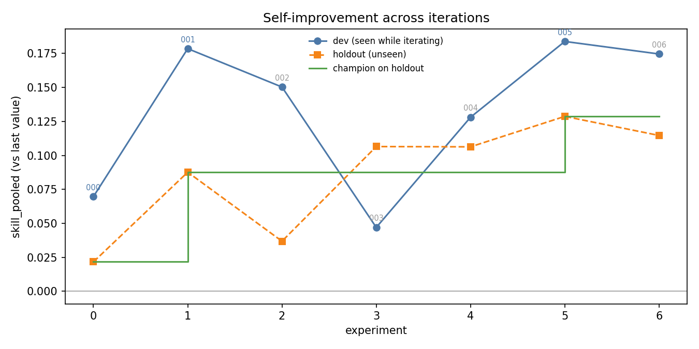

# Research report: experiments

_Written automatically from `ledger.jsonl` by `report.py`. Every number is the ledger's; nothing here is judged by a language model._

## Summary

- 7 experiments: the starting point (exp_000), then 2 kept and 4 rejected.
- Skill vs last value (pooled), DEV: +0.070 at the start (exp_000) → +0.184 for the champion (exp_005).
- HOLDOUT (never used to choose parameters, only as a gate): +0.022 → +0.129.
- Champion interval coverage: DEV 0.80, HOLDOUT 0.76 (target 0.80).
- Rule: keep a change only if DEV improves by at least 0.002 and HOLDOUT does not fall below the champion's.

## All experiments

| id | kept | DEV | HOLDOUT | coverage DEV | hypothesis |
|---|---|---|---|---|---|
| exp_000 | yes | +0.070 | +0.022 | 0.46 | Reference: the starter kit's drift baseline (whole-history empirical random walk), re-run through our walk-... |
| exp_001 | yes | +0.179 | +0.088 | 0.80 | Coverage is low at 0.456 (target 0.80); truth is above q90 in 42% and below q10 in 13% (should be 10% each ... |
| exp_002 | no | +0.150 | +0.037 | 0.65 | The champion's coverage is very close to target (0.8016 vs 0.80) with nearly perfect quantile calibration (... |
| exp_003 | no | +0.047 | +0.107 | 0.80 | Skill worsens with horizon: 0.082 (1d), 0.104 (3d), 0.237 (7d). Horizon 7 has especially high y_above_q50 (... |
| exp_004 | no | +0.128 | +0.106 | 0.81 | skill_pooled=0.1786, skill_worsens_with_horizon (1d=0.082, 7d=0.237), y_above_q50 increases with horizon an... |
| exp_005 | yes | +0.184 | +0.129 | 0.80 | skill on fastgpu_daily/neocloud_spot and fastgpu_daily/hyperscaler_spot is dramatically worse vs other grou... |
| exp_006 | no | +0.175 | +0.115 | 0.79 | Skill is especially poor in fastgpu_daily/neocloud_spot (0.235) and fastgpu_daily/hyperscaler_spot (0.179),... |

## The path, one experiment at a time

### exp_000: kept

**Hypothesis.** Reference: the starter kit's drift baseline (whole-history empirical random walk), re-run through our walk-forward pipeline on daily origins.

**What changed.** starting point. Model: drift (single; no calibration).

**Decision.** first experiment: becomes the starting champion

**Lesson written to memory.** seed: starting champion for this autonomous run

### exp_001: kept

**Hypothesis.** Coverage is low at 0.456 (target 0.80); truth is above q90 in 42% and below q10 in 13% (should be 10% each if calibrated). Skill: dev 0.0697, geomean 0.0606. Best groups are fastgpu_daily|neocloud_spot (skill 0.008) and fastgpu_daily|hyperscaler_spot (0.001). -> Calibrating the drift model using online interval correction (gamma=0.5, scale=0.01, default group_by=instrument_class) will increase coverage closer to the 0.80 target, reduce probabilities of truth above q90/below q10 toward 10%, with only a small increase in pinball loss. Change: Enable interval calibration using gamma 0.5 and scale 0.01, per instrument_class.

**What changed.** `calibrate.enabled`: False → True; `calibrate.gamma`: None → 0.5; `calibrate.group_by`: None → instrument_class; `calibrate.scale`: None → 0.01. Model: drift (single; calibration by instrument_class).

**Test.** Against champion exp_000: DEV +0.1088, HOLDOUT +0.0660. By horizon (DEV, 1/3/7 days): +0.082 / +0.104 / +0.237.

**Decision.** dev skill_pooled +0.1088 vs champion exp_000 (need >= +0.002); holdout +0.0660 (need >= -0.0)

**Lesson written to memory.** Enabling interval calibration with gamma 0.5 and scale 0.01 increased development coverage from 0.456 to 0.802 and improved skill_pooled by +0.1088 (holdout +0.0660) over the champion, implying that further calibration parameter tuning may yield even better interval calibration with minimal loss in skill. Next experiment should test finer values for gamma/scale or alternate groupings to optimize both coverage and skill.

### exp_002: rejected

**Hypothesis.** The champion's coverage is very close to target (0.8016 vs 0.80) with nearly perfect quantile calibration (above_q90: 0.1081, below_q10: 0.0904) and most groups are near 0.10 as desired. However, skill is much worse on longer horizons: skill is 0.082 at horizon 1, 0.104 at 3, and 0.237 at 7. Series with many days since the last change (>30 days: skill -0.008), or in buckets 'fastgpu_daily|neocloud_spot' (0.239), are notably weak. Meanwhile, the champion uses instrument_class for calibration grouping. All drift weights are 1, so grouping doesn't affect model averaging, but should affect calibration.  -> Grouping calibration by series_id instead of instrument_class will allow finer-grained interval correction, benefiting the weak 'worst series' (e.g., those with skill < 0) and series where mean log error bias persists. Most impact should be on series like fastgpu_daily.neocloud_rate_card.H100_SXM_80GB.on_demand.median (skill -0.901), but overall pooled metrics might stay similar due to small n. Change: Change calibrate.group_by from instrument_class to series_id

**What changed.** `calibrate.group_by`: instrument_class → series_id. Model: drift (single; calibration by series_id).

**Test.** Against champion exp_001: DEV -0.0282, HOLDOUT -0.0508. By horizon (DEV, 1/3/7 days): +0.112 / +0.164 / +0.151.

**Decision.** dev skill_pooled -0.0282 vs champion exp_001 (need >= +0.002); holdout -0.0508 (need >= -0.0)

**Lesson written to memory.** Changing calibrate.group_by from instrument_class to series_id reduced pooled dev skill by -0.028 vs champion (holdout -0.051), and coverage worsened (0.65 vs 0.80), implying that finer-grained calibration may have overfit or failed to generalize; future experiments should explore hybrid grouping or regularization to avoid skill and coverage drops.

### exp_003: rejected

**Hypothesis.** Skill worsens with horizon: 0.082 (1d), 0.104 (3d), 0.237 (7d). Horizon 7 has especially high y_above_q50 (0.597), suggesting underconfidence. -> Increasing calibrate.scale from 0.01 to 0.02 (i.e., increasing the speed of interval width adjustment) will help correct delayed reactions to large forecast errors at longer horizons, reducing underconfidence bias especially for 7-day forecasts (where y_above_q50=0.597 and mean_log_err_q50=0.016). This should improve coverage and reduce skill loss at horizon=7, with minimal loss to overall interval calibration due to the already-well-behaved low horizons. Change: Increase calibrate.scale from 0.01 to 0.02 (holding gamma constant).

**What changed.** `calibrate.scale`: 0.01 → 0.02. Model: drift (single; calibration by instrument_class).

**Test.** Against champion exp_001: DEV -0.1316, HOLDOUT +0.0189. By horizon (DEV, 1/3/7 days): +0.018 / -0.129 / +0.143.

**Decision.** dev skill_pooled -0.1316 vs champion exp_001 (need >= +0.002); holdout +0.0189 (need >= -0.0)

**Lesson written to memory.** Increasing calibrate.scale from 0.01 to 0.02 led to a dev skill_pooled decline of -0.132 vs champion, with similar coverage (0.8007 vs 0.8016), implying the adjustment harms pooled skill and that future experiments should test smaller increases or different approaches to correcting underconfidence at longer horizons.

### exp_004: rejected

**Hypothesis.** skill_pooled=0.1786, skill_worsens_with_horizon (1d=0.082, 7d=0.237), y_above_q50 increases with horizon and days since change (e.g., y_above_q50 at 7d=0.597), prior scale=0.01: previous try at scale=0.02 failed, but no smaller increase tried -> A slightly larger step size (scale) for interval calibration (0.015 instead of 0.01) may help correct the underconfidence and slow reactivity seen at longer horizons (where intervals lag behind price changes), without the overreaction and skill collapse seen at 0.02. This should increase skill at 7d, possibly 3d, while maintaining target coverage. Change: Increase calibrate.scale from 0.01 to 0.015, keeping gamma constant.

**What changed.** `calibrate.scale`: 0.01 → 0.015. Model: drift (single; calibration by instrument_class).

**Test.** Against champion exp_001: DEV -0.0505, HOLDOUT +0.0187. By horizon (DEV, 1/3/7 days): +0.042 / +0.049 / +0.186.

**Decision.** dev skill_pooled -0.0505 vs champion exp_001 (need >= +0.002); holdout +0.0187 (need >= -0.0)

**Lesson written to memory.** Increasing calibrate.scale from 0.01 to 0.015 improved holdout skill (+0.0187) but caused a dev skill drop (-0.0505 vs champion) and slightly increased coverage (0.81 vs 0.80), suggesting the step size may now overfit holdout or reduce generalization—next, try scale values between 0.01 and 0.015 to find a better tradeoff.

### exp_005: kept

**Hypothesis.** skill on fastgpu_daily|neocloud_spot and fastgpu_daily|hyperscaler_spot is dramatically worse vs other groups (0.239 and 0.182 vs 0.049 elsewhere); drift base skill in these groups is especially poor (0.008 and 0.001), yet leader signals in the diagnosis table have lagged correlations >0.9 for multiple series. -> Adding the leader model (which uses lagged leading indicators from other data sources at high correlation) to the ensemble will yield a substantial improvement in skill for fastgpu_daily|neocloud_spot and fastgpu_daily|hyperscaler_spot, with potential improvement in overall skill, especially at longer horizons, while maintaining coverage near target. Change: Add leader model to the model list and average (mean) with drift; keep calibration settings unchanged.

**What changed.** adds model `leader`; `combine.method`: single → mean. Model: drift, leader (mean; calibration by instrument_class).

**Test.** Against champion exp_001: DEV +0.0053, HOLDOUT +0.0411. By horizon (DEV, 1/3/7 days): +0.077 / +0.174 / +0.212.

**Decision.** dev skill_pooled +0.0053 vs champion exp_001 (need >= +0.002); holdout +0.0411 (need >= -0.0)

**Lesson written to memory.** Adding the leader model to the ensemble improved dev skill_pooled by +0.0053 (to 0.1839) vs champion and holdout by +0.0411, while maintaining coverage (~0.804), supporting further use and tuning of leader-based signals, with possible focus on longer horizons or optimizing underperforming series.

### exp_006: rejected

**Hypothesis.** Skill is especially poor in fastgpu_daily|neocloud_spot (0.235) and fastgpu_daily|hyperscaler_spot (0.179), where leader (0.25/0.105) strongly outperforms drift (0.008/0.001), but mean weights are fixed at 0.5:0.5. By contrast, in afhubbard|hyperscaler_spot, drift excels (0.174) and leader is much worse (0.115). The coverage and quantile calibration are currently near target (0.804). Mean-weight is not leveraging differences between these base models by group. -> Switching to a hedge ensemble with group_by=instrument_class and eta=2.0 will allow the ensemble to upweight leader or drift where it performs best (e.g., leader in neocloud_spot/rate_card, drift in afhubbard hyperscaler_spot), improving pooled skill by at least 0.005 without harming coverage (~0.80). Change: Change combine.method to hedge, add eta=2.0 and group_by=instrument_class (default).

**What changed.** `combine.eta`: None → 2.0; `combine.group_by`: None → instrument_class; `combine.method`: mean → hedge. Model: drift, leader (hedge; calibration by instrument_class).

**Test.** Against champion exp_005: DEV -0.0092, HOLDOUT -0.0140. By horizon (DEV, 1/3/7 days): +0.087 / +0.163 / +0.199.

**Decision.** dev skill_pooled -0.0092 vs champion exp_005 (need >= +0.002); holdout -0.0140 (need >= -0.0)

**Lesson written to memory.** Switching to group-wise hedge (eta=2.0) reduced pooled skill by -0.009 on dev and -0.014 on holdout compared to champion, with a slight drop in coverage (0.790 vs 0.804), indicating that further tuning (e.g., alternative groupings or eta values) is needed before this ensemble approach can improve overall skill.

## What the loop ruled out

- **exp_002**: Changing calibrate.group_by from instrument_class to series_id reduced pooled dev skill by -0.028 vs champion (holdout -0.051), and coverage worsened (0.65 vs 0.80), implying that finer-grained calibration may have overfit or failed to generalize; future experiments should explore hybrid grouping or regularization to avoid skill and coverage drops.
- **exp_003**: Increasing calibrate.scale from 0.01 to 0.02 led to a dev skill_pooled decline of -0.132 vs champion, with similar coverage (0.8007 vs 0.8016), implying the adjustment harms pooled skill and that future experiments should test smaller increases or different approaches to correcting underconfidence at longer horizons.
- **exp_004**: Increasing calibrate.scale from 0.01 to 0.015 improved holdout skill (+0.0187) but caused a dev skill drop (-0.0505 vs champion) and slightly increased coverage (0.81 vs 0.80), suggesting the step size may now overfit holdout or reduce generalization—next, try scale values between 0.01 and 0.015 to find a better tradeoff.
- **exp_006**: Switching to group-wise hedge (eta=2.0) reduced pooled skill by -0.009 on dev and -0.014 on holdout compared to champion, with a slight drop in coverage (0.790 vs 0.804), indicating that further tuning (e.g., alternative groupings or eta values) is needed before this ensemble approach can improve overall skill.

## Champion by horizon

| horizon | DEV skill | HOLDOUT skill |
|---|---|---|
| 1 day | +0.077 | +0.087 |
| 3 day | +0.174 | +0.045 |
| 7 day | +0.212 | +0.177 |

Champion spec: `experiments/exp_005/spec.json`. Diagnosis: `experiments/exp_005/diagnosis.md`.
