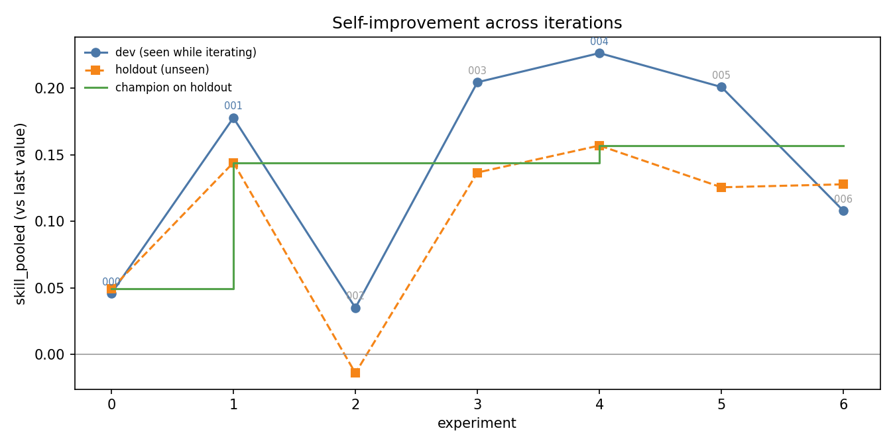

# Research report: experiments

_Written automatically from `ledger.jsonl` by `report.py`. Every number is the ledger's; nothing here is judged by a language model._

## Summary

- 7 experiments: the starting point (exp_000), then 2 kept and 4 rejected.
- Skill vs last value (pooled), DEV: +0.046 at the start (exp_000) → +0.226 for the champion (exp_004).
- HOLDOUT (never used to choose parameters, only as a gate): +0.049 → +0.157.
- Champion interval coverage: DEV 0.73, HOLDOUT 0.83 (target 0.80).
- Rule: keep a change only if DEV improves by at least 0.002 and HOLDOUT does not fall below the champion's.

## All experiments

| id | kept | DEV | HOLDOUT | coverage DEV | hypothesis |
|---|---|---|---|---|---|
| exp_000 | yes | +0.046 | +0.049 | 0.46 | Reference: the starter kit's drift baseline (whole-history empirical random walk), re-run through our walk-... |
| exp_001 | yes | +0.178 | +0.144 | 0.76 | Overall coverage on dev is 0.4626 (well below target 0.80), with truth above q90 in 0.414 and below q10 in ... |
| exp_002 | no | +0.035 | -0.014 | 0.77 | DEV coverage_in is 0.758 (target 0.80); coverage_above_q90 is 0.151 (should be 0.10), and coverage_below_q1... |
| exp_003 | no | +0.205 | +0.137 | 0.75 | By series group: fastgpu_daily/hyperscaler_spot and fastgpu_daily/neocloud_spot have high above_q90 (0.214;... |
| exp_004 | yes | +0.226 | +0.157 | 0.73 | DEV overall coverage is 0.758 (vs target 0.80). Above q90 is 0.151 (should be 0.10), below q10 is 0.08998 (... |
| exp_005 | no | +0.201 | +0.126 | 0.74 | Coverage in champion is 0.733 (target 0.80); above_q90 (0.18 overall) is high, especially in fastgpu_daily/... |
| exp_006 | no | +0.108 | +0.128 | 0.59 | Calibration coverage is systematically too high in fastgpu_daily/hyperscaler_spot (above_q90 0.262, below_q... |

## The path, one experiment at a time

### exp_000: kept

**Hypothesis.** Reference: the starter kit's drift baseline (whole-history empirical random walk), re-run through our walk-forward pipeline on daily origins.

**What changed.** starting point. Model: drift (single; no calibration).

**Decision.** first experiment: becomes the starting champion

**Lesson written to memory.** seed: starting champion for this autonomous run

### exp_001: kept

**Hypothesis.** Overall coverage on dev is 0.4626 (well below target 0.80), with truth above q90 in 0.414 and below q10 in 0.123 (both too high); this strongly indicates undercoverage. Champion calibration is disabled. -> Enabling calibration (with default gamma=0.5, scale=0.01) will widen intervals and correct the obvious undercoverage, increasing overall coverage closer to (but likely still below) target 0.80, particularly reducing the rate above q90 and below q10. Change: Enable calibrate with default gamma and scale.

**What changed.** `calibrate.enabled`: False → True; `calibrate.gamma`: None → 0.5; `calibrate.scale`: None → 0.01. Model: drift (single; calibration by group).

**Test.** Against champion exp_000: DEV +0.1319, HOLDOUT +0.0949. By horizon (DEV, 1/3/7 days): +0.040 / +0.044 / +0.250.

**Decision.** dev skill_pooled +0.1319 vs champion exp_000 (need >= +0.002); holdout +0.0949 (need >= -0.0)

**Lesson written to memory.** Enabling calibration with default parameters increased dev coverage from 0.4626 (champion) to 0.7585 and improved skill_pooled by +0.1319 (holdout +0.0949), suggesting calibration effectively addressed undercoverage. Next, experiment with more aggressive calibration (higher gamma or scale) to further boost coverage to the 0.80 target.

### exp_002: rejected

**Hypothesis.** DEV coverage_in is 0.758 (target 0.80); coverage_above_q90 is 0.151 (should be 0.10), and coverage_below_q10 is 0.08998 (slightly low), so intervals are slightly too tight on the upper end. Prior lesson: enabling calibration with default gamma=0.5, scale=0.01 (exp_001) already significantly improved coverage from 0.4626 to 0.758 and skill. The next step per lesson is more aggressive calibration (higher gamma or scale, but only product matters). Current gamma*scale=0.005. Increasing it may further improve coverage toward target. -> Increasing calibration scale to 0.02 (gamma remains 0.5, gamma*scale=0.01) will further widen intervals, shifting coverage closer to the 0.80 target and reducing q90/q10 miscoverage, without overfitting if gains are real. The largest current coverage gap is above q90 (too high), so widening intervals observed so far brings coverage closer to nominal. Change: calibrate.scale from 0.01 to 0.02 (double interval adjustment step size).

**What changed.** `calibrate.scale`: 0.01 → 0.02. Model: drift (single; calibration by group).

**Test.** Against champion exp_001: DEV -0.1427, HOLDOUT -0.1581. By horizon (DEV, 1/3/7 days): -0.055 / -0.108 / +0.107.

**Decision.** dev skill_pooled -0.1427 vs champion exp_001 (need >= +0.002); holdout -0.1581 (need >= -0.0)

**Lesson written to memory.** Doubling the calibration scale (from 0.01 to 0.02) slightly improved dev coverage (0.767→0.758), but substantially worsened skill_pooled (-0.1427 vs champion) and failed both dev and holdout thresholds; next, try a more moderate incremental increase or investigate alternative calibration curves to balance coverage gains without sacrificing skill.

### exp_003: rejected

**Hypothesis.** By series group: fastgpu_daily|hyperscaler_spot and fastgpu_daily|neocloud_spot have high above_q90 (0.214; 0.228) and below_q10 (0.179; 0.163), and have among the worst skill per-group (0.184; 0.156), but leader models show very high lagged correlation between alternative collectors (e.g., leader corr=0.87 for RTX_6000_Ada). Yet, the champion only uses drift. Past lesson: switching calibration step size directly was too aggressive and overfitted. All combine weights are 1 (single model). -> Adding the leader model (default params) via mean ensemble with drift may help particularly in series with strong cross-collector lagged correlation (e.g., neocloud_rate_card, fastgpu_daily); this should reduce error in series with known leader/lag correlations and could improve coverage if leader forecasts are more timely. Change: Add leader model (default) and combine with drift by mean.

**What changed.** adds model `leader`; `combine.method`: single → mean. Model: drift, leader (mean; calibration by group).

**Test.** Against champion exp_001: DEV +0.0267, HOLDOUT -0.0075. By horizon (DEV, 1/3/7 days): -0.020 / +0.207 / +0.229.

**Decision.** dev skill_pooled +0.0267 vs champion exp_001 (need >= +0.002); holdout -0.0075 (need >= -0.0)

**Lesson written to memory.** The proposed mean ensemble of drift and leader models improved dev skill_pooled by +0.0267 but decreased holdout by -0.0075 versus the champion, with a small drop in coverage, suggesting potential overfitting; next, tune the ensemble method or reweight components to boost generalization, especially on holdout.

### exp_004: kept

**Hypothesis.** DEV overall coverage is 0.758 (vs target 0.80). Above q90 is 0.151 (should be 0.10), below q10 is 0.08998 (nearly right), and coverage is particularly too high for fastgpu_daily|hyperscaler_spot (above_q90 0.214, below_q10 0.179) and fastgpu_daily|neocloud_spot (above_q90 0.228, below_q10 0.163). Previous increase of calibration scale from 0.01 to 0.02 hurt skill, likely overcompensating. Default calibration gamma*scale=0.005; previous lesson is that nudging these parameters has impact. -> Current calibration is slightly too timid to push above q90 coverage (0.151, target 0.10) down while also improving overall coverage, especially in fastgpu_daily|hyperscaler_spot and fastgpu_daily|neocloud_spot. Reducing calibration step size (gamma from 0.5 to 0.3, keeping scale at 0.01) will apply corrections more gradually, potentially making the intervals less wide overall and bringing the upper tail in line, improving overfitting risk exhibited in exp_002. Change: Reduce calibration gamma from 0.5 to 0.3 (scale remains 0.01)

**What changed.** `calibrate.gamma`: 0.5 → 0.3. Model: drift (single; calibration by group).

**Test.** Against champion exp_001: DEV +0.0486, HOLDOUT +0.0128. By horizon (DEV, 1/3/7 days): +0.070 / +0.089 / +0.303.

**Decision.** dev skill_pooled +0.0486 vs champion exp_001 (need >= +0.002); holdout +0.0128 (need >= -0.0)

**Lesson written to memory.** The new experiment outperformed the champion, improving dev pooled skill by +0.0486 and holdout by +0.0128, while dev coverage_in decreased to 0.733 (from 0.758), indicating tighter intervals but with excess coverage above q90, especially for fastgpu_daily|hyperscaler_spot and neocloud_spot; next, a smaller calibration gamma will be tested to more gradually correct and target desired over/under coverage without overly widening intervals.

### exp_005: rejected

**Hypothesis.** Coverage in champion is 0.733 (target 0.80); above_q90 (0.18 overall) is high, especially in fastgpu_daily|hyperscaler_spot (0.262) and fastgpu_daily|neocloud_spot (0.255), while below_q10 (0.09) is slightly low. Prior experiments show calibration scale 0.01 is safe, scale 0.02 overfits, and that decreasing gamma from 0.5 to 0.3 (at scale 0.01) tightened intervals but dropped coverage. -> Increasing calibration gamma to 0.4 (from 0.3, keeping scale at 0.01) will slightly widen intervals, recovering some coverage toward 0.80 overall without substantial overfitting or skill loss. This should reduce above_q90 counts (especially in fastgpu_daily|hyperscaler_spot and neocloud_spot) and increase coverage_in, while maintaining pinball skill gains seen in exp_004. Change: Increase calibrate.gamma from 0.3 to 0.4 (keep scale 0.01).

**What changed.** `calibrate.gamma`: 0.3 → 0.4. Model: drift (single; calibration by group).

**Test.** Against champion exp_004: DEV -0.0255, HOLDOUT -0.0313. By horizon (DEV, 1/3/7 days): +0.050 / +0.064 / +0.277.

**Decision.** dev skill_pooled -0.0255 vs champion exp_004 (need >= +0.002); holdout -0.0313 (need >= -0.0)

**Lesson written to memory.** Increasing calibrate.gamma to 0.4 slightly improved coverage on dev (0.742 vs 0.733), but caused a significant skill_pooled drop on both dev (-0.0255) and holdout (-0.0313) relative to the champion, so further widening of intervals is not advisable; the next experiment should explore alternative ways to raise coverage, such as segment-specific calibration or targeted interval expansion, rather than increasing gamma.

### exp_006: rejected

**Hypothesis.** Calibration coverage is systematically too high in fastgpu_daily|hyperscaler_spot (above_q90 0.262, below_q10 0.202) and fastgpu_daily|neocloud_spot (above_q90 0.255, below_q10 0.163), yet the overall champion calibration is applied pool-wide. Previous attempts to increase wideness (gamma/scale) led to worse skill and did not substantially reduce the excess outlier coverage where most needed. Calibration group tuning is untried. -> Using calibration grouped by series_id will allow calibration to respond specifically to the worst over/undercalibrated series (like fastgpu_daily|hyperscaler_spot and fastgpu_daily|neocloud_spot), yielding better coverage for those series (closer to 0.10 at q90/q10) without widening intervals for already well-calibrated series, thus improving pooled skill or reducing coverage misses. Change: Set calibrate.group_by to series_id (previously not set, so defaulted to instrument_class); all other champion settings unchanged.

**What changed.** `calibrate.group_by`: None → series_id. Model: drift (single; calibration by series_id).

**Test.** Against champion exp_004: DEV -0.1185, HOLDOUT -0.0291. By horizon (DEV, 1/3/7 days): +0.122 / +0.126 / +0.099.

**Decision.** dev skill_pooled -0.1185 vs champion exp_004 (need >= +0.002); holdout -0.0291 (need >= -0.0)

**Lesson written to memory.** Grouping calibration by series_id reduced pooled skill (dev -0.1185, holdout -0.0291 vs champion) and coverage_in (dev 0.59 vs 0.73), indicating that more targeted or hybrid grouping approaches should be tested rather than strict series-level groupings.

## What the loop ruled out

- **exp_002**: Doubling the calibration scale (from 0.01 to 0.02) slightly improved dev coverage (0.767→0.758), but substantially worsened skill_pooled (-0.1427 vs champion) and failed both dev and holdout thresholds; next, try a more moderate incremental increase or investigate alternative calibration curves to balance coverage gains without sacrificing skill.
- **exp_003**: The proposed mean ensemble of drift and leader models improved dev skill_pooled by +0.0267 but decreased holdout by -0.0075 versus the champion, with a small drop in coverage, suggesting potential overfitting; next, tune the ensemble method or reweight components to boost generalization, especially on holdout.
- **exp_005**: Increasing calibrate.gamma to 0.4 slightly improved coverage on dev (0.742 vs 0.733), but caused a significant skill_pooled drop on both dev (-0.0255) and holdout (-0.0313) relative to the champion, so further widening of intervals is not advisable; the next experiment should explore alternative ways to raise coverage, such as segment-specific calibration or targeted interval expansion, rather than increasing gamma.
- **exp_006**: Grouping calibration by series_id reduced pooled skill (dev -0.1185, holdout -0.0291 vs champion) and coverage_in (dev 0.59 vs 0.73), indicating that more targeted or hybrid grouping approaches should be tested rather than strict series-level groupings.

## Champion by horizon

| horizon | DEV skill | HOLDOUT skill |
|---|---|---|
| 1 day | +0.070 | +0.085 |
| 3 day | +0.089 | +0.078 |
| 7 day | +0.303 | +0.231 |

Champion spec: `experiments/exp_004/spec.json`. Diagnosis: `experiments/exp_004/diagnosis.md`.
