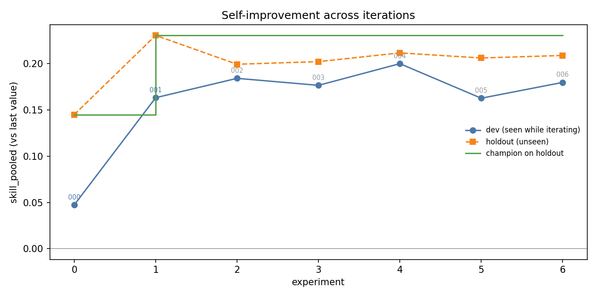

# Research report: experiments

_Written automatically from `ledger.jsonl` by `report.py`. Every number is the ledger's; nothing here is judged by a language model._

## Summary

- 7 experiments: the starting point (exp_000), then 1 kept and 5 rejected.
- Skill vs last value (pooled), DEV: +0.047 at the start (exp_000) → +0.163 for the champion (exp_001).
- HOLDOUT (never used to choose parameters, only as a gate): +0.145 → +0.230.
- Champion interval coverage: DEV 0.79, HOLDOUT 0.85 (target 0.80).
- Rule: keep a change only if DEV improves by at least 0.002 and HOLDOUT does not fall below the champion's.

## All experiments

| id | kept | DEV | HOLDOUT | coverage DEV | hypothesis |
|---|---|---|---|---|---|
| exp_000 | yes | +0.047 | +0.145 | 0.45 | Reference: the starter kit's drift baseline (whole-history empirical random walk), re-run through our walk-... |
| exp_001 | yes | +0.163 | +0.230 | 0.79 | Overall skill 0.0474; coverage_in 0.454958; coverage_above_q90 0.420515; coverage_below_q10 0.124527. The i... |
| exp_002 | no | +0.184 | +0.199 | 0.70 | Coverage is now at 0.7896 (up from 0.45) using calibrate (gamma=0.5, scale=0.01, group_by=instrument_class)... |
| exp_003 | no | +0.176 | +0.202 | 0.76 | Calibration is by instrument_class (champion), but gpu_model grouping (exp_002) overfit: skill_pooled rose ... |
| exp_004 | no | +0.200 | +0.212 | 0.76 | Coverage by horizon is low at 1d (0.32), 3d (0.475), and 7d (0.601); overall coverage_in improved from 0.45... |
| exp_005 | no | +0.163 | +0.206 | 0.79 | champion calibrate.group_by=instrument_class obtains coverage_in 0.790 (dev). Exp_002 (gpu_model) and exp_0... |
| exp_006 | no | +0.180 | +0.209 | 0.77 | By horizon: skill at 1d is 0.057, at 3d is 0.051, at 7d is 0.241; interval coverage: 1d-0.32, 3d-0.475, 7d-... |

## The path, one experiment at a time

### exp_000: kept

**Hypothesis.** Reference: the starter kit's drift baseline (whole-history empirical random walk), re-run through our walk-forward pipeline on daily origins.

**What changed.** starting point. Model: drift (single; no calibration).

**Decision.** first experiment: becomes the starting champion

**Lesson written to memory.** seed: starting champion for this autonomous run

### exp_001: kept

**Hypothesis.** Overall skill 0.0474; coverage_in 0.454958; coverage_above_q90 0.420515; coverage_below_q10 0.124527. The interval coverage is far too low (should target 0.80), and is under-dispersed at both tails. By horizon: coverage at 1d is only 0.32, at 3d is 0.475, at 7d is 0.601 -- all much too low. The mean_log_err_q50 is near zero, so there's not a big median bias; the core problem is narrow intervals. By group, only fastgpu_daily|hyperscaler_spot and afhubbard|hyperscaler_spot are significantly off in skill, but coverage is bad everywhere. -> Enabling interval calibration (default gamma=0.5, scale=0.01, grouped by instrument_class) will widen intervals and push coverage closer to the 0.80 target, reducing skill due to increased average pinball loss, but addressing the most pressing issue: gross undercoverage. Change: Enable calibration with default gamma=0.5, scale=0.01, group_by=instrument_class.

**What changed.** `calibrate.enabled`: False → True; `calibrate.gamma`: None → 0.5; `calibrate.group_by`: None → instrument_class; `calibrate.scale`: None → 0.01. Model: drift (single; calibration by instrument_class).

**Test.** Against champion exp_000: DEV +0.1158, HOLDOUT +0.0855. By horizon (DEV, 1/3/7 days): +0.057 / +0.051 / +0.241.

**Decision.** dev skill_pooled +0.1158 vs champion exp_000 (need >= +0.002); holdout +0.0855 (need >= -0.0)

**Lesson written to memory.** Interval calibration (gamma=0.5, scale=0.01 by instrument_class) improved coverage_in to 0.79 (up from 0.45) while boosting dev skill_pooled by +0.1158 and holdout by +0.0855 vs the champion; the next experiment should confirm stability of coverage across groups and tune calibration strength to further balance coverage and skill.

### exp_002: rejected

**Hypothesis.** Coverage is now at 0.7896 (up from 0.45) using calibrate (gamma=0.5, scale=0.01, group_by=instrument_class) on drift, with skill_pooled up to 0.1631 from 0.0474. However, there are still signs of over-dispersed intervals on some instrument_class subgroups (e.g. gpurentalprices|neocloud_rate_card: coverage_below_q10=0.069, above_q90=0.135), while fastgpu_daily|hyperscaler_spot shows coverage_below_q10=0.138, above_q90=0.138. This suggests some calibration heterogeneity at finer granularity. By gpu_model may match the idiosyncrasy in series coverage more closely. -> Calibrating intervals by gpu_model (rather than instrument_class) will improve interval coverage for clusters that remain miscalibrated (e.g. gpurentalprices|neocloud_rate_card and fastgpu_daily|hyperscaler_spot), by accounting for hardware-specific variance, and may yield a small skill improvement (>0.005), without degrading pooled coverage. Change: Set calibrate.group_by to gpu_model (was instrument_class).

**What changed.** `calibrate.group_by`: instrument_class → gpu_model. Model: drift (single; calibration by gpu_model).

**Test.** Against champion exp_001: DEV +0.0209, HOLDOUT -0.0312. By horizon (DEV, 1/3/7 days): +0.092 / +0.168 / +0.211.

**Decision.** dev skill_pooled +0.0209 vs champion exp_001 (need >= +0.002); holdout -0.0312 (need >= -0.0)

**Lesson written to memory.** Calibrating by gpu_model raised dev skill_pooled to 0.1841 (+0.0209 vs champion) but decreased dev coverage to 0.7021 (-0.0874), and failed holdout (-0.0312 vs needed ≥ 0.0); for the next experiment, explore hybrid grouping (e.g., group_by both gpu_model and instrument_class) to reduce miscalibration without sacrificing overall coverage or holdout skill.

### exp_003: rejected

**Hypothesis.** Calibration is by instrument_class (champion), but gpu_model grouping (exp_002) overfit: skill_pooled rose 0.021 to 0.1841 but coverage_in fell by 0.087 to 0.702. -> Calibrating by source_class, instead of instrument_class, may sidestep overfitting seen with gpu_model while still improving coverage calibration for classes such as neocloud_rate_card (where above_q90=0.135, below_q10=0.069) and hyperscaler_spot (where both tails are too low). Stronger calibration at a coarser but relevant class may produce more consistent 80% coverage across source classes, ideally without overshrinking intervals. Change: Change calibrate.group_by from 'instrument_class' to 'source_class'.

**What changed.** `calibrate.group_by`: instrument_class → source_class. Model: drift (single; calibration by source_class).

**Test.** Against champion exp_001: DEV +0.0133, HOLDOUT -0.0283. By horizon (DEV, 1/3/7 days): +0.066 / +0.110 / +0.232.

**Decision.** dev skill_pooled +0.0133 vs champion exp_001 (need >= +0.002); holdout -0.0283 (need >= -0.0)

**Lesson written to memory.** Calibrating by gpu_model in exp_002 overfit: dev skill_pooled improved by +0.0133 vs champion but holdout dropped by -0.0283, while coverage_in decreased on dev; next, calibrate by source_class, a coarser grouping, to potentially avoid overfitting while improving consistent coverage across source classes.

### exp_004: rejected

**Hypothesis.** Coverage by horizon is low at 1d (0.32), 3d (0.475), and 7d (0.601); overall coverage_in improved from 0.45 to 0.79 with instrument_class calibration. Previous exp_002 using gpu_model for group_by overfit (coverage_in dropped to 0.702); exp_003 with group_by source_class also caused a slight dev coverage drop (0.763) and failed holdout. Strength of calibration is still at gamma=0.5, scale=0.01 (product: 0.005). -> The champion's calibration (gamma=0.5, scale=0.01 = 0.005) increased interval width enough to reach coverage targets, but may be slightly too aggressive, as skill_pooled is moderately high. Reducing calibration strength (gamma=0.25, scale=0.01 = 0.0025) by half, while keeping group_by = instrument_class, should tighten intervals and improve skill_pooled with minimal loss in coverage, especially at longer horizons where intervals may now be wider than required. Change: Reduce calibrate.gamma from 0.5 to 0.25 (scale fixed at 0.01)

**What changed.** `calibrate.gamma`: 0.5 → 0.25. Model: drift (single; calibration by instrument_class).

**Test.** Against champion exp_001: DEV +0.0368, HOLDOUT -0.0189. By horizon (DEV, 1/3/7 days): +0.078 / +0.092 / +0.278.

**Decision.** dev skill_pooled +0.0368 vs champion exp_001 (need >= +0.002); holdout -0.0189 (need >= -0.0)

**Lesson written to memory.** Reducing calibrate.gamma to 0.25 increased dev skill_pooled (+0.037 vs champion) and tightened intervals (dev coverage_in 0.76 vs 0.79), but resulted in holdout skill_pooled dropping below threshold (-0.019 vs 0). Next, try a smaller gamma reduction (e.g., gamma=0.35) or tune scale to balance coverage retention and generalization.

### exp_005: rejected

**Hypothesis.** champion calibrate.group_by=instrument_class obtains coverage_in 0.790 (dev). Exp_002 (gpu_model) and exp_003 (source_class) overfit: both raised skill but dropped coverage below target (to 0.702/0.763). Exp_004 reduced gamma to 0.25 (same group) and slightly boosted skill, but also reduced coverage below the target (0.758). Champion's coverage is closest to ideal, but the skill is not highest among available models. -> The 'composition' model outperformed 'drift' in all but the smallest groups when examined as a base model (dev skill: drift 0.073 vs composition 0.101 in gpurentalprices|neocloud_rate_card; drift 0.023 vs composition 0.074 in fastgpu_daily|neocloud_rate_card, etc.). Using 'composition' in place of 'drift' in the champion pipeline (calibrate by instrument_class) should raise skill_pooled, potentially above 0.17 (from 0.163), while keeping coverage near 0.79. Change: Replace the model in the champion pipeline: use 'composition' (window=60, all defaults) instead of 'drift'. Keep calibrate settings fixed (enabled: true, group_by: instrument_class, gamma: 0.5, scale: 0.01).

**What changed.** adds model `composition`; drops model `drift`. Model: composition (single; calibration by instrument_class).

**Test.** Against champion exp_001: DEV -0.0006, HOLDOUT -0.0244. By horizon (DEV, 1/3/7 days): -0.071 / +0.134 / +0.224.

**Decision.** dev skill_pooled -0.0006 vs champion exp_001 (need >= +0.002); holdout -0.0244 (need >= -0.0)

**Lesson written to memory.** Replacing 'drift' with 'composition' in the champion pipeline slightly reduced dev skill_pooled (0.1626 vs 0.1632) and didn't improve holdout results, while coverage remained stable (0.788 vs 0.790). The next experiment should focus on model parameter tuning or feature engineering, as model swap alone did not deliver the expected skill gains.

### exp_006: rejected

**Hypothesis.** By horizon: skill at 1d is 0.057, at 3d is 0.051, at 7d is 0.241; interval coverage: 1d-0.32, 3d-0.475, 7d-0.601 (all under target 0.80). Calibration params are gamma=0.5, scale=0.01. Reducing gamma to 0.25 (exp_004) led to skill_pooled +0.037 but coverage_in down to 0.758. A smaller adjustment (gamma=0.35) may nudge coverage up toward 0.80 without over-tightening intervals or harming skill. -> The current calibration step size (gamma=0.5) might be slightly too aggressive, resulting in intervals that are close to (but not at) the desired coverage. Reducing gamma to 0.35 (with scale=0.01) will slow calibration, possibly increasing coverage and improving stability, while keeping intervals tight enough to maintain skill. Change: Reduce calibrate.gamma from 0.5 to 0.35; all else unchanged.

**What changed.** `calibrate.gamma`: 0.5 → 0.35. Model: drift (single; calibration by instrument_class).

**Test.** Against champion exp_001: DEV +0.0165, HOLDOUT -0.0217. By horizon (DEV, 1/3/7 days): +0.073 / +0.057 / +0.262.

**Decision.** dev skill_pooled +0.0165 vs champion exp_001 (need >= +0.002); holdout -0.0217 (need >= -0.0)

**Lesson written to memory.** The experiment increased dev skill_pooled by +0.0165 versus the champion but lost -0.0217 in holdout and showed a slight drop in coverage (0.771 vs 0.790); next, test a more conservative gamma adjustment or methods to better generalize coverage gains from dev to holdout.

## What the loop ruled out

- **exp_002**: Calibrating by gpu_model raised dev skill_pooled to 0.1841 (+0.0209 vs champion) but decreased dev coverage to 0.7021 (-0.0874), and failed holdout (-0.0312 vs needed ≥ 0.0); for the next experiment, explore hybrid grouping (e.g., group_by both gpu_model and instrument_class) to reduce miscalibration without sacrificing overall coverage or holdout skill.
- **exp_003**: Calibrating by gpu_model in exp_002 overfit: dev skill_pooled improved by +0.0133 vs champion but holdout dropped by -0.0283, while coverage_in decreased on dev; next, calibrate by source_class, a coarser grouping, to potentially avoid overfitting while improving consistent coverage across source classes.
- **exp_004**: Reducing calibrate.gamma to 0.25 increased dev skill_pooled (+0.037 vs champion) and tightened intervals (dev coverage_in 0.76 vs 0.79), but resulted in holdout skill_pooled dropping below threshold (-0.019 vs 0). Next, try a smaller gamma reduction (e.g., gamma=0.35) or tune scale to balance coverage retention and generalization.
- **exp_005**: Replacing 'drift' with 'composition' in the champion pipeline slightly reduced dev skill_pooled (0.1626 vs 0.1632) and didn't improve holdout results, while coverage remained stable (0.788 vs 0.790). The next experiment should focus on model parameter tuning or feature engineering, as model swap alone did not deliver the expected skill gains.
- **exp_006**: The experiment increased dev skill_pooled by +0.0165 versus the champion but lost -0.0217 in holdout and showed a slight drop in coverage (0.771 vs 0.790); next, test a more conservative gamma adjustment or methods to better generalize coverage gains from dev to holdout.

## Champion by horizon

| horizon | DEV skill | HOLDOUT skill |
|---|---|---|
| 1 day | +0.057 | +0.159 |
| 3 day | +0.051 | +0.274 |
| 7 day | +0.241 | +0.224 |

Champion spec: `experiments/exp_001/spec.json`. Diagnosis: `experiments/exp_001/diagnosis.md`.
