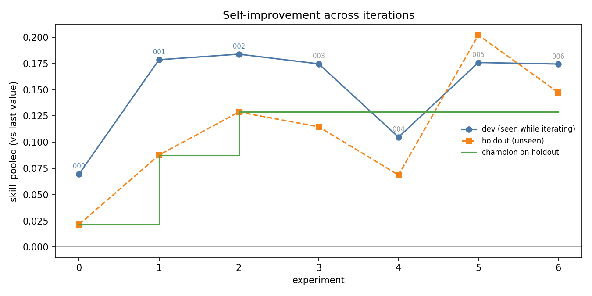

# Research report: experiments

_Written automatically from `ledger.jsonl` by `report.py`. Every number is the ledger's; nothing here is judged by a language model._

## Summary

- 7 experiments: the starting point (exp_000), then 2 kept and 4 rejected.
- Skill vs last value (pooled), DEV: +0.070 at the start (exp_000) → +0.184 for the champion (exp_002).
- HOLDOUT (never used to choose parameters, only as a gate): +0.022 → +0.129.
- Champion interval coverage: DEV 0.80, HOLDOUT 0.76 (target 0.80).
- Rule: keep a change only if DEV improves by at least 0.002 and HOLDOUT does not fall below the champion's.

## All experiments

| id | kept | DEV | HOLDOUT | coverage DEV | hypothesis |
|---|---|---|---|---|---|
| exp_000 | yes | +0.070 | +0.022 | 0.46 | Reference: the starter kit's drift baseline (whole-history empirical random walk), re-run through our walk-... |
| exp_001 | yes | +0.179 | +0.088 | 0.80 | Coverage is too low (overall 0.456; q90=0.418, q10=0.126), far from the target 0.80. All series use drift o... |
| exp_002 | yes | +0.184 | +0.129 | 0.80 | Skill and coverage are much lower in fastgpu_daily/hyperscaler_spot (skill 0.182; coverage below_q10 0.228,... |
| exp_003 | no | +0.175 | +0.115 | 0.79 | By group, drift underperforms leader in all but gpurentalprices/marketplace_ask (drift=0.179, leader=0.194)... |
| exp_004 | no | +0.105 | +0.069 | 0.79 | Coverage is slightly high on q10 (below_q10 0.0909; target 0.10) and slightly low on q90 (above_q90 0.1051;... |
| exp_005 | no | +0.176 | +0.202 | 0.80 | dev skill for fastgpu_daily/neocloud_spot (0.235) and fastgpu_daily/neocloud_rate_card (0.196) is much wors... |
| exp_006 | no | +0.174 | +0.147 | 0.80 | The mean ensemble gives equal weights to drift and leader in all groups, yet the leader model strongly outp... |

## The path, one experiment at a time

### exp_000: kept

**Hypothesis.** Reference: the starter kit's drift baseline (whole-history empirical random walk), re-run through our walk-forward pipeline on daily origins.

**What changed.** starting point. Model: drift (single; no calibration).

**Decision.** first experiment: becomes the starting champion

**Lesson written to memory.** seed: starting champion for this autonomous run

### exp_001: kept

**Hypothesis.** Coverage is too low (overall 0.456; q90=0.418, q10=0.126), far from the target 0.80. All series use drift only, and over-confident tails are evident across nearly every group and horizon (esp. q90 coverage: 0.332 at 1d, 0.494 at 7d vs 0.90 desired). -> Enabling interval calibration with a small but nonzero update should increase the tail coverage (especially above q90), helping to approach the 0.80 target, with minimal risk of degrading point or median skill. Calibration should not harm the skill as long as adjustments are moderate. Change: Enable online calibration with gamma=0.5, scale=0.01 (default: gamma*scale=0.005) and group_by=instrument_class (default).

**What changed.** `calibrate.enabled`: False → True; `calibrate.gamma`: None → 0.5; `calibrate.group_by`: None → instrument_class; `calibrate.scale`: None → 0.01. Model: drift (single; calibration by instrument_class).

**Test.** Against champion exp_000: DEV +0.1088, HOLDOUT +0.0660. By horizon (DEV, 1/3/7 days): +0.082 / +0.104 / +0.237.

**Decision.** dev skill_pooled +0.1088 vs champion exp_000 (need >= +0.002); holdout +0.0660 (need >= -0.0)

**Lesson written to memory.** Enabling online interval calibration (gamma=0.5, scale=0.01) improved dev pooled skill by +0.1088 and holdout by +0.0660 versus the champion, raising in-sample coverage from 0.456 to 0.802; this suggests that online calibration substantially improves tail coverage and skill, so the next experiment can explore tuning gamma/scale parameters or coverage targets for even better balance.

### exp_002: kept

**Hypothesis.** Skill and coverage are much lower in fastgpu_daily|hyperscaler_spot (skill 0.182; coverage below_q10 0.228, above_q90 0.111), versus afhubbard|hyperscaler_spot (skill 0.049; below_q10 0.049, above_q90 0.06). All use 'drift' only, but some series show lead-lag correlation (e.g., fastgpu_daily.neocloud_rate_card.RTX_A6000 has gpurentalprices.neocloud_rate_card.RTX_A6000 as a leader at lag 3, corr -0.924), and 'leader' is not yet tried. -> Adding the leader model as a second base (with default window=60, floor=1.0, beta=1.0) and combining by mean will improve skill and calibration. Strong cross-source lead signals (e.g., -0.924 at lag 3) should reduce error and over-uncertainty, especially for series with high correlations noted. Change: Add leader as a second model; switch combine.method from single to mean (equal weights, no eta/group_by).

**What changed.** adds model `leader`; `combine.method`: single → mean. Model: drift, leader (mean; calibration by instrument_class).

**Test.** Against champion exp_001: DEV +0.0053, HOLDOUT +0.0411. By horizon (DEV, 1/3/7 days): +0.077 / +0.174 / +0.212.

**Decision.** dev skill_pooled +0.0053 vs champion exp_001 (need >= +0.002); holdout +0.0411 (need >= -0.0)

**Lesson written to memory.** Adding a leader-based model and mean combination improved dev skill_pooled by +0.0053 and holdout by +0.0411 versus the champion, with in-coverage stable at 0.80; next, explore tuning the combine weights (eta) or group_by to leverage heterogeneity across series.

### exp_003: rejected

**Hypothesis.** By group, drift underperforms leader in all but gpurentalprices|marketplace_ask (drift=0.179, leader=0.194) and afhubbard|hyperscaler_spot (drift=0.174, leader=0.115); in fastgpu_daily|neocloud_spot, leader skill is notably higher (drift=0.008, leader=0.25). The mean ensemble weights are uniform (0.5/0.5), and groupwise skill differs. Using a dynamic ensemble (hedge) with group_by set to instrument_class would allow the stronger model in each context to gain weight. In the current champion, combine.method is mean. This experiment tests whether the ability to change weights adaptively by instrument_class helps, especially for fastgpu_daily|neocloud_spot and similar groups. -> Allowing the ensemble to adaptively reweight drift vs leader by instrument_class (using hedge with eta=2.0) will allow groups where leader is superior to upweight it and vice versa, potentially improving skill, especially in heterogeneous groups where one model clearly outperforms the other. Change: Set combine.method to hedge with eta=2.0 and group_by=instrument_class (from mean).

**What changed.** `combine.eta`: None → 2.0; `combine.group_by`: None → instrument_class; `combine.method`: mean → hedge. Model: drift, leader (hedge; calibration by instrument_class).

**Test.** Against champion exp_002: DEV -0.0092, HOLDOUT -0.0140. By horizon (DEV, 1/3/7 days): +0.087 / +0.163 / +0.199.

**Decision.** dev skill_pooled -0.0092 vs champion exp_002 (need >= +0.002); holdout -0.0140 (need >= -0.0)

**Lesson written to memory.** Switching to an adaptive hedge ensemble by instrument_class reduced dev skill_pooled by -0.0092 and holdout by -0.0140 vs the mean ensemble champion, with slightly lower coverage; this suggests adaptive weighting did not improve performance, so the next experiment should revisit groupings or model-level changes before further weighting strategies.

### exp_004: rejected

**Hypothesis.** Coverage is slightly high on q10 (below_q10 0.0909; target 0.10) and slightly low on q90 (above_q90 0.1051; target 0.10), but pooled in-interval is well calibrated (0.804). The pool skill is highest in afhubbard|hyperscaler_spot (skill 0.024) and lowest in fastgpu_daily|neocloud_spot (skill 0.235), with worst individual series all showing negative skill (e.g., fastgpu_daily.neocloud_spot.A100_80GB.spot.median = -inf, gpurentalprices.neocloud_rate_card.L4.on_demand.median = -1.04). All worst series are in the neocloud groups, and in all these groups leader has higher skill than drift (e.g. in fastgpu_daily|neocloud_spot: drift 0.008 vs leader 0.25). Mean ensemble does not specialize model weights by group. Historical use of a hedge ensemble by instrument_class (exp_003) with eta=2.0 performed worse (skill_pooled -0.0092 vs champion) and coverage dropped below 0.80. This suggests that the higher variance of hedge outweighed its adaptivity at this grouping/learning rate, but that other forms of adaptivity (on a different grouping, or with a lower eta) might help, or that calibration might not need to be grouped as granularly. -> Calibrating pooled rather than per-instrument_class will reduce noise in calibration and avoid overfitting for small groups, potentially improving overall and group skill without harming interval coverage. Coverage in current champion is already near target, and most skill in problematic groups (worst series) comes from the leader model, so this should avoid degrading performance of strong groups, while reducing variance in underrepresented groups (e.g., gpurentalprices|marketplace_ask, fastgpu_daily|neocloud_spot). Change: Set calibrate.group_by from 'instrument_class' to 'all', leaving models and combine method unchanged.

**What changed.** `calibrate.group_by`: instrument_class → all. Model: drift, leader (mean; calibration by all).

**Test.** Against champion exp_002: DEV -0.0791, HOLDOUT -0.0601. By horizon (DEV, 1/3/7 days): +0.069 / +0.096 / +0.117.

**Decision.** dev skill_pooled -0.0791 vs champion exp_002 (need >= +0.002); holdout -0.0601 (need >= -0.0)

**Lesson written to memory.** Pooled calibration (vs champion) reduced skill_pooled on dev (-0.0791) and holdout (-0.0601) and coverage fell below target (0.787 vs 0.804); this suggests pooling over all data with current settings harms both calibration and skill, so future experiments should revisit grouped calibration or explore other denoising techniques.

### exp_005: rejected

**Hypothesis.** dev skill for fastgpu_daily|neocloud_spot (0.235) and fastgpu_daily|neocloud_rate_card (0.196) is much worse than afhubbard|hyperscaler_spot (0.024); in both, drift alone is very poor on its own (0.008 and 0.05), while leader does much better (0.25 and 0.166). -> Replacing drift with the momentum model (uses price directionality and is similar but more responsive than drift) should improve ensemble skill in the fastgpu_daily subgroups, especially for 'neocloud_spot' and 'neocloud_rate_card', as these show high episodic jumps and outperforming leader models. Change: Switch drift for momentum as first model (momentum default params); keep leader and rest unchanged.

**What changed.** adds model `momentum`; drops model `drift`. Model: momentum, leader (mean; calibration by instrument_class).

**Test.** Against champion exp_002: DEV -0.0080, HOLDOUT +0.0733. By horizon (DEV, 1/3/7 days): +0.011 / +0.157 / +0.220.

**Decision.** dev skill_pooled -0.0080 vs champion exp_002 (need >= +0.002); holdout +0.0733 (need >= -0.0)

**Lesson written to memory.** Replacing drift with the momentum model decreased dev skill_pooled by -0.0080 (to 0.1759) versus champion and slightly lowered coverage (0.797 vs 0.804), but improved holdout skill. This suggests the momentum model does not generalize as well as drift on dev and should not be adopted; future experiments might tune or combine momentum and drift to capture episodic jumps.

### exp_006: rejected

**Hypothesis.** The mean ensemble gives equal weights to drift and leader in all groups, yet the leader model strongly outperforms drift in fastgpu_daily|neocloud_spot (leader=0.25, drift=0.008) and fastgpu_daily|neocloud_rate_card (leader=0.166, drift=0.05), while the reverse is true only for afhubbard|hyperscaler_spot (drift=0.174, leader=0.115). Mean weights do not reflect this. Previous attempts with hedge by instrument_class hurt skill, so perhaps a more granular group will perform better. -> Switching the adaptive hedge ensemble's group_by from instrument_class to series_id will allow the ensemble to assign weights that reflect the sharp heterogeneity in base model performance between individual series. This should improve dev skill in series such as fastgpu_daily|neocloud_spot and fastgpu_daily|neocloud_rate_card (where leader dominates), with minimal risk to overall coverage if calibration group remains at instrument_class. Change: Set combine.method to 'hedge' (eta=2.0) and combine.group_by to 'series_id'.

**What changed.** `combine.eta`: None → 2.0; `combine.group_by`: None → series_id; `combine.method`: mean → hedge. Model: drift, leader (hedge; calibration by instrument_class).

**Test.** Against champion exp_002: DEV -0.0094, HOLDOUT +0.0187. By horizon (DEV, 1/3/7 days): +0.085 / +0.153 / +0.204.

**Decision.** dev skill_pooled -0.0094 vs champion exp_002 (need >= +0.002); holdout +0.0187 (need >= -0.0)

**Lesson written to memory.** Switching hedge grouping to series_id decreased dev skill_pooled by -0.0094 vs champion (holdout +0.0187), with a small drop in coverage (0.796 vs 0.804); next, try combining both series_id and instrument_class in grouping to balance adaptiveness and generalization.

## What the loop ruled out

- **exp_003**: Switching to an adaptive hedge ensemble by instrument_class reduced dev skill_pooled by -0.0092 and holdout by -0.0140 vs the mean ensemble champion, with slightly lower coverage; this suggests adaptive weighting did not improve performance, so the next experiment should revisit groupings or model-level changes before further weighting strategies.
- **exp_004**: Pooled calibration (vs champion) reduced skill_pooled on dev (-0.0791) and holdout (-0.0601) and coverage fell below target (0.787 vs 0.804); this suggests pooling over all data with current settings harms both calibration and skill, so future experiments should revisit grouped calibration or explore other denoising techniques.
- **exp_005**: Replacing drift with the momentum model decreased dev skill_pooled by -0.0080 (to 0.1759) versus champion and slightly lowered coverage (0.797 vs 0.804), but improved holdout skill. This suggests the momentum model does not generalize as well as drift on dev and should not be adopted; future experiments might tune or combine momentum and drift to capture episodic jumps.
- **exp_006**: Switching hedge grouping to series_id decreased dev skill_pooled by -0.0094 vs champion (holdout +0.0187), with a small drop in coverage (0.796 vs 0.804); next, try combining both series_id and instrument_class in grouping to balance adaptiveness and generalization.

## Champion by horizon

| horizon | DEV skill | HOLDOUT skill |
|---|---|---|
| 1 day | +0.077 | +0.087 |
| 3 day | +0.174 | +0.045 |
| 7 day | +0.212 | +0.177 |

Champion spec: `experiments/exp_002/spec.json`. Diagnosis: `experiments/exp_002/diagnosis.md`.
