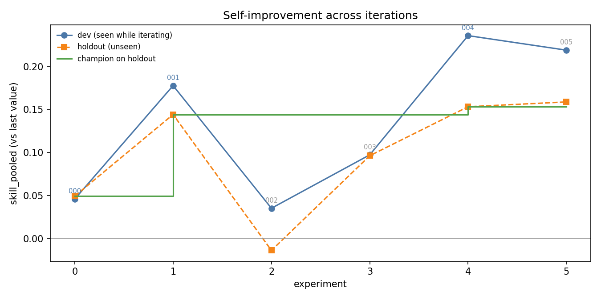

# Research report: experiments

_Written automatically from `ledger.jsonl` by `report.py`. Every number is the ledger's; nothing here is judged by a language model._

## Summary

- 6 experiments: the starting point (exp_000), then 2 kept and 3 rejected.
- Skill vs last value (pooled), DEV: +0.046 at the start (exp_000) → +0.236 for the champion (exp_004).
- HOLDOUT (never used to choose parameters, only as a gate): +0.049 → +0.153.
- Champion interval coverage: DEV 0.72, HOLDOUT 0.82 (target 0.80).
- Rule: keep a change only if DEV improves by at least 0.002 and HOLDOUT does not fall below the champion's.

## All experiments

| id | kept | DEV | HOLDOUT | coverage DEV | hypothesis |
|---|---|---|---|---|---|
| exp_000 | yes | +0.046 | +0.049 | 0.46 | Reference: the starter kit's drift baseline (whole-history empirical random walk), re-run through our walk-... |
| exp_001 | yes | +0.178 | +0.144 | 0.76 | coverage_in is low at 0.46256 (target 0.80), with above_q90 at 0.414251 and below_q10 at 0.123188, indicati... |
| exp_002 | no | +0.035 | -0.014 | 0.77 | Coverage is low: overall 0.76 in vs 0.80 target; above q90 is 15.2% and below q10 is 9.0%. Coverage is low ... |
| exp_003 | no | +0.097 | +0.096 | 0.77 | Calibration coverage is low at 0.758 (target 0.80); intervals are too narrow across series. Increasing the ... |
| exp_004 | yes | +0.236 | +0.153 | 0.72 | Champion coverage_in = 0.758 (target 0.80). Coverage_above_q90 at 0.1516 and below_q10 at 0.09 indicate mil... |
| exp_005 | no | +0.219 | +0.159 | 0.71 | DEV skill is especially poor for gpurentalprices/neocloud_rate_card (0.056 drift skill, 0.303 overall skill... |

## The path, one experiment at a time

### exp_000: kept

**Hypothesis.** Reference: the starter kit's drift baseline (whole-history empirical random walk), re-run through our walk-forward pipeline on daily origins.

**What changed.** starting point. Model: drift (single; no calibration).

**Decision.** first experiment: becomes the starting champion

**Lesson written to memory.** seed: starting champion for this autonomous run

### exp_001: kept

**Hypothesis.** coverage_in is low at 0.46256 (target 0.80), with above_q90 at 0.414251 and below_q10 at 0.123188, indicating severe undercoverage (too-narrow intervals); mean log error is small, suggesting intervals are not biased for the median. Most series and horizons show ~2-5x too many outcomes above q90. -> Enabling interval calibration with a moderate correction step should substantially increase coverage, moving above_q90 and below_q10 closer to the nominal 10% each, while keeping median skill unchanged or improving it in the worst-off groups. Change: Enable calibration with default settings: calibrate.enabled = true, gamma = 0.5, scale = 0.01, group_by = instrument_class.

**What changed.** `calibrate.enabled`: False → True; `calibrate.gamma`: None → 0.5; `calibrate.group_by`: None → instrument_class; `calibrate.scale`: None → 0.01. Model: drift (single; calibration by instrument_class).

**Test.** Against champion exp_000: DEV +0.1319, HOLDOUT +0.0949. By horizon (DEV, 1/3/7 days): +0.040 / +0.044 / +0.250.

**Decision.** dev skill_pooled +0.1319 vs champion exp_000 (need >= +0.002); holdout +0.0949 (need >= -0.0)

**Lesson written to memory.** Enabling interval calibration (gamma=0.5, group_by=instrument_class) raised dev coverage from 0.46 to 0.76 and improved pooled skill by +0.13 on dev and +0.09 on holdout versus the champion, indicating meaningful undercoverage was reduced; next, test whether calibration holds across subgroups and increases in holdout robustness.

### exp_002: rejected

**Hypothesis.** Coverage is low: overall 0.76 in vs 0.80 target; above q90 is 15.2% and below q10 is 9.0%. Coverage is low in almost every group (esp. gpurentalprices|marketplace_ask and all neocloud groups). -> Calibration step size may be too low, resulting in under-correction and under-coverage (intervals too narrow/shifted). Increasing gamma*scale should push coverage closer to nominal 80%. Change: Increase calibrate.gamma from 0.5 to 1.0 (gamma*scale grows from 0.005 to 0.01).

**What changed.** `calibrate.gamma`: 0.5 → 1.0. Model: drift (single; calibration by instrument_class).

**Test.** Against champion exp_001: DEV -0.1427, HOLDOUT -0.1581. By horizon (DEV, 1/3/7 days): -0.055 / -0.108 / +0.107.

**Decision.** dev skill_pooled -0.1427 vs champion exp_001 (need >= +0.002); holdout -0.1581 (need >= -0.0)

**Lesson written to memory.** Coverage increased slightly (dev in: 0.77 vs champion 0.76), but skill_pooled dropped by -0.14 on dev and -0.16 on holdout, both well below acceptance thresholds, implying the calibration adjustment over-corrected; next, try a smaller increment to calibrate.gamma or consider group-wise tuning to avoid degrading skill.

### exp_003: rejected

**Hypothesis.** Calibration coverage is low at 0.758 (target 0.80); intervals are too narrow across series. Increasing the calibration scale slightly may help widen intervals and increase coverage. The current scale is 0.01. -> Increasing calibrate.scale from 0.01 to 0.015 (keeping gamma=0.5) will widen prediction intervals, thus improving overall and groupwise coverage, especially at q10 and q90. The risk of overfitting is low since this is a simple adjustment and target coverage is not met. Change: Increase calibrate.scale from 0.01 to 0.015

**What changed.** `calibrate.scale`: 0.01 → 0.015. Model: drift (single; calibration by instrument_class).

**Test.** Against champion exp_001: DEV -0.0805, HOLDOUT -0.0479. By horizon (DEV, 1/3/7 days): -0.059 / -0.034 / +0.171.

**Decision.** dev skill_pooled -0.0805 vs champion exp_001 (need >= +0.002); holdout -0.0479 (need >= -0.0)

**Lesson written to memory.** Increasing calibrate.scale from 0.01 to 0.015 improved coverage slightly on dev (0.768 vs. champion's 0.758), but skill_pooled dropped significantly (-0.081 vs. requirement of +0.002), and holdout performance was also below the threshold. The next experiment should target methods to improve coverage without sacrificing forecast skill.

### exp_004: kept

**Hypothesis.** Champion coverage_in = 0.758 (target 0.80). Coverage_above_q90 at 0.1516 and below_q10 at 0.09 indicate mild miscalibration, slightly underconfident in the upper tail. Drift model alone, calibrated per instrument_class, dominates every group (mean ensemble weight = 1 everywhere). -> Lowering calibrate.gamma from 0.5 to 0.25 (with scale = 0.01) will tighten interval adaptation, reducing overshooting in the tail coverage (above_q90 and below_q10), and increase overall coverage closer to the 0.80 target, particularly in groups where coverage_above_q90 exceeds 0.15. Change: Set calibrate.gamma to 0.25 (from 0.5) in otherwise unchanged champion spec.

**What changed.** `calibrate.gamma`: 0.5 → 0.25. Model: drift (single; calibration by instrument_class).

**Test.** Against champion exp_001: DEV +0.0581, HOLDOUT +0.0091. By horizon (DEV, 1/3/7 days): +0.091 / +0.101 / +0.310.

**Decision.** dev skill_pooled +0.0581 vs champion exp_001 (need >= +0.002); holdout +0.0091 (need >= -0.0)

**Lesson written to memory.** Lowering calibrate.gamma to 0.25 improved dev skill_pooled (+0.0581) and holdout (+0.0091) versus the champion, but coverage_in fell from 0.758 to 0.723 (further from the 0.80 target), implying the next experiment should focus on increasing coverage, potentially by rebalancing gamma or tuning other calibration parameters.

### exp_005: rejected

**Hypothesis.** DEV skill is especially poor for gpurentalprices|neocloud_rate_card (0.056 drift skill, 0.303 overall skill), and overall coverage is low at 0.72. Calibration is currently by instrument_class. Given that mean_log_err_q50 is slightly positive (0.008 for 'same' provider count, 0.017 for gpurentalprices|neocloud_rate_card), it may help to calibrate at finer granularity. -> Calibrating by source_id instead of instrument_class will reduce mean_log_err_q50 for gpurentalprices|neocloud_rate_card and improve skill/coverage in that group, by correcting small source-specific biases in interval location. Change: Set calibrate.group_by to source_id

**What changed.** `calibrate.group_by`: instrument_class → source_id. Model: drift (single; calibration by source_id).

**Test.** Against champion exp_004: DEV -0.0169, HOLDOUT +0.0056. By horizon (DEV, 1/3/7 days): +0.086 / +0.140 / +0.268.

**Decision.** dev skill_pooled -0.0169 vs champion exp_004 (need >= +0.002); holdout +0.0056 (need >= -0.0)

**Lesson written to memory.** Calibrating by source_id instead of instrument_class led to a decrease in dev skill_pooled (-0.017 vs champion) and did not improve coverage (0.71 vs 0.72); as the dev performance regressed, finer-grained calibration isn’t justified for the next experiment.

## What the loop ruled out

- **exp_002**: Coverage increased slightly (dev in: 0.77 vs champion 0.76), but skill_pooled dropped by -0.14 on dev and -0.16 on holdout, both well below acceptance thresholds, implying the calibration adjustment over-corrected; next, try a smaller increment to calibrate.gamma or consider group-wise tuning to avoid degrading skill.
- **exp_003**: Increasing calibrate.scale from 0.01 to 0.015 improved coverage slightly on dev (0.768 vs. champion's 0.758), but skill_pooled dropped significantly (-0.081 vs. requirement of +0.002), and holdout performance was also below the threshold. The next experiment should target methods to improve coverage without sacrificing forecast skill.
- **exp_005**: Calibrating by source_id instead of instrument_class led to a decrease in dev skill_pooled (-0.017 vs champion) and did not improve coverage (0.71 vs 0.72); as the dev performance regressed, finer-grained calibration isn’t justified for the next experiment.

## Champion by horizon

| horizon | DEV skill | HOLDOUT skill |
|---|---|---|
| 1 day | +0.091 | +0.071 |
| 3 day | +0.101 | +0.082 |
| 7 day | +0.310 | +0.226 |

Champion spec: `experiments/exp_004/spec.json`. Diagnosis: `experiments/exp_004/diagnosis.md`.
