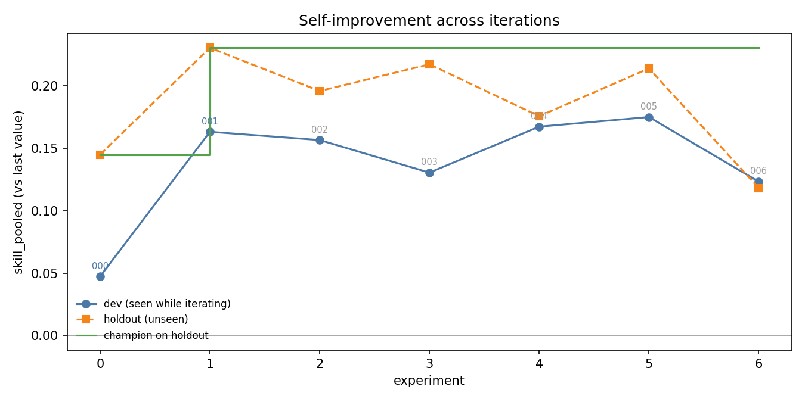

# Research report: experiments

_Written automatically from `ledger.jsonl` by `report.py`. Every number is the ledger's; nothing here is judged by a language model._

## Summary

- 7 experiments: the starting point (exp_000), then 1 kept and 5 rejected.
- Skill vs last value (pooled), DEV: +0.047 at the start (exp_000) → +0.163 for the champion (exp_001).
- HOLDOUT (never used to choose parameters, only as a gate): +0.145 → +0.230.
- Champion interval coverage: DEV 0.79, HOLDOUT 0.85 (target 0.80).
- Rule: keep a change only if DEV improves by at least 0.002 and HOLDOUT does not fall below the champion's.

## All experiments

| id | kept | DEV | HOLDOUT | coverage DEV | hypothesis |
|---|---|---|---|---|---|
| exp_000 | yes | +0.047 | +0.145 | 0.45 | Reference: the starter kit's drift baseline (whole-history empirical random walk), re-run through our walk-... |
| exp_001 | yes | +0.163 | +0.230 | 0.79 | The overall coverage under champion is very low: coverage_in=0.45 (should be near 0.8), with above_q90 at 0... |
| exp_002 | no | +0.157 | +0.196 | 0.78 | The champion is strongest on afhubbard/hyperscaler_spot (skill 0.053) but weakest (negative or near zero sk... |
| exp_003 | no | +0.130 | +0.217 | 0.63 | By 'series group': skill in 'afhubbard/hyperscaler_spot' is 0.053 (best), but 'fastgpu_daily/neocloud_spot'... |
| exp_004 | no | +0.167 | +0.176 | 0.79 | champion skill_pooled 0.16315; drift base model skill by group includes near-zero or negative (e.g., fastgp... |
| exp_005 | no | +0.175 | +0.214 | 0.79 | The group fastgpu_daily/neocloud_spot has particularly bad skill (0.211), elevated coverage above q90 (0.16... |
| exp_006 | no | +0.123 | +0.118 | 0.78 | coverage_in is low at 0.7896 (target is 0.80); skill_geomean is 0.0662; calibration uses group_by instrumen... |

## The path, one experiment at a time

### exp_000: kept

**Hypothesis.** Reference: the starter kit's drift baseline (whole-history empirical random walk), re-run through our walk-forward pipeline on daily origins.

**What changed.** starting point. Model: drift (single; no calibration).

**Decision.** first experiment: becomes the starting champion

**Lesson written to memory.** seed: starting champion for this autonomous run

### exp_001: kept

**Hypothesis.** The overall coverage under champion is very low: coverage_in=0.45 (should be near 0.8), with above_q90 at 0.42 and below_q10 at 0.12. This means the predicted intervals are much too narrow. Coverage by all meaningful slices (series group, horizon, dsc_bucket) is similarly poor. The champion does not use calibration. -> Enabling interval calibration (with default parameters) will widen the intervals and bring coverage much closer to the target of 0.80, especially reducing the fraction of points above q90 and below q10, at the cost of slight over-coverage if overcorrected. Change: Enable calibration, using calibrate.enabled=true, gamma=0.5, scale=0.01, group_by=instrument_class (defaults).

**What changed.** `calibrate.enabled`: False → True; `calibrate.gamma`: None → 0.5; `calibrate.group_by`: None → instrument_class; `calibrate.scale`: None → 0.01. Model: drift (single; calibration by instrument_class).

**Test.** Against champion exp_000: DEV +0.1158, HOLDOUT +0.0855. By horizon (DEV, 1/3/7 days): +0.057 / +0.051 / +0.241.

**Decision.** dev skill_pooled +0.1158 vs champion exp_000 (need >= +0.002); holdout +0.0855 (need >= -0.0)

**Lesson written to memory.** Enabling interval calibration increased dev coverage_in from 0.45 to 0.79, with skill_pooled rising from 0.047 to 0.163; similar gains were confirmed on holdout. This implies calibration should remain enabled and further tuning of calibration parameters should optimize coverage and skill.

### exp_002: rejected

**Hypothesis.** The champion is strongest on afhubbard|hyperscaler_spot (skill 0.053) but weakest (negative or near zero skill) on fastgpu_daily|hyperscaler_spot and fastgpu_daily|neocloud_spot (skill -0.03 and -0, respectively). Coverage in these weak groups is also off: e.g., fastgpu_daily|neocloud_spot has above_q90 of 16.1% and below_q10 of 12.4%, over-dispersed relative to ideal 10%. -> The 'drift' model is too slow to adapt to recent shocks in some groups, leading to over-dispersed intervals. Adding 'momentum' (which reacts faster to trend changes) in a mean ensemble should help reduce pinball loss and bring coverage closer to target, especially for fastgpu_daily|neocloud_spot and fastgpu_daily|hyperscaler_spot. Change: Add 'momentum' model (default params) and combine by mean.

**What changed.** adds model `momentum`; `combine.method`: single → mean. Model: drift, momentum (mean; calibration by instrument_class).

**Test.** Against champion exp_001: DEV -0.0066, HOLDOUT -0.0346. By horizon (DEV, 1/3/7 days): -0.013 / +0.110 / +0.214.

**Decision.** dev skill_pooled -0.0066 vs champion exp_001 (need >= +0.002); holdout -0.0346 (need >= -0.0)

**Lesson written to memory.** Adding the 'momentum' model (mean ensemble) resulted in a pooled dev skill 0.0066 below the champion and worse holdout skill (-0.0346), with a slight drop in coverage (77.6% vs 78.9%). Next, try model weighting or alternate ensembling methods to improve skill and retain coverage, as simple averaging underperformed.

### exp_003: rejected

**Hypothesis.** By 'series group': skill in 'afhubbard|hyperscaler_spot' is 0.053 (best), but 'fastgpu_daily|neocloud_spot' is 0.211 (worst) and 'gpurentalprices|neocloud_rate_card' is 0.169 but q10/q90 coverage is too wide/narrow in several groups. Further, coverage overall is slightly low (0.789 vs target 0.80), and gamma * scale = 0.005 (min step). Champion calibrates by instrument_class. -> Calibrating by 'series_id' instead of 'instrument_class' will allow finer-grained interval correction that may improve coverage (from 0.7895 up to or just above 0.80) and may help on series with negative skill by better adapting intervals to idiosyncratic volatility. Change: Change calibrate.group_by from 'instrument_class' to 'series_id'. All else (gamma/scale) the same.

**What changed.** `calibrate.group_by`: instrument_class → series_id. Model: drift (single; calibration by series_id).

**Test.** Against champion exp_001: DEV -0.0327, HOLDOUT -0.0133. By horizon (DEV, 1/3/7 days): +0.089 / +0.135 / +0.136.

**Decision.** dev skill_pooled -0.0327 vs champion exp_001 (need >= +0.002); holdout -0.0133 (need >= -0.0)

**Lesson written to memory.** Calibrating by 'series_id' instead of 'instrument_class' reduced skill on both dev (-0.0327) and holdout (-0.0133), and coverage dropped substantially (from 0.7896 to 0.6279); thus, finer-grained calibration is not effective as implemented—next, try hybrid grouping or different calibration parameters to balance interval width and coverage.

### exp_004: rejected

**Hypothesis.** champion skill_pooled 0.16315; drift base model skill by group includes near-zero or negative (e.g., fastgpu_daily|neocloud_spot: -0, fastgpu_daily|hyperscaler_spot: -0.03); 'vol_tail' (dev only) is allowed and may help model volatility, especially with negative drift performance. Coverage is a little low (0.7896 vs 0.80 target), especially for 'gpurentalprices|neocloud_rate_card' (0.135 above q90, 0.069 below q10). -> Adding the 'vol_tail' model to the ensemble and switching to a mean (equal-weight) combination will better capture volatility and uncertainty in rate cards and spot groups, especially where 'drift' alone underperforms. This should improve calibration (coverage near 0.80) and pinball loss, notably in high-volatility series. We expect obvious improvement (>=0.005) if drift is missing jumps or underestimates spread. Change: Switch combine.method from 'single' (drift only) to 'mean' of drift and vol_tail (both with default params).

**What changed.** adds model `vol_tail`; `combine.method`: single → mean. Model: drift, vol_tail (mean; calibration by instrument_class).

**Test.** Against champion exp_001: DEV +0.0041, HOLDOUT -0.0548. By horizon (DEV, 1/3/7 days): +0.041 / +0.139 / +0.207.

**Decision.** dev skill_pooled +0.0041 vs champion exp_001 (need >= +0.002); holdout -0.0548 (need >= -0.0)

**Lesson written to memory.** Adding 'vol_tail' and switching to a mean combination improved dev skill_pooled (+0.0041) and slightly increased coverage (0.7918 vs 0.7896), but holdout performance fell significantly (-0.0548 vs champion), implying the ensemble is overfit to dev and future experiments should regularize or selectively blend only where drift underperforms.

### exp_005: rejected

**Hypothesis.** The group fastgpu_daily|neocloud_spot has particularly bad skill (0.211), elevated coverage above q90 (0.161), and a candidate leading signal pair to gpurentalprices.neocloud_spot.B200.spot.median (lag_days 1, corr 0.974). Also, drift as a base model yields -0 skill here. -> Adding the 'leader' model with default params and ensembling by mean with drift will improve skill for fastgpu_daily|neocloud_spot by leveraging predictive signal from correlated leading series, with possible modest overall DEV gain. Mean combine is most likely to help if the two models are anticorrelated in error. Change: Combine 'drift' and 'leader' with method='mean', keeping all other champion settings.

**What changed.** adds model `leader`; `combine.method`: single → mean. Model: drift, leader (mean; calibration by instrument_class).

**Test.** Against champion exp_001: DEV +0.0118, HOLDOUT -0.0166. By horizon (DEV, 1/3/7 days): +0.043 / +0.152 / +0.213.

**Decision.** dev skill_pooled +0.0118 vs champion exp_001 (need >= +0.002); holdout -0.0166 (need >= -0.0)

**Lesson written to memory.** Mean-ensembling drift and leader improved DEV skill_pooled by +0.012 vs champion (0.175 vs 0.163), but holdout skill dropped by -0.017, and coverage in remained stable; next, try tuning ensemble weights or constraints to mitigate holdout degradation.

### exp_006: rejected

**Hypothesis.** coverage_in is low at 0.7896 (target is 0.80); skill_geomean is 0.0662; calibration uses group_by instrument_class -> Calibration may better correct for systematic bias if applied at a more granular group, possibly improving interval coverage. Specifically, since some groups (e.g., neocloud_rate_card and neocloud_spot) show opposite mean_log_err_q50 and miscoverage patterns, calibrating by source_id may yield better coverage and reduce systematic error. Change: Change calibrate.group_by from instrument_class to source_id

**What changed.** `calibrate.group_by`: instrument_class → source_id. Model: drift (single; calibration by source_id).

**Test.** Against champion exp_001: DEV -0.0399, HOLDOUT -0.1122. By horizon (DEV, 1/3/7 days): +0.061 / +0.083 / +0.156.

**Decision.** dev skill_pooled -0.0399 vs champion exp_001 (need >= +0.002); holdout -0.1122 (need >= -0.0)

**Lesson written to memory.** Changing calibration grouping from instrument_class to source_id reduced skill_pooled on dev by -0.0399 and decreased coverage_in to 0.775 (below target 0.80); since both skill and coverage dropped, further experiments should reconsider the grouping strategy—potentially aggregating at a less granular level or exploring hybrid groupings.

## What the loop ruled out

- **exp_002**: Adding the 'momentum' model (mean ensemble) resulted in a pooled dev skill 0.0066 below the champion and worse holdout skill (-0.0346), with a slight drop in coverage (77.6% vs 78.9%). Next, try model weighting or alternate ensembling methods to improve skill and retain coverage, as simple averaging underperformed.
- **exp_003**: Calibrating by 'series_id' instead of 'instrument_class' reduced skill on both dev (-0.0327) and holdout (-0.0133), and coverage dropped substantially (from 0.7896 to 0.6279); thus, finer-grained calibration is not effective as implemented—next, try hybrid grouping or different calibration parameters to balance interval width and coverage.
- **exp_004**: Adding 'vol_tail' and switching to a mean combination improved dev skill_pooled (+0.0041) and slightly increased coverage (0.7918 vs 0.7896), but holdout performance fell significantly (-0.0548 vs champion), implying the ensemble is overfit to dev and future experiments should regularize or selectively blend only where drift underperforms.
- **exp_005**: Mean-ensembling drift and leader improved DEV skill_pooled by +0.012 vs champion (0.175 vs 0.163), but holdout skill dropped by -0.017, and coverage in remained stable; next, try tuning ensemble weights or constraints to mitigate holdout degradation.
- **exp_006**: Changing calibration grouping from instrument_class to source_id reduced skill_pooled on dev by -0.0399 and decreased coverage_in to 0.775 (below target 0.80); since both skill and coverage dropped, further experiments should reconsider the grouping strategy—potentially aggregating at a less granular level or exploring hybrid groupings.

## Champion by horizon

| horizon | DEV skill | HOLDOUT skill |
|---|---|---|
| 1 day | +0.057 | +0.159 |
| 3 day | +0.051 | +0.274 |
| 7 day | +0.241 | +0.224 |

Champion spec: `experiments/exp_001/spec.json`. Diagnosis: `experiments/exp_001/diagnosis.md`.
