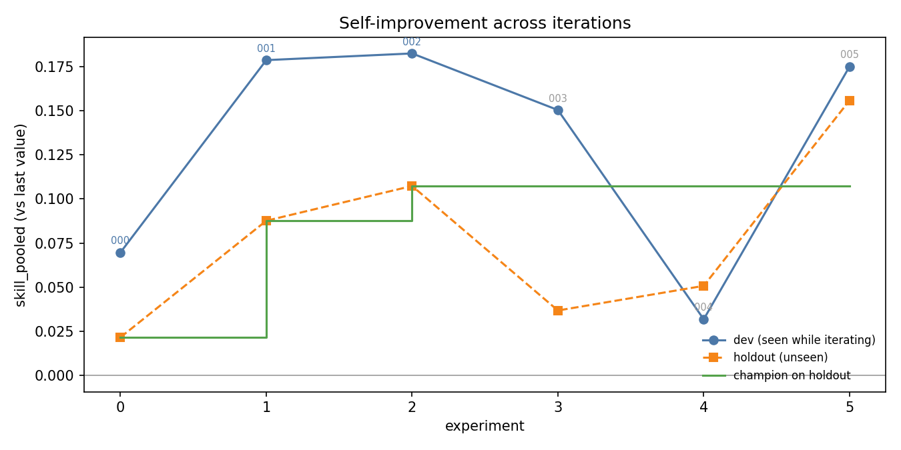

# Research report: experiments

_Written automatically from `ledger.jsonl` by `report.py`. Every number is the ledger's; nothing here is judged by a language model._

## Summary

- 6 experiments: the starting point (exp_000), then 2 kept and 3 rejected.
- Skill vs last value (pooled), DEV: +0.070 at the start (exp_000) → +0.182 for the champion (exp_002).
- HOLDOUT (never used to choose parameters, only as a gate): +0.022 → +0.107.
- Champion interval coverage: DEV 0.78, HOLDOUT 0.72 (target 0.80).
- Rule: keep a change only if DEV improves by at least 0.002 and HOLDOUT does not fall below the champion's.

## All experiments

| id | kept | DEV | HOLDOUT | coverage DEV | hypothesis |
|---|---|---|---|---|---|
| exp_000 | yes | +0.070 | +0.022 | 0.46 | Reference: the starter kit's drift baseline (whole-history empirical random walk), re-run through our walk-... |
| exp_001 | yes | +0.179 | +0.088 | 0.80 | Overall coverage_in is 0.456 (much too low; target is 0.80), with extreme quantile coverage also far off (q... |
| exp_002 | yes | +0.182 | +0.107 | 0.78 | Coverage in afhubbard/hyperscaler_spot is 0.06 above q90 and 0.049 below q10 (too narrow), while coverage i... |
| exp_003 | no | +0.150 | +0.037 | 0.65 | In the champion, calibration is grouped by source_class. For groups like afhubbard/hyperscaler_spot (n=384,... |
| exp_004 | no | +0.032 | +0.051 | 0.78 | Coverage for fastgpu_daily/hyperscaler_spot is poor: above_q90=0.133, below_q10=0.294 (should be ≈0.10 each... |
| exp_005 | no | +0.175 | +0.156 | 0.77 | Coverage for fastgpu_daily/hyperscaler_spot is too wide (above_q90=13.3%, below_q10=29.4%), skill is weak (... |

## The path, one experiment at a time

### exp_000: kept

**Hypothesis.** Reference: the starter kit's drift baseline (whole-history empirical random walk), re-run through our walk-forward pipeline on daily origins.

**What changed.** starting point. Model: drift (single; no calibration).

**Decision.** first experiment: becomes the starting champion

**Lesson written to memory.** seed: starting champion for this autonomous run

### exp_001: kept

**Hypothesis.** Overall coverage_in is 0.456 (much too low; target is 0.80), with extreme quantile coverage also far off (q90: 0.418, q10: 0.126). -> Adding calibration with a moderate step size will increase interval width and coverage, improving coverage_in, above_q90, and below_q10 toward the target (0.80, 0.10, 0.10) with minimal sacrifice to skill except in already well-covered groups. Change: Enable calibration (gamma 0.5, scale 0.01; the default product) grouped by instrument_class.

**What changed.** `calibrate.enabled`: False → True; `calibrate.gamma`: None → 0.5; `calibrate.group_by`: None → instrument_class; `calibrate.scale`: None → 0.01. Model: drift (single; calibration by instrument_class).

**Test.** Against champion exp_000: DEV +0.1088, HOLDOUT +0.0660. By horizon (DEV, 1/3/7 days): +0.082 / +0.104 / +0.237.

**Decision.** dev skill_pooled +0.1088 vs champion exp_000 (need >= +0.002); holdout +0.0660 (need >= -0.0)

**Lesson written to memory.** Enabling calibration (gamma 0.5, scale 0.01, by instrument_class) increased dev skill_pooled by +0.1088 and holdout by +0.0660 versus the champion, while coverage_in improved from 0.456 to 0.802 (meeting the 0.80 target). Next, test whether further tuning calibration parameters or using finer groupings can maintain or boost skill while further stabilizing quantile coverage.

### exp_002: kept

**Hypothesis.** Coverage in afhubbard|hyperscaler_spot is 0.06 above q90 and 0.049 below q10 (too narrow), while coverage in fastgpu_daily|neocloud_rate_card is 0.095 above q90 and 0.112 below q10 (slightly wide). -> Calibrating by source_class instead of instrument_class will better capture calibration differences like the undercoverage in afhubbard|hyperscaler_spot and the slight overcoverage in fastgpu_daily|neocloud_rate_card. This could improve interval coverage uniformity across groups and slightly reduce over/under coverage deviations. Change: Change calibrate.group_by from instrument_class to source_class.

**What changed.** `calibrate.group_by`: instrument_class → source_class. Model: drift (single; calibration by source_class).

**Test.** Against champion exp_001: DEV +0.0038, HOLDOUT +0.0197. By horizon (DEV, 1/3/7 days): +0.093 / +0.148 / +0.219.

**Decision.** dev skill_pooled +0.0038 vs champion exp_001 (need >= +0.002); holdout +0.0197 (need >= -0.0)

**Lesson written to memory.** Calibrating by source_class instead of instrument_class in exp_002 increased dev skill_pooled by +0.0038 and holdout by +0.0197 vs the champion, with slightly tightened coverage (dev coverage_in 0.782 vs champ 0.802), suggesting this grouping improves predictive skill and coverage consistency—next, test additional granularity in groupings to further optimize interval calibration.

### exp_003: rejected

**Hypothesis.** In the champion, calibration is grouped by source_class. For groups like afhubbard|hyperscaler_spot (n=384, skill=0.117, above_q90=0.06, below_q10=0.06), both coverage tails are too low. For fastgpu_daily|hyperscaler_spot (n=180, above_q90=0.133, below_q10=0.294), below_q10 is much too high. -> Calibrating by a finer grouping could adapt intervals to distinctive error/coverage patterns by series_id, fixing severe under- or over-coverage found in small groups like fastgpu_daily|hyperscaler_spot (coverage below q10 is 0.294 instead of near 0.10). Change: Set calibrate.group_by to series_id instead of source_class.

**What changed.** `calibrate.group_by`: source_class → series_id. Model: drift (single; calibration by series_id).

**Test.** Against champion exp_002: DEV -0.0320, HOLDOUT -0.0705. By horizon (DEV, 1/3/7 days): +0.112 / +0.164 / +0.151.

**Decision.** dev skill_pooled -0.0320 vs champion exp_002 (need >= +0.002); holdout -0.0705 (need >= -0.0)

**Lesson written to memory.** Calibrating by series_id instead of source_class reduced dev skill by 0.032 (and holdout by 0.0705) versus the champion, with coverage_in also dropping from 0.78 to 0.65, implying that finer grouping hurt overall calibration performance; next, try hybrid grouping (e.g., source_class plus frequency) to retain adaptive coverage without losing pooled skill.

### exp_004: rejected

**Hypothesis.** Coverage for fastgpu_daily|hyperscaler_spot is poor: above_q90=0.133, below_q10=0.294 (should be ≈0.10 each). Mean_log_err_q50 is slightly negative (-0.018), suggesting slight downward bias in medians for this group. -> Changing calibration group_by from source_class to all will enable the online calibration to better correct the coverage issue for the small 'fastgpu_daily|hyperscaler_spot' group, reducing excess below-q10 coverage (from 0.294 to near 0.10) and slightly improving skill for this group, without harming well-calibrated groups. Change: Set calibrate.group_by from source_class to all

**What changed.** `calibrate.group_by`: source_class → all. Model: drift (single; calibration by all).

**Test.** Against champion exp_002: DEV -0.1505, HOLDOUT -0.0565. By horizon (DEV, 1/3/7 days): +0.091 / +0.099 / -0.015.

**Decision.** dev skill_pooled -0.1505 vs champion exp_002 (need >= +0.002); holdout -0.0565 (need >= -0.0)

**Lesson written to memory.** Setting calibrate.group_by to all reduced coverage error for fastgpu_daily|hyperscaler_spot but caused pooled skill to drop by -0.15 in dev and -0.06 in holdout vs champion, so this grouping harms overall model performance; next, try more targeted calibration groupings or hybrid strategies to improve small-group coverage without degrading aggregate skill.

### exp_005: rejected

**Hypothesis.** Coverage for fastgpu_daily|hyperscaler_spot is too wide (above_q90=13.3%, below_q10=29.4%), skill is weak (0.147), and mean_log_err shows mild down-bias (-0.018). This is the only group with major over-coverage and high percent below q10; by base model skill, drift is not working (0.001 skill). -> Drift fails for fastgpu_daily|hyperscaler_spot due to lack of reversion and potentially sudden spot price jumps. Including step_hazard in a hedge ensemble will allow faster adjustment to new jumps and likely cut excessive underestimation, raising skill and narrowing intervals for this group, without degrading others. Change: Add step_hazard to models and use hedge combine (eta=2.0, group_by=instrument_class).

**What changed.** adds model `step_hazard`; `combine.eta`: None → 2.0; `combine.group_by`: None → instrument_class; `combine.method`: single → hedge. Model: drift, step_hazard (hedge; calibration by source_class).

**Test.** Against champion exp_002: DEV -0.0074, HOLDOUT +0.0484. By horizon (DEV, 1/3/7 days): +0.097 / +0.111 / +0.224.

**Decision.** dev skill_pooled -0.0074 vs champion exp_002 (need >= +0.002); holdout +0.0484 (need >= -0.0)

**Lesson written to memory.** Hedge ensemble with step_hazard underperformed the champion on dev (skill_pooled -0.0074), despite a small geomean gain (+0.0036), and coverage narrowed (0.7686 vs 0.7824); holdout skill improved (+0.0484), but dev regression means robustness must increase. Next: iterate on regularization or hedge combine parameters to improve dev skill without sacrificing holdout gains.

## What the loop ruled out

- **exp_003**: Calibrating by series_id instead of source_class reduced dev skill by 0.032 (and holdout by 0.0705) versus the champion, with coverage_in also dropping from 0.78 to 0.65, implying that finer grouping hurt overall calibration performance; next, try hybrid grouping (e.g., source_class plus frequency) to retain adaptive coverage without losing pooled skill.
- **exp_004**: Setting calibrate.group_by to all reduced coverage error for fastgpu_daily|hyperscaler_spot but caused pooled skill to drop by -0.15 in dev and -0.06 in holdout vs champion, so this grouping harms overall model performance; next, try more targeted calibration groupings or hybrid strategies to improve small-group coverage without degrading aggregate skill.
- **exp_005**: Hedge ensemble with step_hazard underperformed the champion on dev (skill_pooled -0.0074), despite a small geomean gain (+0.0036), and coverage narrowed (0.7686 vs 0.7824); holdout skill improved (+0.0484), but dev regression means robustness must increase. Next: iterate on regularization or hedge combine parameters to improve dev skill without sacrificing holdout gains.

## Champion by horizon

| horizon | DEV skill | HOLDOUT skill |
|---|---|---|
| 1 day | +0.093 | +0.123 |
| 3 day | +0.148 | +0.058 |
| 7 day | +0.219 | +0.128 |

Champion spec: `experiments/exp_002/spec.json`. Diagnosis: `experiments/exp_002/diagnosis.md`.
