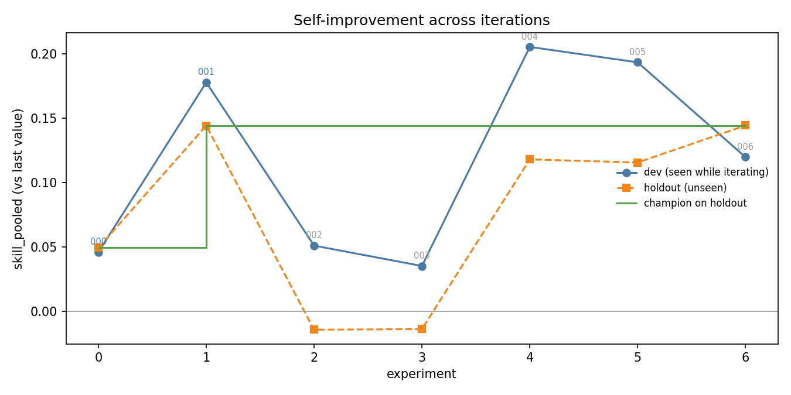

# Research report: experiments

_Written automatically from `ledger.jsonl` by `report.py`. Every number is the ledger's; nothing here is judged by a language model._

## Summary

- 7 experiments: the starting point (exp_000), then 1 kept and 5 rejected.
- Skill vs last value (pooled), DEV: +0.046 at the start (exp_000) → +0.178 for the champion (exp_001).
- HOLDOUT (never used to choose parameters, only as a gate): +0.049 → +0.144.
- Champion interval coverage: DEV 0.76, HOLDOUT 0.84 (target 0.80).
- Rule: keep a change only if DEV improves by at least 0.002 and HOLDOUT does not fall below the champion's.

## All experiments

| id | kept | DEV | HOLDOUT | coverage DEV | hypothesis |
|---|---|---|---|---|---|
| exp_000 | yes | +0.046 | +0.049 | 0.46 | Reference: the starter kit's drift baseline (whole-history empirical random walk), re-run through our walk-... |
| exp_001 | yes | +0.178 | +0.144 | 0.76 | coverage_in is only 0.46256 (target 0.80), above_q90=0.414251 and below_q10=0.123188 both too high; champio... |
| exp_002 | no | +0.051 | -0.014 | 0.75 | Overall skill 0.1778, coverage_in 0.758454 (target 0.80), skill for afhubbard/hyperscaler_spot is only 0.06... |
| exp_003 | no | +0.035 | -0.014 | 0.77 | coverage_in is only 0.758, below the 0.80 target, with above_q90 at 0.151 and below_q10 at 0.090. Calibrati... |
| exp_004 | no | +0.205 | +0.118 | 0.76 | Coverage is low across the board (overall 0.758, above_q90 0.1516, below_q10 0.09), especially in fastgpu_d... |
| exp_005 | no | +0.193 | +0.116 | 0.74 | The champion shows notably poor skill (-inf to -0.45) and near-zero coverage in multiple 'neocloud_rate_car... |
| exp_006 | no | +0.120 | +0.144 | 0.62 | Coverage is low (0.758454 < target 0.8) and the most problematic series and series groups have very poor sk... |

## The path, one experiment at a time

### exp_000: kept

**Hypothesis.** Reference: the starter kit's drift baseline (whole-history empirical random walk), re-run through our walk-forward pipeline on daily origins.

**What changed.** starting point. Model: drift (single; no calibration).

**Decision.** first experiment: becomes the starting champion

**Lesson written to memory.** seed: starting champion for this autonomous run

### exp_001: kept

**Hypothesis.** coverage_in is only 0.46256 (target 0.80), above_q90=0.414251 and below_q10=0.123188 both too high; champion has no calibration. Over-quantile hits most in fastgpu_daily|neocloud_rate_card (above_q90: 0.517) and gpurentalprices|neocloud_rate_card (above_q90: 0.514). -> Enabling interval calibration with mild settings will reduce the excessive number of truth-above-q90 and truth-below-q10 events, improving coverage to be closer to the target 0.80, especially for the neocloud_rate_card groups. Mild correction (gamma=0.5, scale=0.01) should improve coverage without degrading skill by more than noise. Change: Enable interval calibration using gamma=0.5, scale=0.01, group_by=instrument_class.

**What changed.** `calibrate.enabled`: False → True; `calibrate.gamma`: None → 0.5; `calibrate.group_by`: None → instrument_class; `calibrate.scale`: None → 0.01. Model: drift (single; calibration by instrument_class).

**Test.** Against champion exp_000: DEV +0.1319, HOLDOUT +0.0949. By horizon (DEV, 1/3/7 days): +0.040 / +0.044 / +0.250.

**Decision.** dev skill_pooled +0.1319 vs champion exp_000 (need >= +0.002); holdout +0.0949 (need >= -0.0)

**Lesson written to memory.** Interval calibration increased dev coverage_in from 0.463 to 0.758 (approaching the 0.80 target) and improved dev skill_pooled by +0.132; next, test stronger calibration or groupings to further close coverage gap while monitoring for possible skill tradeoffs.

### exp_002: rejected

**Hypothesis.** Overall skill 0.1778, coverage_in 0.758454 (target 0.80), skill for afhubbard|hyperscaler_spot is only 0.066 but base drift model achieves 0.186 for this group. -> Changing calibration group_by from instrument_class to all will allow global interval adjustment factors to borrow strength across instrument classes, helping underperforming small groups like afhubbard|hyperscaler_spot whose interval coverage is very low (above_q90 and below_q10 sum to 12%, well below target 20%) and average skill is much worse than single base model skill. This global pooling should improve coverage on small groups without major skill loss. Change: Set calibrate.group_by from instrument_class to all.

**What changed.** `calibrate.group_by`: instrument_class → all. Model: drift (single; calibration by all).

**Test.** Against champion exp_001: DEV -0.1269, HOLDOUT -0.1586. By horizon (DEV, 1/3/7 days): +0.033 / +0.080 / +0.041.

**Decision.** dev skill_pooled -0.1269 vs champion exp_001 (need >= +0.002); holdout -0.1586 (need >= -0.0)

**Lesson written to memory.** Setting calibrate.group_by from instrument_class to all decreased skill_pooled by -0.1269 vs the champion on dev and -0.1586 on holdout, and reduced coverage_in from 0.758 to 0.748 (target 0.80); global pooling hurts overall skill and fails to improve coverage, so next, try a hybrid grouping (e.g., cluster small groups together) to balance pooling benefits and preserve performance.

### exp_003: rejected

**Hypothesis.** coverage_in is only 0.758, below the 0.80 target, with above_q90 at 0.151 and below_q10 at 0.090. Calibration uses gamma=0.5 and scale=0.01 grouped by instrument_class. Raising scale may broaden intervals and increase coverage without much risk of overshoot due to the small step. -> Increasing calibrate.scale to 0.02 (doubling step size) while keeping gamma=0.5 will increase coverage closer to 0.80 by more aggressively correcting undercoverage, especially for groups with low below_q10 shares, and should improve or maintain skill if not excessive. Change: Increase calibrate.scale from 0.01 to 0.02.

**What changed.** `calibrate.scale`: 0.01 → 0.02. Model: drift (single; calibration by instrument_class).

**Test.** Against champion exp_001: DEV -0.1427, HOLDOUT -0.1581. By horizon (DEV, 1/3/7 days): -0.055 / -0.108 / +0.107.

**Decision.** dev skill_pooled -0.1427 vs champion exp_001 (need >= +0.002); holdout -0.1581 (need >= -0.0)

**Lesson written to memory.** Doubling calibrate.scale to 0.02 slightly increased dev coverage from 0.758 to 0.768 but led to a large drop in skill_pooled (-0.143 vs champion on dev, -0.158 on holdout); coverage gains are not worth the skill loss—next, test smaller scale increases or alternative calibration/grouping strategies to improve coverage with less skill penalty.

### exp_004: rejected

**Hypothesis.** Coverage is low across the board (overall 0.758, above_q90 0.1516, below_q10 0.09), especially in fastgpu_daily groups (high above_q90 and below_q10). Calibration uses gamma=0.5, scale=0.01, group_by=instrument_class. No modeling change was ever tried (drift only, all single). -> Adding a volatility-aware interval expansion model (vol_tail) may improve interval calibration and coverage, especially for groups with extreme above_q90/below_q10 rates and longer horizons. Change: Add vol_tail with default params and combine by mean (equal weights) with drift.

**What changed.** adds model `vol_tail`; `combine.method`: single → mean. Model: drift, vol_tail (mean; calibration by instrument_class).

**Test.** Against champion exp_001: DEV +0.0276, HOLDOUT -0.0263. By horizon (DEV, 1/3/7 days): -0.010 / +0.199 / +0.232.

**Decision.** dev skill_pooled +0.0276 vs champion exp_001 (need >= +0.002); holdout -0.0263 (need >= -0.0)

**Lesson written to memory.** Adding the vol_tail model did not improve in-sample coverage (0.7566 vs champion 0.7585) or address low coverage in extreme groups, and although dev skill_pooled improved (+0.0276), holdout performance deteriorated substantially (-0.0263 vs champion). For the next experiment, further interval calibration or group-specific modeling should be explored, potentially with adaptive scale or alternative aggregation beyond equal weighting.

### exp_005: rejected

**Hypothesis.** The champion shows notably poor skill (-inf to -0.45) and near-zero coverage in multiple 'neocloud_rate_card' and 'neocloud_spot' series, e.g., fastgpu_daily.neocloud_spot.A100_80GB.spot.median (skill -inf, 0% above_q90/below_q10) and gpurentalprices.neocloud_rate_card.L40S.on_demand.median (skill -51.1, 0% coverage tails). Also, worst performance is concentrated in neocloud_* series, and by group, drift alone produces skill near or below zero on these. The composition model, with mean skill ~0.15-0.18, may help diversify high-miss groups (its k_beta/rho suggest it adapts to reversals and random shocks). -> Adding the composition model and mean-ensembling with drift will help with chronic under-coverage and low skill in 'neocloud_*' groups by giving weight to reversal- and volatility-sensitive signals absent from drift. Change: Add 'composition' model (default params) and set combine.method to 'mean' (equal weighting of drift and composition).

**What changed.** adds model `composition`; `combine.method`: single → mean. Model: drift, composition (mean; calibration by instrument_class).

**Test.** Against champion exp_001: DEV +0.0156, HOLDOUT -0.0286. By horizon (DEV, 1/3/7 days): -0.152 / +0.204 / +0.228.

**Decision.** dev skill_pooled +0.0156 vs champion exp_001 (need >= +0.002); holdout -0.0286 (need >= -0.0)

**Lesson written to memory.** Mean-ensembling drift and composition models improved dev skill_pooled (+0.0156 vs champion), but holdout skill dropped (-0.0286), and coverage_in decreased slightly (0.7367 vs 0.7585); next, test weighted ensembling or regularization to improve holdout generalization while retaining gains in neocloud_* series.

### exp_006: rejected

**Hypothesis.** Coverage is low (0.758454 < target 0.8) and the most problematic series and series groups have very poor skill—the worst have zero or negative skill and no coverage in the tails. The calibration is by instrument_class; the skill distribution shows some series (notably in neocloud_rate_card and neocloud_spot) behave very differently. All models so far use only per-instrument_class calibration. -> Calibrating by series_id (instead of instrument_class) will better correct for the idiosyncratic miscalibration in the worst series, increasing overall coverage and possibly skill, especially in groups/series with extremely poor coverage (e.g., all zero in tails). Change: Change calibrate.group_by from instrument_class to series_id.

**What changed.** `calibrate.group_by`: instrument_class → series_id. Model: drift (single; calibration by series_id).

**Test.** Against champion exp_001: DEV -0.0581, HOLDOUT +0.0001. By horizon (DEV, 1/3/7 days): +0.123 / +0.131 / +0.114.

**Decision.** dev skill_pooled -0.0581 vs champion exp_001 (need >= +0.002); holdout +0.0001 (need >= -0.0)

**Lesson written to memory.** Calibrating by series_id instead of instrument_class reduced pooled skill on dev (-0.0581) and coverage dropped further (0.62 vs prior 0.76), while holdout was flat; this suggests series-level calibration did not help and may have overfit, so future experiments should explore alternative calibration grouping or hybrid strategies.

## What the loop ruled out

- **exp_002**: Setting calibrate.group_by from instrument_class to all decreased skill_pooled by -0.1269 vs the champion on dev and -0.1586 on holdout, and reduced coverage_in from 0.758 to 0.748 (target 0.80); global pooling hurts overall skill and fails to improve coverage, so next, try a hybrid grouping (e.g., cluster small groups together) to balance pooling benefits and preserve performance.
- **exp_003**: Doubling calibrate.scale to 0.02 slightly increased dev coverage from 0.758 to 0.768 but led to a large drop in skill_pooled (-0.143 vs champion on dev, -0.158 on holdout); coverage gains are not worth the skill loss—next, test smaller scale increases or alternative calibration/grouping strategies to improve coverage with less skill penalty.
- **exp_004**: Adding the vol_tail model did not improve in-sample coverage (0.7566 vs champion 0.7585) or address low coverage in extreme groups, and although dev skill_pooled improved (+0.0276), holdout performance deteriorated substantially (-0.0263 vs champion). For the next experiment, further interval calibration or group-specific modeling should be explored, potentially with adaptive scale or alternative aggregation beyond equal weighting.
- **exp_005**: Mean-ensembling drift and composition models improved dev skill_pooled (+0.0156 vs champion), but holdout skill dropped (-0.0286), and coverage_in decreased slightly (0.7367 vs 0.7585); next, test weighted ensembling or regularization to improve holdout generalization while retaining gains in neocloud_* series.
- **exp_006**: Calibrating by series_id instead of instrument_class reduced pooled skill on dev (-0.0581) and coverage dropped further (0.62 vs prior 0.76), while holdout was flat; this suggests series-level calibration did not help and may have overfit, so future experiments should explore alternative calibration grouping or hybrid strategies.

## Champion by horizon

| horizon | DEV skill | HOLDOUT skill |
|---|---|---|
| 1 day | +0.040 | +0.066 |
| 3 day | +0.044 | +0.059 |
| 7 day | +0.250 | +0.224 |

Champion spec: `experiments/exp_001/spec.json`. Diagnosis: `experiments/exp_001/diagnosis.md`.
