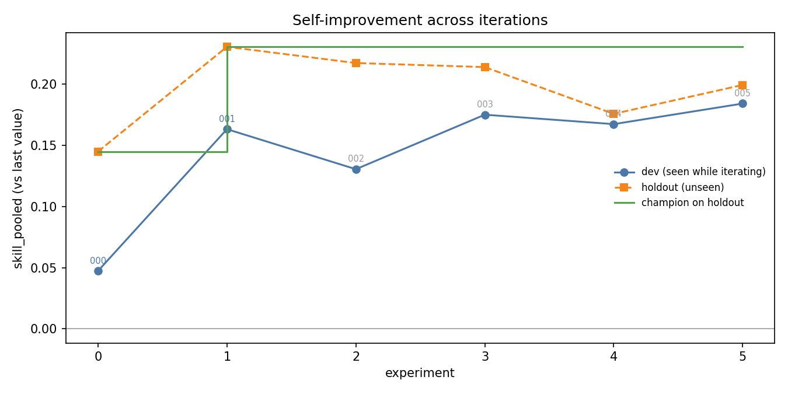

# Research report: experiments

_Written automatically from `ledger.jsonl` by `report.py`. Every number is the ledger's; nothing here is judged by a language model._

## Summary

- 6 experiments: the starting point (exp_000), then 1 kept and 4 rejected.
- Skill vs last value (pooled), DEV: +0.047 at the start (exp_000) → +0.163 for the champion (exp_001).
- HOLDOUT (never used to choose parameters, only as a gate): +0.145 → +0.230.
- Champion interval coverage: DEV 0.79, HOLDOUT 0.85 (target 0.80).
- Rule: keep a change only if DEV improves by at least 0.002 and HOLDOUT does not fall below the champion's.

## All experiments

| id | kept | DEV | HOLDOUT | coverage DEV | hypothesis |
|---|---|---|---|---|---|
| exp_000 | yes | +0.047 | +0.145 | 0.45 | Reference: the starter kit's drift baseline (whole-history empirical random walk), re-run through our walk-... |
| exp_001 | yes | +0.163 | +0.230 | 0.79 | coverage_in is 0.454958 (well below target 0.80), above_q90 0.420515 and below_q10 0.124527 (both too high—... |
| exp_002 | no | +0.130 | +0.217 | 0.63 | By group, 'fastgpu_daily/neocloud_rate_card' (n=759) has skill 0.169, but 'drift' alone provides only 0.023... |
| exp_003 | no | +0.175 | +0.214 | 0.79 | Worst series have negative skill (e.g., fastgpu_daily.neocloud_spot.A100_80GB.spot.median with -inf skill, ... |
| exp_004 | no | +0.167 | +0.176 | 0.79 | drift has poor or even negative skill in fastgpu_daily/hyperscaler_spot (−0.03), fastgpu_daily/neocloud_rat... |
| exp_005 | no | +0.184 | +0.199 | 0.70 | The champion uses calibration group_by=instrument_class, with overall skill 0.1631, coverage_in 0.7896; wor... |

## The path, one experiment at a time

### exp_000: kept

**Hypothesis.** Reference: the starter kit's drift baseline (whole-history empirical random walk), re-run through our walk-forward pipeline on daily origins.

**What changed.** starting point. Model: drift (single; no calibration).

**Decision.** first experiment: becomes the starting champion

**Lesson written to memory.** seed: starting champion for this autonomous run

### exp_001: kept

**Hypothesis.** coverage_in is 0.454958 (well below target 0.80), above_q90 0.420515 and below_q10 0.124527 (both too high—should be ~0.10); intervals are too narrow everywhere. -> Enabling interval calibration should widen the forecast intervals, raising both overall coverage and interval coverage across all groups, especially improving the horizon splits (where coverage_in is ~0.32 at 1-day and only ~0.60 at 7-day). Change: Enable calibration with gamma=0.5, scale=0.01, group_by=instrument_class (default/calibration-on).

**What changed.** `calibrate.enabled`: False → True; `calibrate.gamma`: None → 0.5; `calibrate.group_by`: None → instrument_class; `calibrate.scale`: None → 0.01. Model: drift (single; calibration by instrument_class).

**Test.** Against champion exp_000: DEV +0.1158, HOLDOUT +0.0855. By horizon (DEV, 1/3/7 days): +0.057 / +0.051 / +0.241.

**Decision.** dev skill_pooled +0.1158 vs champion exp_000 (need >= +0.002); holdout +0.0855 (need >= -0.0)

**Lesson written to memory.** Enabling interval calibration greatly improved coverage_in from 0.45 to 0.79 on dev and increased pooled skill by +0.12 vs the champion, with +0.09 on holdout, suggesting that further tuning gamma/scale parameters could help reach or surpass the 0.80 coverage target and optimize skill. Next, test more aggressive calibration parameters and evaluate horizon- and quantile-grouped coverage to ensure uniform improvement.

### exp_002: rejected

**Hypothesis.** By group, 'fastgpu_daily|neocloud_rate_card' (n=759) has skill 0.169, but 'drift' alone provides only 0.023 here. Skill is much higher in the champion with calibration by 'instrument_class', likely compensating for highly grouped over/underprediction in this group (see mean_log_err_q50 = 0.004). Calibrating on a finer group may correct residual local bias. -> Calibrating by 'series_id' instead of 'instrument_class' will better correct group-local bias, especially in groups like 'fastgpu_daily|neocloud_rate_card' and 'gpurentalprices|neocloud_rate_card' where 'drift' alone is weak and the mean_log_err_q50 is slightly positive, indicating a tendency to slightly underpredict. Finer grouping should improve coverage/skill in these groups without reducing coverage overall. Change: Set calibrate.group_by to 'series_id' instead of 'instrument_class'.

**What changed.** `calibrate.group_by`: instrument_class → series_id. Model: drift (single; calibration by series_id).

**Test.** Against champion exp_001: DEV -0.0327, HOLDOUT -0.0133. By horizon (DEV, 1/3/7 days): +0.089 / +0.135 / +0.136.

**Decision.** dev skill_pooled -0.0327 vs champion exp_001 (need >= +0.002); holdout -0.0133 (need >= -0.0)

**Lesson written to memory.** Calibrating by 'series_id' reduced pooled skill vs the champion (dev: -0.0327, holdout: -0.0133) and coverage dropped from 0.79 to 0.63, so broader calibration by 'instrument_class' should be retained or intermediate grouping trialed to avoid coverage loss.

### exp_003: rejected

**Hypothesis.** Worst series have negative skill (e.g., fastgpu_daily.neocloud_spot.A100_80GB.spot.median with -inf skill, fastgpu_daily.neocloud_rate_card.H100_SXM_80GB.on_demand.median with -1.036 skill), while 'leader' signals are highly correlated and could potentially improve these series. -> Adding the 'leader' base model (default params) to the current 'drift'-only spec and combining them using a mean ensemble could improve the skill, especially for poorly performing series where lead-lag relationships exist, without harming coverage or overfitting (since both are simple models). Change: Add the 'leader' base model and change 'combine' to 'mean' to ensemble 'drift' and 'leader'.

**What changed.** adds model `leader`; `combine.method`: single → mean. Model: drift, leader (mean; calibration by instrument_class).

**Test.** Against champion exp_001: DEV +0.0118, HOLDOUT -0.0166. By horizon (DEV, 1/3/7 days): +0.043 / +0.152 / +0.213.

**Decision.** dev skill_pooled +0.0118 vs champion exp_001 (need >= +0.002); holdout -0.0166 (need >= -0.0)

**Lesson written to memory.** Adding the 'leader' base model and mean ensembling with 'drift' improved dev skill_pooled by +0.0118 but reduced holdout skill_pooled by -0.0166 versus champion, with coverage unchanged—suggesting possible overfitting and that additional regularization or alternative ensembling approaches should be tested in the next experiment.

### exp_004: rejected

**Hypothesis.** drift has poor or even negative skill in fastgpu_daily|hyperscaler_spot (−0.03), fastgpu_daily|neocloud_rate_card (0.023), fastgpu_daily|neocloud_spot (−0), but afhubbard|hyperscaler_spot is much higher (0.169). Coverage in afhubbard|hyperscaler_spot is also very low (q90: 6%, q10: 4%). -> The poor and heterogeneous baseline skill and low coverage in some groups suggests the single drift model is too rigid. Adding a volatility-sensitive model (vol_tail) to a mean ensemble can help capture uncertainty and correct tight intervals, especially in segments like afhubbard|hyperscaler_spot and gpurentalprices|marketplace_ask where drift undercovers. Change: Change combine.method from 'single' to 'mean' and add the vol_tail model with default params to the ensemble.

**What changed.** adds model `vol_tail`; `combine.method`: single → mean. Model: drift, vol_tail (mean; calibration by instrument_class).

**Test.** Against champion exp_001: DEV +0.0041, HOLDOUT -0.0548. By horizon (DEV, 1/3/7 days): +0.041 / +0.139 / +0.207.

**Decision.** dev skill_pooled +0.0041 vs champion exp_001 (need >= +0.002); holdout -0.0548 (need >= -0.0)

**Lesson written to memory.** Adding vol_tail to the ensemble increased dev skill_pooled by +0.0041 but decreased holdout skill by -0.0548 versus the champion, with coverage remaining similar; this suggests overfitting and indicates future experiments should focus on improving holdout generalization, perhaps by regularizing or segmenting the volatility component.

### exp_005: rejected

**Hypothesis.** The champion uses calibration group_by=instrument_class, with overall skill 0.1631, coverage_in 0.7896; worst skill is in gpurentalprices|neocloud_rate_card (-0.877 to 0.073). -> Calibrating separately by gpu_model could improve interval coverage and reduce negative-skill series, especially for hardware-specific rate-card series. Change: Change calibrate.group_by from instrument_class to gpu_model.

**What changed.** `calibrate.group_by`: instrument_class → gpu_model. Model: drift (single; calibration by gpu_model).

**Test.** Against champion exp_001: DEV +0.0209, HOLDOUT -0.0312. By horizon (DEV, 1/3/7 days): +0.092 / +0.168 / +0.211.

**Decision.** dev skill_pooled +0.0209 vs champion exp_001 (need >= +0.002); holdout -0.0312 (need >= -0.0)

**Lesson written to memory.** Calibrating by gpu_model increased dev skill_pooled by +0.0209 vs champion, but decreased coverage_in (0.7021 vs 0.7896), and holdout skill change was negative (-0.0312). The next experiment should explore hybrid or hierarchical calibration groupings to improve holdout generalization and recover lost coverage.

## What the loop ruled out

- **exp_002**: Calibrating by 'series_id' reduced pooled skill vs the champion (dev: -0.0327, holdout: -0.0133) and coverage dropped from 0.79 to 0.63, so broader calibration by 'instrument_class' should be retained or intermediate grouping trialed to avoid coverage loss.
- **exp_003**: Adding the 'leader' base model and mean ensembling with 'drift' improved dev skill_pooled by +0.0118 but reduced holdout skill_pooled by -0.0166 versus champion, with coverage unchanged—suggesting possible overfitting and that additional regularization or alternative ensembling approaches should be tested in the next experiment.
- **exp_004**: Adding vol_tail to the ensemble increased dev skill_pooled by +0.0041 but decreased holdout skill by -0.0548 versus the champion, with coverage remaining similar; this suggests overfitting and indicates future experiments should focus on improving holdout generalization, perhaps by regularizing or segmenting the volatility component.
- **exp_005**: Calibrating by gpu_model increased dev skill_pooled by +0.0209 vs champion, but decreased coverage_in (0.7021 vs 0.7896), and holdout skill change was negative (-0.0312). The next experiment should explore hybrid or hierarchical calibration groupings to improve holdout generalization and recover lost coverage.

## Champion by horizon

| horizon | DEV skill | HOLDOUT skill |
|---|---|---|
| 1 day | +0.057 | +0.159 |
| 3 day | +0.051 | +0.274 |
| 7 day | +0.241 | +0.224 |

Champion spec: `experiments/exp_001/spec.json`. Diagnosis: `experiments/exp_001/diagnosis.md`.
