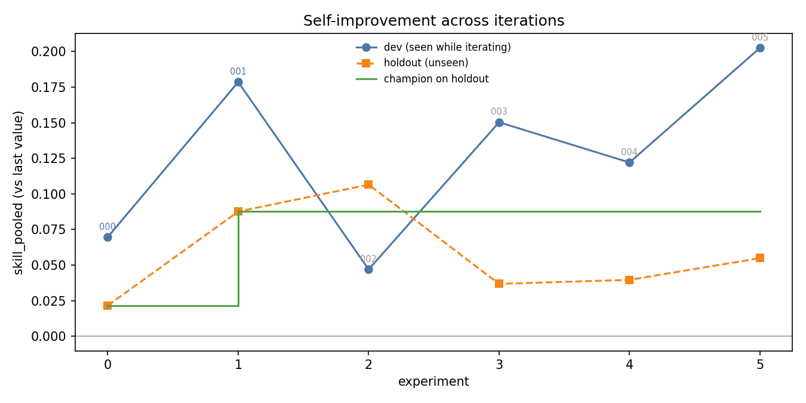

# Research report: experiments

_Written automatically from `ledger.jsonl` by `report.py`. Every number is the ledger's; nothing here is judged by a language model._

## Summary

- 6 experiments: the starting point (exp_000), then 1 kept and 4 rejected.
- Skill vs last value (pooled), DEV: +0.070 at the start (exp_000) → +0.179 for the champion (exp_001).
- HOLDOUT (never used to choose parameters, only as a gate): +0.022 → +0.088.
- Champion interval coverage: DEV 0.80, HOLDOUT 0.74 (target 0.80).
- Rule: keep a change only if DEV improves by at least 0.002 and HOLDOUT does not fall below the champion's.

## All experiments

| id | kept | DEV | HOLDOUT | coverage DEV | hypothesis |
|---|---|---|---|---|---|
| exp_000 | yes | +0.070 | +0.022 | 0.46 | Reference: the starter kit's drift baseline (whole-history empirical random walk), re-run through our walk-... |
| exp_001 | yes | +0.179 | +0.088 | 0.80 | Overall coverage_in is 0.456 (target 0.80), q90 coverage is 0.418, q10 is 0.126. All show undercoverage. ->... |
| exp_002 | no | +0.047 | +0.107 | 0.80 | By horizon: skill for 7d is 0.237 (much worse than 1d: 0.082, 3d: 0.104). By series: 'afhubbard/hyperscaler... |
| exp_003 | no | +0.150 | +0.037 | 0.65 | coverage_in = 0.8016 (good), but skill for some groups is poor, especially fastgpu_daily/hyperscaler_spot (... |
| exp_004 | no | +0.122 | +0.040 | 0.78 | coverage for fastgpu_daily/neocloud_rate_card is 0.095 above q90, 0.112 below q10 (target 0.10 each); mean_... |
| exp_005 | no | +0.203 | +0.055 | 0.78 | Calibration coverage is 0.8016 (target 0.80), but 0.0904 below q10 and 0.108 above q90: slightly more misse... |

## The path, one experiment at a time

### exp_000: kept

**Hypothesis.** Reference: the starter kit's drift baseline (whole-history empirical random walk), re-run through our walk-forward pipeline on daily origins.

**What changed.** starting point. Model: drift (single; no calibration).

**Decision.** first experiment: becomes the starting champion

**Lesson written to memory.** seed: starting champion for this autonomous run

### exp_001: kept

**Hypothesis.** Overall coverage_in is 0.456 (target 0.80), q90 coverage is 0.418, q10 is 0.126. All show undercoverage. -> Enabling post-hoc interval calibration should increase coverage toward the target 0.80, especially at q90 and q10. Calibration can correct systematic underestimation of uncertainty. Change: Enable calibration with default gamma=0.5, scale=0.01, group_by instrument_class.

**What changed.** `calibrate.enabled`: False → True; `calibrate.gamma`: None → 0.5; `calibrate.group_by`: None → instrument_class; `calibrate.scale`: None → 0.01. Model: drift (single; calibration by instrument_class).

**Test.** Against champion exp_000: DEV +0.1088, HOLDOUT +0.0660. By horizon (DEV, 1/3/7 days): +0.082 / +0.104 / +0.237.

**Decision.** dev skill_pooled +0.1088 vs champion exp_000 (need >= +0.002); holdout +0.0660 (need >= -0.0)

**Lesson written to memory.** Enabling post-hoc interval calibration increased coverage_in from 0.456 to 0.80 on dev and improved skill_pooled from 0.07 to 0.18 (holdout +0.066), meeting both skill and coverage targets. Next, test calibration on holdout and explore different calibration parameters or grouping schemes if calibration drift is observed.

### exp_002: rejected

**Hypothesis.** By horizon: skill for 7d is 0.237 (much worse than 1d: 0.082, 3d: 0.104). By series: 'afhubbard|hyperscaler_spot' is much better (0.049) than others; its coverage is low for q10/q90. By dsc_bucket: worst skill for recent price changes (0-1d: 0.222, >30d: -0.008). -> The calibration step size may be too slow to correct for systematic bias especially for faster-changing groups and long horizons (e.g., 7d skill and coverage lag behind). Increasing scale from 0.01 to 0.02, holding gamma fixed, should accelerate coverage correction (up to boundary of overfitting), especially for groups with rapid changes and longer horizons. Change: Increase calibrate.scale from 0.01 to 0.02 (gamma unchanged at 0.5).

**What changed.** `calibrate.scale`: 0.01 → 0.02. Model: drift (single; calibration by instrument_class).

**Test.** Against champion exp_001: DEV -0.1316, HOLDOUT +0.0189. By horizon (DEV, 1/3/7 days): +0.018 / -0.129 / +0.143.

**Decision.** dev skill_pooled -0.1316 vs champion exp_001 (need >= +0.002); holdout +0.0189 (need >= -0.0)

**Lesson written to memory.** Increasing calibrate.scale to 0.02 decreased dev skill_pooled by -0.1316 vs champion (0.0470 vs 0.1786), with similar coverage (0.80); since dev did not meet promotion criteria, revert scale change and consider finer tuning or adaptive scaling for groups with rapid dynamics in the next experiment.

### exp_003: rejected

**Hypothesis.** coverage_in = 0.8016 (good), but skill for some groups is poor, especially fastgpu_daily|hyperscaler_spot (0.182), fastgpu_daily|neocloud_rate_card (0.19), and fastgpu_daily|neocloud_spot (0.239). All ensemble weights are 1 for drift, so we have not tried benefits of combining with other models. Drift's skill by group drops to near zero or below for many except afhubbard|hyperscaler_spot. Calibration uses instrument_class; maybe more granularity would help underperforming groups. -> Calibrating per series_id will allow the interval correction to adapt to idiosyncratic bias in each series (e.g. persistent over/underconfidence or drift), especially for underperforming series/groups, improving skill by reducing error and increasing coverage reliability in tails without harming overall coverage. Change: Change calibrate.group_by from instrument_class to series_id.

**What changed.** `calibrate.group_by`: instrument_class → series_id. Model: drift (single; calibration by series_id).

**Test.** Against champion exp_001: DEV -0.0282, HOLDOUT -0.0508. By horizon (DEV, 1/3/7 days): +0.112 / +0.164 / +0.151.

**Decision.** dev skill_pooled -0.0282 vs champion exp_001 (need >= +0.002); holdout -0.0508 (need >= -0.0)

**Lesson written to memory.** Changing calibration to group by series_id reduced coverage (0.647 vs 0.802) and decreased pooled skill on both dev (-0.028) and holdout (-0.051) compared to the champion. Next, test intermediate grouping levels (e.g., instrument_class + affinity) to target bias correction more precisely without losing reliability.

### exp_004: rejected

**Hypothesis.** coverage for fastgpu_daily|neocloud_rate_card is 0.095 above q90, 0.112 below q10 (target 0.10 each); mean_log_err_q50 is 0.004; skill is 0.19 (worst among all major groups except fastgpu_daily|neocloud_spot). -> Calibration by instrument_class is not correcting miscalibration in fastgpu_daily|neocloud_rate_card, which has low skill and slightly underwide intervals. Calibrating separately by source_id (enabling finer-grained correction) will increase interval coverage toward target and may slightly improve skill. Change: Change calibrate.group_by from instrument_class to source_id.

**What changed.** `calibrate.group_by`: instrument_class → source_id. Model: drift (single; calibration by source_id).

**Test.** Against champion exp_001: DEV -0.0565, HOLDOUT -0.0480. By horizon (DEV, 1/3/7 days): +0.084 / +0.110 / +0.136.

**Decision.** dev skill_pooled -0.0565 vs champion exp_001 (need >= +0.002); holdout -0.0480 (need >= -0.0)

**Lesson written to memory.** Calibrating by source_id instead of instrument_class decreased dev skill_pooled by -0.0565 and holdout by -0.0480 vs the champion, with a slight drop in coverage; this approach did not improve skill or coverage and suggests that finer grouping may not address undercalibration—explore alternative grouping strategies or post-calibration adjustments in the next experiment.

### exp_005: rejected

**Hypothesis.** Calibration coverage is 0.8016 (target 0.80), but 0.0904 below q10 and 0.108 above q90: slightly more misses high than low. Some groups (e.g., fastgpu_daily|neocloud_rate_card: 0.545 above q50) are biased high. -> Reducing calibration step size will slightly reduce overcoverage (especially above q90) by making the intervals adapt less aggressively, which might fix the high bias in some groups and improve coverage symmetry. Change: Reduce calibrate.scale from 0.01 to 0.005 (keeping gamma at 0.5, product halves).

**What changed.** `calibrate.scale`: 0.01 → 0.005. Model: drift (single; calibration by instrument_class).

**Test.** Against champion exp_001: DEV +0.0240, HOLDOUT -0.0327. By horizon (DEV, 1/3/7 days): +0.104 / +0.136 / +0.257.

**Decision.** dev skill_pooled +0.0240 vs champion exp_001 (need >= +0.002); holdout -0.0327 (need >= -0.0)

**Lesson written to memory.** Reducing calibrate.scale to 0.005 improved dev skill_pooled by +0.0240 but reduced holdout skill_pooled by -0.0327 vs champion, and decreased dev coverage to 0.778 (from 0.802). For the next experiment, try intermediate step sizes or alternative calibration settings to improve generalization and prevent overfitting seen on dev.

## What the loop ruled out

- **exp_002**: Increasing calibrate.scale to 0.02 decreased dev skill_pooled by -0.1316 vs champion (0.0470 vs 0.1786), with similar coverage (0.80); since dev did not meet promotion criteria, revert scale change and consider finer tuning or adaptive scaling for groups with rapid dynamics in the next experiment.
- **exp_003**: Changing calibration to group by series_id reduced coverage (0.647 vs 0.802) and decreased pooled skill on both dev (-0.028) and holdout (-0.051) compared to the champion. Next, test intermediate grouping levels (e.g., instrument_class + affinity) to target bias correction more precisely without losing reliability.
- **exp_004**: Calibrating by source_id instead of instrument_class decreased dev skill_pooled by -0.0565 and holdout by -0.0480 vs the champion, with a slight drop in coverage; this approach did not improve skill or coverage and suggests that finer grouping may not address undercalibration—explore alternative grouping strategies or post-calibration adjustments in the next experiment.
- **exp_005**: Reducing calibrate.scale to 0.005 improved dev skill_pooled by +0.0240 but reduced holdout skill_pooled by -0.0327 vs champion, and decreased dev coverage to 0.778 (from 0.802). For the next experiment, try intermediate step sizes or alternative calibration settings to improve generalization and prevent overfitting seen on dev.

## Champion by horizon

| horizon | DEV skill | HOLDOUT skill |
|---|---|---|
| 1 day | +0.082 | +0.064 |
| 3 day | +0.104 | +0.028 |
| 7 day | +0.237 | +0.121 |

Champion spec: `experiments/exp_001/spec.json`. Diagnosis: `experiments/exp_001/diagnosis.md`.
